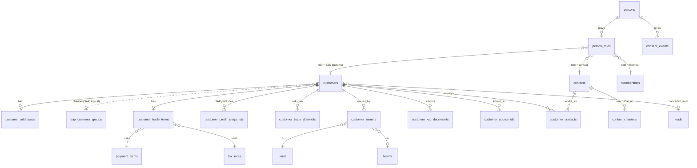
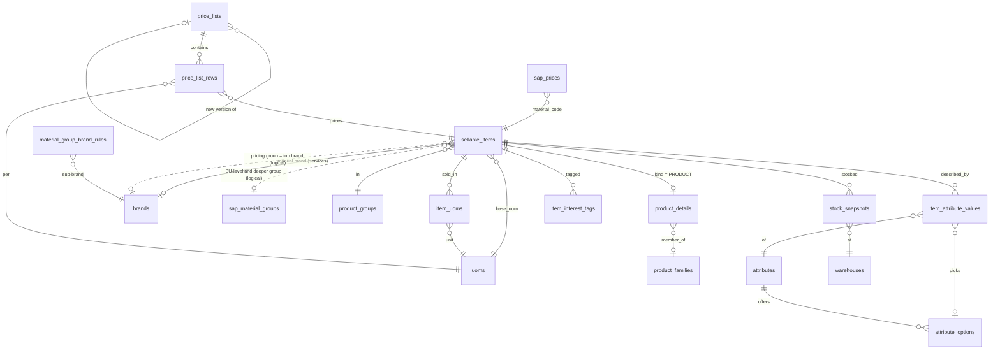
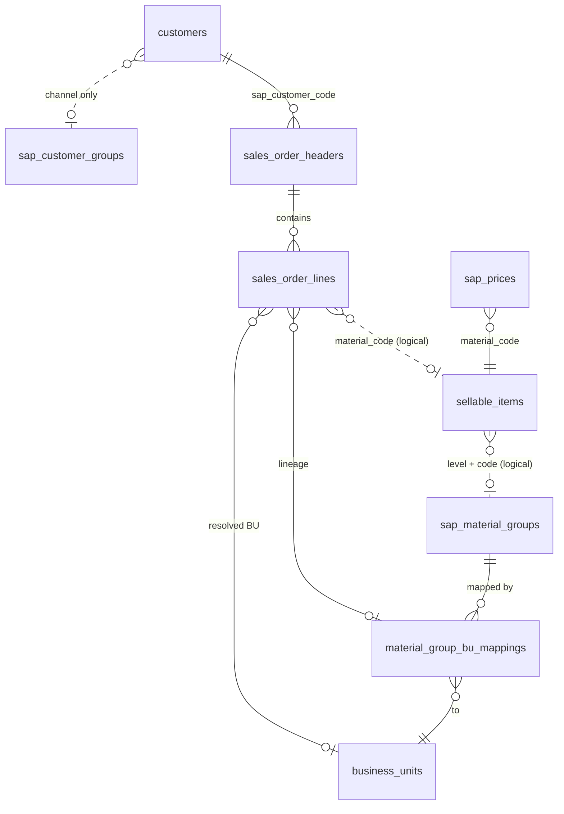
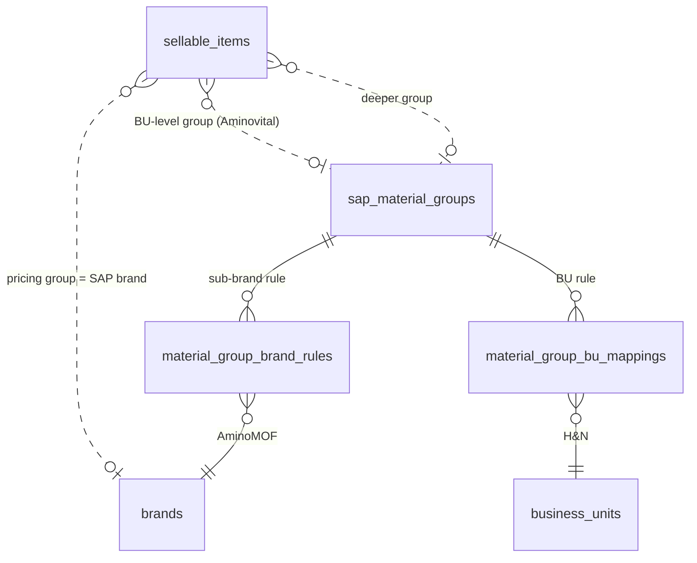

# AJT design app: customer and product data model (reverse-engineered), revision 4

Source: the clickable prototype at `https://ajt-design.vercel.app` (AJT CRM & Loyalty · Design).
The prototype has no public API or schema, so this model is derived from what its
screens show. Crawled 2026-11-14 with headless Chromium.

**Scope:** customer and product master data plus their direct children. Leads,
deals, quotes, orders, cases, inventory, and loyalty appear only as FK stubs.

**Status:** spec only. Nothing here is applied to `db/schema.ts`. Section 7 compares
this model with the current repo schema.

**Revision 2 (BU mapping clarification).** AJT clarified how Customer Group,
Product, Pricing, Brand, and Business Unit relate. Section 9 lists the resulting
conditions and limitations, section 10 is the Business Unit solution design, and
section 11 maps AJT's acceptance criteria to the model. Columns and tables added for
the clarification carry the `-- C` tag.

**Revision 3 (brand from SAP pricing group).** In AJT's SAP, the Material Pricing
Group holds one value per material and is used only to define the brand. The CRM
splits brands further into sub-brands using deeper Material Group levels. Section 12
is the brand design. Revision 2 is kept unchanged in `docs/ajt-design-data-model.md`.

**Revision 4 (sub-brands sit under Business Unit).** AJT's example: the SAP product
code of AminoMOF sits under Material Group Aminovital, the CRM maps Aminovital to
Business Unit H&N, so CRM sub-brand AminoMOF sits under H&N. The SAP brand (Material
Pricing Group) has no Business Unit above it. The Material Group → BU rule list is
kept by the CRM team and approved by AJT. Section 12 is rewritten; revision 3 is kept
in `docs/ajt-design-data-model-v3.md`.

## 0. Method and legend

Pages read:

| Area | Pages |
|------|-------|
| Customers | `/customers` (B2B tab and `?tab=b2c`), `/customers/C-2001` (B2B, natural person), `/customers/C-2002` (B2B, juristic), `/customers/C-2101` (B2C, no purchases), `/customers/CB-M-3004` (B2C, member), `/customers/new` |
| Contacts | `/contacts/CT-4003`, `/contacts/CT-4104` (same person as `CB-M-3004`) |
| Products | `/commerce/products`, `/commerce/products/P-4001`, `/commerce/products/P-4010`, `/commerce/products/reference` (all 6 tabs), `/commerce/products/import` |
| Services | `/commerce/services`, `/commerce/services/SV-1001` |
| Price lists | `/commerce/price-lists`, `PL-0001` (global, tiered), `PL-0002` (customer-group scope), `PL-0012` (promo, overlapping dates) |
| Master data | `/settings/master-data` (54 sets), plus the sets: channels, payment terms, account tiers, industries, customer groups, contact roles, tax rates, KYC |
| Loyalty | `/loyalty-cms/members` (only to confirm the member code format) |

Every column carries one tag in the DDL comments:

- `-- O` **observed**: the field or value is shown on a screen.
- `-- I` **inferred**: needed to make observed behaviour work (keys, audit columns, flags implied by UI text), but not shown.
- `-- C` **clarification**: required by AJT's BU mapping clarification. The prototype has no screen for it.

A comment of the form `joins table(column)` marks a **logical join**: the columns
match by value, but there is deliberately no foreign key, so data that arrives
before its master record is accepted and routed to an exception instead of rejected.

Conventions (decided for this spec, not taken from the repo):

- `INTEGER GENERATED ALWAYS AS IDENTITY` surrogate PK, plus a unique business code (`C-2001`, `P-4001`, `PL-0001`).
- `TIMESTAMPTZ` for events, `DATE` for calendar dates, `NUMERIC(14,2)` for money, `NUMERIC(14,3)` for quantities, `BOOLEAN` for flags.
- Enums owned by the system are `CHECK` constraints. Lists that admins edit are picklists (section 4).
- Thai text is the primary label. `_en` columns hold English where the UI shows it.

## 1. Key findings

1. **One customer register, two profiles.** B2B (`ลูกค้าธุรกิจ`) and B2C (`ลูกค้าทั่วไป`) share `/customers/{code}` and one list with two tabs. Legal form is a separate axis: a B2B customer can be a natural person (`C-2001 · ลูกค้าธุรกิจ · บุคคลธรรมดา`) or a juristic entity (`C-2002 · นิติบุคคล`).
2. **Codes show where a record came from.** `C-2xxx` is created in the CRM. `CB-M-3004` is a B2C customer that came in from loyalty membership `M-3004`. Loyalty CMS members use `AJM-1xxxx`. Contacts use `CT-4xxx`.
3. **A person can hold several roles.** `CT-4104` (contact at C-2001), `CB-M-3004` (B2C customer) and membership `M-3004` are the same person. The contact page has a panel "บทบาทของคนนี้ · คนเดียวกันในทุกส่วนของระบบ" (this person's roles, the same person everywhere in the system). The records stay separate and are joined by a link table.
4. **Contacts are M:N with customers.** Each relationship has a role, a department, a rapport level, owners, a time period (`8 มี.ค. 2569 → ตอนนี้`) and an end reason. A "primary company" (`บริษัทหลัก`) is flagged.
5. **Contact channels are their own rows.** Each phone, email, or LINE ID has a label (work or personal), a primary flag, and a status (verified, unusable, retired).
6. **Consent is per person, per purpose, per channel.** The UI shows "ยินยอม 4/7" (consented to 4 of 7). Purposes: marketing (split into LINE OA, email, SMS, phone), partner sharing, behaviour analytics, health data. The history is append-only and each entry records the request channel and the actor ("ลูกค้าถอนเองผ่าน LINE", the customer withdrew it themselves via LINE).
7. **SAP owns credit and the customer code. CDP owns B2C profiles and product interest tags.** The UI says "ข้อมูลจาก SAP ณ …" (data from SAP as of …), "แก้ไขที่ SAP" (edit in SAP) and "แก้ไขที่ CDP" (edit in CDP). Credit is a published snapshot, not a value the CRM computes.
8. **Prices do not live on products.** The products page footer says "ราคาอยู่ที่รายการราคา ไม่ได้อยู่บนสินค้า" (prices live on price lists, not on products). Price lists are versioned and immutable once active ("quotes and orders already reference this version"). Rows are item × sales UoM × minimum quantity.
9. **Products and services are one sellable-item concept.** Both use product groups, a base UoM, sales UoM conversions, and price-list rows. Only products have attributes, a GTIN, shelf life, a family, and stock.
10. **SKU variants are described by attributes.** A product family (`FAM-AJI-MSG`) groups SKUs, and typed attributes (net weight in g, volume in ml, flavour, packaging, storage) tell them apart.
11. **UoM conversion is per item.** Global UoMs only define quantity precision. "1 ลัง = 144 ซอง" (1 case = 144 sachets) is stored on the item, with its own barcode and gross weight.
12. **Field-level history and PII-view logging** appear on both customers and products ("ทุกการแก้ไข และทุกครั้งที่มีคนเปิดดูข้อมูลส่วนบุคคล": every edit, and every time someone opens personal data).
13. **Business Unit belongs to the product side, never the customer side** (AJT clarification). BU is resolved from an approved Material Group level of the product. SAP Customer Group is the customer's channel or classification. Customer and product meet only on a sales order line. The prototype shows no BU screen; the only trace is a "สมาชิกของ BU" (BU membership) column in the loyalty member list.
14. **Brand and sub-brand follow separate routes** (revision 4). The SAP brand is the Material Pricing Group and has nothing above it. The CRM sub-brand comes from a CRM rule on a Material Group level below the BU level, and sits under the Business Unit its products map to: AminoMOF (Material Group Aminovital) sits under H&N. The prototype's brand list mixes both kinds (`BIRDY`, `BIRDY-ROBUSTA`, `ROSDEE-MENU`).

## 2. Customer domain

### 2.1 ERD



### 2.2 DDL

```sql
-- ---------- stubs (outside scope, present so FKs resolve) ----------
CREATE TABLE teams (
  id    INTEGER GENERATED ALWAYS AS IDENTITY PRIMARY KEY,
  name  TEXT NOT NULL UNIQUE                         -- O "ทีมกรุงเทพ 2"
);
CREATE TABLE users (
  id       INTEGER GENERATED ALWAYS AS IDENTITY PRIMARY KEY,
  name     TEXT NOT NULL,                            -- O
  team_id  INTEGER REFERENCES teams(id)              -- O primary team shown next to name
);
CREATE TABLE leads (
  id         INTEGER GENERATED ALWAYS AS IDENTITY PRIMARY KEY,
  lead_code  TEXT NOT NULL UNIQUE                    -- O "L-1008"
);
CREATE TABLE memberships (                           -- loyalty, out of scope
  id               INTEGER GENERATED ALWAYS AS IDENTITY PRIMARY KEY,
  membership_code  TEXT NOT NULL UNIQUE,             -- O "M-3004", "AJM-10001"
  tier             TEXT,                             -- O Silver | Gold | Platinum
  tier_valid_until DATE                              -- O "ถือระดับนี้ถึง 24 มิ.ย. 2570"
);

-- ---------- customers ----------
CREATE TABLE customers (
  id                   INTEGER GENERATED ALWAYS AS IDENTITY PRIMARY KEY,
  customer_code        TEXT NOT NULL UNIQUE,         -- O C-2001 / CB-M-3004
  profile              TEXT NOT NULL CHECK (profile IN ('B2B','B2C')),                 -- O
  legal_form           TEXT NOT NULL CHECK (legal_form IN ('NATURAL','JURISTIC')),     -- O บุคคลธรรมดา / นิติบุคคล
  name_prefix_id       INTEGER REFERENCES picklist_values(id),  -- O "นาย", "บจก."
  name_th              TEXT NOT NULL,                -- O
  name_en              TEXT,                         -- O "Somchai Phetcharat"
  tax_id_encrypted     TEXT,                         -- O masked "x-xxxx-xxxxx-37-2"; encrypt like lib/pii.ts
  tax_id_last_digits   TEXT,                         -- I needed for the mask without decrypting
  sap_customer_code    TEXT UNIQUE,                  -- O "รหัสร้านค้า · ยังไม่มีรหัสจาก SAP"; customer identity key once SAP issues it
  customer_group_code  TEXT,                         -- C SAP Customer Group = channel / classification, read-only; never a BU; joins sap_customer_groups(code)
  phone                TEXT,                         -- O company / shop phone
  email                TEXT,                         -- O
  website              TEXT,                         -- O
  birth_date           DATE,                         -- O natural persons only, masked
  gender               TEXT CHECK (gender IN ('MALE','FEMALE','UNSPECIFIED')),          -- O
  occupation_id        INTEGER REFERENCES picklist_values(id),  -- O "เจ้าของกิจการ"
  industry_id          INTEGER REFERENCES picklist_values(id),  -- O set 'industries'
  industry_other_text  TEXT,                         -- O free text when "other" is picked
  industry_subgroup_id INTEGER REFERENCES picklist_values(id),  -- O prototype set 'customer-groups' (factory sub-type); renamed so it is not confused with SAP Customer Group
  account_tier_id      INTEGER REFERENCES picklist_values(id),  -- O Key Account | General
  awareness_channel_id INTEGER REFERENCES picklist_values(id),  -- O "งานแสดงสินค้า / อีเวนต์"
  status               TEXT NOT NULL DEFAULT 'PENDING_DOCS'
                       CHECK (status IN ('PENDING_DOCS','ACTIVE','SUSPENDED','INACTIVE')),  -- O
  lifecycle_stage      TEXT,                         -- O "Active · เริ่มห่างหาย"; derived by job
  lifecycle_reason     TEXT,                         -- O second half of the label
  converted_from_lead_id INTEGER REFERENCES leads(id),          -- O "มาจากลีด L-1008"
  converted_at         TIMESTAMPTZ,                  -- O "แปลงเมื่อ 4 มี.ค. 2569"
  origin               TEXT NOT NULL DEFAULT 'CRM'
                       CHECK (origin IN ('CRM','LEAD','IMPORT','CDP','LOYALTY','RECEIPT')),  -- O "สร้างด้วยมือ ไม่ได้มาจากใบเสร็จ"
  created_by           INTEGER REFERENCES users(id), -- O history "สร้าง"
  created_at           TIMESTAMPTZ NOT NULL DEFAULT now(),
  updated_at           TIMESTAMPTZ NOT NULL DEFAULT now()
);
CREATE INDEX customers_profile_status ON customers(profile, status);

-- Bill-to / ship-to addresses and branches. "สำนักงานใหญ่ · รหัสสาขา 00000"
CREATE TABLE customer_addresses (
  id                INTEGER GENERATED ALWAYS AS IDENTITY PRIMARY KEY,
  customer_id       INTEGER NOT NULL REFERENCES customers(id) ON DELETE CASCADE,
  label             TEXT NOT NULL,                   -- O "สำนักงานใหญ่"
  branch_code       TEXT,                            -- O "00000" (Thai tax branch, 5 digits)
  address_line      TEXT NOT NULL,                   -- O
  subdistrict       TEXT,                            -- O แขวง
  district          TEXT,                            -- O เขต
  province          TEXT,                            -- O used as list column "จังหวัด"
  postal_code       TEXT,                            -- O
  country_id        INTEGER REFERENCES picklist_values(id),     -- O set 'countries'
  is_default_billing  BOOLEAN NOT NULL DEFAULT false,          -- O "ค่าตั้งต้น · ออกใบ"
  is_default_shipping BOOLEAN NOT NULL DEFAULT false,          -- O "ค่าตั้งต้น · จัดส่ง"
  receiver_name     TEXT,                            -- O masked
  receiver_phone    TEXT,                            -- O
  receiver_email    TEXT,                            -- O
  CHECK (branch_code IS NULL OR branch_code ~ '^[0-9]{5}$')    -- I
);
CREATE UNIQUE INDEX customer_addresses_one_default_bill
  ON customer_addresses(customer_id) WHERE is_default_billing;   -- I
CREATE UNIQUE INDEX customer_addresses_one_default_ship
  ON customer_addresses(customer_id) WHERE is_default_shipping;  -- I

-- Trade terms (tab "เงื่อนไขการค้า"). One row per customer.
CREATE TABLE customer_trade_terms (
  customer_id          INTEGER PRIMARY KEY REFERENCES customers(id) ON DELETE CASCADE,
  payment_term_id      INTEGER REFERENCES payment_terms(id),   -- O "1C09 · เครดิต 30 วัน"
  tax_rate_id          INTEGER REFERENCES tax_rates(id),       -- O NULL = org default ("ค่าตั้งต้นขององค์กร")
  receiving_conditions TEXT,                         -- O "รับของเฉพาะช่วงบ่าย 13:00-16:00"
  document_conditions  TEXT                          -- O "เงื่อนไขการส่งเอกสาร"
);
-- Price lists that apply to the customer are resolved by scope (section 3), not stored here.

-- Credit is published by SAP. Keep each snapshot, show the latest one.
CREATE TABLE customer_credit_snapshots (
  id            INTEGER GENERATED ALWAYS AS IDENTITY PRIMARY KEY,
  customer_id   INTEGER NOT NULL REFERENCES customers(id) ON DELETE CASCADE,
  credit_limit  NUMERIC(14,2) NOT NULL,              -- O ฿300,000
  credit_used   NUMERIC(14,2) NOT NULL,              -- O ฿34,129
  -- remaining = limit - used, computed at read time  -- O ฿265,871
  as_of         TIMESTAMPTZ NOT NULL,                -- O "ข้อมูลจาก SAP ณ 7 ส.ค. 2569 00:31 น."
  source_system TEXT NOT NULL DEFAULT 'SAP'          -- O
);
CREATE INDEX customer_credit_latest ON customer_credit_snapshots(customer_id, as_of DESC);

-- Trade channels (tab "ช่องทางการค้า"). One is primary and drives quotes and orders.
CREATE TABLE customer_trade_channels (
  id                     INTEGER GENERATED ALWAYS AS IDENTITY PRIMARY KEY,
  customer_id            INTEGER NOT NULL REFERENCES customers(id) ON DELETE CASCADE,
  business_type_id       INTEGER NOT NULL REFERENCES picklist_values(id), -- O leaf of set 'channels' (e.g. ยี่ปั๊ว under ร้านค้าดั้งเดิม)
  is_primary             BOOLEAN NOT NULL DEFAULT false,  -- O "ใบเสนอราคาและคำสั่งซื้อใช้ค่าของช่องทางหลัก"
  min_shelf_life_pct     NUMERIC(5,2) CHECK (min_shelf_life_pct BETWEEN 0 AND 100), -- O "อายุคงเหลือขั้นต่ำตอนส่ง 75%"
  UNIQUE (customer_id, business_type_id)
);
CREATE UNIQUE INDEX customer_trade_channels_one_primary
  ON customer_trade_channels(customer_id) WHERE is_primary;      -- I

-- Owners: "ผู้ดูแลหลัก" (primary) + "ผู้ดูแลร่วม · 3" (co-owners).
-- "หัวหน้าตามผัง" (managers per org chart) is derived from teams, not stored.
CREATE TABLE customer_owners (
  customer_id  INTEGER NOT NULL REFERENCES customers(id) ON DELETE CASCADE,
  user_id      INTEGER NOT NULL REFERENCES users(id),
  team_id      INTEGER REFERENCES teams(id),         -- O "หน่วยงานที่รับผิดชอบ · ทีมกรุงเทพ 2"
  owner_role   TEXT NOT NULL CHECK (owner_role IN ('PRIMARY','CO_OWNER')),  -- O
  assigned_at  TIMESTAMPTZ NOT NULL DEFAULT now(),
  PRIMARY KEY (customer_id, user_id)
);
CREATE UNIQUE INDEX customer_owners_one_primary
  ON customer_owners(customer_id) WHERE owner_role = 'PRIMARY';  -- I

-- KYC (tab "บันทึกและไฟล์"). Required types come from set 'kyc' and the
-- org policy "ต้องใช้เอกสาร" (documents required). Customer stays PENDING_DOCS until all are verified.
CREATE TABLE customer_kyc_documents (
  id            INTEGER GENERATED ALWAYS AS IDENTITY PRIMARY KEY,
  customer_id   INTEGER NOT NULL REFERENCES customers(id) ON DELETE CASCADE,
  doc_type_id   INTEGER NOT NULL REFERENCES picklist_values(id), -- O company-cert | vat-registration | director-id | bank-book
  status        TEXT NOT NULL DEFAULT 'SUBMITTED'
                CHECK (status IN ('SUBMITTED','VERIFIED','REJECTED')),  -- O "ยืนยันแล้ว"
  file_name     TEXT NOT NULL,                       -- O "ภพ20.pdf"
  file_url      TEXT NOT NULL,                       -- I
  uploaded_by   INTEGER REFERENCES users(id),        -- O "ผู้แนบ"
  uploaded_at   TIMESTAMPTZ NOT NULL DEFAULT now(),  -- O "แนบเมื่อ"
  verified_by   INTEGER REFERENCES users(id),        -- I
  verified_at   TIMESTAMPTZ                          -- I
);

-- "รหัสของลูกค้ารายนี้ในแต่ละระบบต้นทาง" (this customer's code in each source system).
-- For B2C: "หนึ่งแถวต่อการสมัครหนึ่งครั้ง" (one row per registration), e.g. ChocoCRM campaign sign-ups.
CREATE TABLE customer_source_ids (
  id              INTEGER GENERATED ALWAYS AS IDENTITY PRIMARY KEY,
  customer_id     INTEGER NOT NULL REFERENCES customers(id) ON DELETE CASCADE,
  source_system   TEXT NOT NULL,                     -- O "ChocoCRM"
  source_account  TEXT,                              -- O "Choco AjinomotoAmino"
  external_id     TEXT NOT NULL,                     -- O "ChocoCRM_crm_cp1_76921"
  campaign_name   TEXT,                              -- O "AminoVital Amino House Launch 2025"
  registered_at   TIMESTAMPTZ,                       -- O
  UNIQUE (source_system, external_id)
);

-- ---------- contacts ----------
CREATE TABLE contacts (
  id                INTEGER GENERATED ALWAYS AS IDENTITY PRIMARY KEY,
  contact_code      TEXT NOT NULL UNIQUE,            -- O CT-4003
  name_prefix_id    INTEGER REFERENCES picklist_values(id),  -- O "นางสาว"
  full_name         TEXT NOT NULL,                   -- O
  nickname          TEXT,                            -- O "นิด"
  preferred_language TEXT,                           -- O "ไทย"
  occupation_id     INTEGER REFERENCES picklist_values(id),  -- O
  birth_date        DATE,                            -- O masked
  gender            TEXT CHECK (gender IN ('MALE','FEMALE','UNSPECIFIED')),  -- O
  household_size    INTEGER,                         -- O "จำนวนคนในครัวเรือน"
  household_type_id INTEGER REFERENCES picklist_values(id),  -- O "อยู่คนเดียว"
  marital_status_id INTEGER REFERENCES picklist_values(id),  -- O
  income_band_id    INTEGER REFERENCES picklist_values(id),  -- O
  household_source  TEXT,                            -- O "พนักงานบันทึกให้" / "แบบสอบถาม · 9 มิ.ย. 2569"
  internal_note     TEXT,                            -- O "บันทึกภายใน"
  status            TEXT NOT NULL DEFAULT 'ACTIVE' CHECK (status IN ('ACTIVE','INACTIVE')),  -- O
  origin            TEXT,                            -- O "สร้างที่นี่" / "สมัครสมาชิกที่หน้าร้าน"
  last_imported_at  TIMESTAMPTZ,                     -- O "นำเข้าล่าสุด 30 ก.ค. 2569"
  created_at        TIMESTAMPTZ NOT NULL DEFAULT now()  -- O "วันที่สร้าง"
);

CREATE TABLE contact_channels (
  id          INTEGER GENERATED ALWAYS AS IDENTITY PRIMARY KEY,
  contact_id  INTEGER NOT NULL REFERENCES contacts(id) ON DELETE CASCADE,
  kind        TEXT NOT NULL CHECK (kind IN ('PHONE','EMAIL','LINE')),          -- O
  value       TEXT NOT NULL,                         -- O masked in UI
  label_id    INTEGER REFERENCES picklist_values(id),-- O "ที่ทำงาน" / "ส่วนตัว"
  is_primary  BOOLEAN NOT NULL DEFAULT false,        -- O "ช่องทางหลัก"
  status      TEXT NOT NULL DEFAULT 'ACTIVE'
              CHECK (status IN ('ACTIVE','VERIFIED','UNUSABLE','RETIRED')),     -- O ยืนยันแล้ว / ใช้ไม่ได้ / เลิกใช้
  created_at  TIMESTAMPTZ NOT NULL DEFAULT now()
);
CREATE UNIQUE INDEX contact_channels_one_primary_per_kind
  ON contact_channels(contact_id, kind) WHERE is_primary AND status <> 'RETIRED';  -- I

-- Customer <-> contact relationship (tab "ความสัมพันธ์").
CREATE TABLE customer_contacts (
  id                  INTEGER GENERATED ALWAYS AS IDENTITY PRIMARY KEY,
  customer_id         INTEGER NOT NULL REFERENCES customers(id) ON DELETE CASCADE,
  contact_id          INTEGER NOT NULL REFERENCES contacts(id) ON DELETE CASCADE,
  role_id             INTEGER REFERENCES picklist_values(id),   -- O set 'contact-roles' (จัดซื้อ, ผู้รับสินค้า...)
  role_other_text     TEXT,                                     -- O free text for "อื่น ๆ"
  job_title           TEXT,                                     -- O "หัวหน้าโกดัง"
  department_id       INTEGER REFERENCES picklist_values(id),   -- O set 'departments' ("ฝ่ายคลังสินค้า")
  rapport_id          INTEGER REFERENCES picklist_values(id),   -- O set 'relationship-rapport' ("ยังไม่คุ้นเคย")
  is_primary_contact  BOOLEAN NOT NULL DEFAULT false,           -- O "ผู้ติดต่อหลัก" for the customer
  is_primary_company  BOOLEAN NOT NULL DEFAULT false,           -- O "บริษัทหลักของบุคคลนี้" for the contact
  preferred_channel   TEXT,                                     -- O "ช่องทางและเวลาที่สะดวก"
  preferred_time      TEXT,                                     -- O
  started_on          DATE NOT NULL,                            -- O "8 มี.ค. 2569 →"
  ended_on            DATE,                                     -- O "แสดงผู้ติดต่อที่สิ้นสุดแล้ว (1)"
  end_reason_id       INTEGER REFERENCES picklist_values(id),   -- O set 'contact-end-reasons'
  CHECK (ended_on IS NULL OR ended_on >= started_on)
);
CREATE UNIQUE INDEX customer_contacts_open
  ON customer_contacts(customer_id, contact_id) WHERE ended_on IS NULL;           -- I
CREATE UNIQUE INDEX customer_contacts_one_primary_contact
  ON customer_contacts(customer_id) WHERE is_primary_contact AND ended_on IS NULL; -- I
CREATE UNIQUE INDEX customer_contacts_one_primary_company
  ON customer_contacts(contact_id) WHERE is_primary_company AND ended_on IS NULL;  -- I
-- Contact owners default to the primary company's primary owner
-- ("ตามผู้ดูแลหลักของ …"); an override table is left out until the UI needs one.

-- ---------- one person, many roles ----------
-- CT-4104 = CB-M-3004 = M-3004. The records stay separate (each module keeps its
-- own fields) and are joined through a person.
CREATE TABLE persons (
  id          INTEGER GENERATED ALWAYS AS IDENTITY PRIMARY KEY,   -- I
  created_at  TIMESTAMPTZ NOT NULL DEFAULT now()
);
CREATE TABLE person_roles (
  id             INTEGER GENERATED ALWAYS AS IDENTITY PRIMARY KEY,
  person_id      INTEGER NOT NULL REFERENCES persons(id) ON DELETE CASCADE,
  role           TEXT NOT NULL CHECK (role IN ('CONTACT','B2C_CUSTOMER','MEMBER')),  -- O the three rows of the panel
  contact_id     INTEGER UNIQUE REFERENCES contacts(id) ON DELETE CASCADE,
  customer_id    INTEGER UNIQUE REFERENCES customers(id) ON DELETE CASCADE,
  membership_id  INTEGER UNIQUE REFERENCES memberships(id) ON DELETE CASCADE,
  linked_by      INTEGER REFERENCES users(id),       -- O "ผูกบทบาทอื่น" is a manual action
  linked_at      TIMESTAMPTZ NOT NULL DEFAULT now(),
  CHECK (
    (role = 'CONTACT'      AND contact_id    IS NOT NULL AND customer_id IS NULL AND membership_id IS NULL) OR
    (role = 'B2C_CUSTOMER' AND customer_id   IS NOT NULL AND contact_id  IS NULL AND membership_id IS NULL) OR
    (role = 'MEMBER'       AND membership_id IS NOT NULL AND contact_id  IS NULL AND customer_id   IS NULL)
  )
);
-- A person can be a contact at several companies through customer_contacts,
-- but holds at most one contact record: UNIQUE(contact_id) here.

-- ---------- consent ----------
-- Per person, append-only. Current state = latest row per (person, purpose, channel).
-- "ยินยอม 4/7" counts the 7 purpose/channel cells that are GRANTED.
CREATE TABLE consent_events (
  id                 INTEGER GENERATED ALWAYS AS IDENTITY PRIMARY KEY,
  person_id          INTEGER NOT NULL REFERENCES persons(id) ON DELETE CASCADE,
  purpose            TEXT NOT NULL CHECK (purpose IN ('MARKETING','PARTNER_SHARING','BEHAVIOUR_ANALYTICS','HEALTH_DATA')), -- O
  channel            TEXT CHECK (channel IN ('LINE_OA','EMAIL','SMS','PHONE')),  -- O MARKETING only
  status             TEXT NOT NULL CHECK (status IN ('GRANTED','DENIED','WITHDRAWN')), -- O ยินยอม / ไม่ยินยอม / ถอน
  request_channel_id INTEGER REFERENCES picklist_values(id), -- O set 'consent-request-channels' ("ผ่าน LINE")
  actor              TEXT NOT NULL CHECK (actor IN ('SUBJECT','STAFF','IMPORT')),  -- O "ลูกค้าถอนเอง"
  recorded_by        INTEGER REFERENCES users(id),
  privacy_notice_version TEXT,                       -- O "หัวข้อความยินยอมตั้งที่ประกาศความเป็นส่วนตัว"
  captured_at        TIMESTAMPTZ NOT NULL DEFAULT now(),
  CHECK ((purpose = 'MARKETING') = (channel IS NOT NULL))
);
CREATE INDEX consent_events_current ON consent_events(person_id, purpose, channel, captured_at DESC);
```

Contacts and B2C customers that have no person yet show "ยังไม่เคยถาม" (never
asked). `consent_events` needs a person, so create a `persons` row the first time
consent is captured.

## 3. Product domain

### 3.1 ERD



### 3.2 DDL

```sql
-- ---------- reference (tab "กลุ่มสินค้า แบรนด์ และหน่วยขาย") ----------
-- Brands (revision 4). BRAND rows are SAP brands from Material Pricing Group, with
-- nothing above them. SUB_BRAND rows are CRM-defined; a sub-brand's Business Unit is
-- derived from its products' Material Group (sub_brand_bu_current), never stored here.
CREATE TABLE brands (
  id          INTEGER GENERATED ALWAYS AS IDENTITY PRIMARY KEY,
  code        TEXT NOT NULL UNIQUE,                  -- O "AJINOMOTO", "BIRDY-ROBUSTA"
  name_th     TEXT NOT NULL,                         -- O "อายิโนะโมะโต๊ะ"
  brand_level TEXT NOT NULL DEFAULT 'BRAND' CHECK (brand_level IN ('BRAND','SUB_BRAND')),  -- C
  sap_pricing_group_code TEXT UNIQUE,                -- C SAP Material Pricing Group that defines this top brand
  is_active   BOOLEAN NOT NULL DEFAULT true,         -- O
  updated_at  TIMESTAMPTZ NOT NULL DEFAULT now(),    -- O "แก้ไขล่าสุด"
  CHECK (brand_level = 'BRAND' OR sap_pricing_group_code IS NULL)
);
-- User brand permissions ("สิทธิ์ของผู้ใช้กำหนดที่หน้าผู้ใช้งานระบบ") live with users; out of scope.

-- The product group also routes leads to salespeople and groups sales in reports.
CREATE TABLE product_groups (
  id           INTEGER GENERATED ALWAYS AS IDENTITY PRIMARY KEY,
  code         TEXT NOT NULL UNIQUE,                 -- O "PG-001"
  name_th      TEXT NOT NULL,                        -- O "ผงชูรส"
  description  TEXT,                                 -- O
  code_prefix  TEXT,                                 -- O "MSG" (used by item code generator)
  is_active    BOOLEAN NOT NULL DEFAULT true         -- O "ปิดกลุ่มแล้ว…ยังอ่านได้" -> soft disable only
);

CREATE TABLE uoms (
  id              INTEGER GENERATED ALWAYS AS IDENTITY PRIMARY KEY,
  code            TEXT NOT NULL UNIQUE,              -- O "UOM-CASE"
  name_th         TEXT NOT NULL,                     -- O "ลัง"
  description     TEXT,                              -- O
  decimal_places  SMALLINT NOT NULL DEFAULT 0 CHECK (decimal_places BETWEEN 0 AND 3), -- O "จำนวนเต็มเท่านั้น" = 0, "ไม่เกิน 2 ตำแหน่งทศนิยม" = 2
  is_active       BOOLEAN NOT NULL DEFAULT true
);

CREATE TABLE attributes (
  id          INTEGER GENERATED ALWAYS AS IDENTITY PRIMARY KEY,
  code        TEXT NOT NULL UNIQUE,                  -- O "ATTR-NET", "ATTR-FLAVOUR"
  name_th     TEXT NOT NULL,                         -- O "น้ำหนักสุทธิ"
  description TEXT,
  value_type  TEXT NOT NULL CHECK (value_type IN ('NUMBER_WITH_UNIT','OPTION')),  -- O "ตัวเลขพร้อมหน่วย · g" / "เลือกจากรายการ · 8 ตัวเลือก"
  unit        TEXT,                                  -- O "g", "ml"
  is_active   BOOLEAN NOT NULL DEFAULT true,
  CHECK ((value_type = 'NUMBER_WITH_UNIT') = (unit IS NOT NULL))
);
CREATE TABLE attribute_options (
  id            INTEGER GENERATED ALWAYS AS IDENTITY PRIMARY KEY,
  attribute_id  INTEGER NOT NULL REFERENCES attributes(id) ON DELETE CASCADE,
  label_th      TEXT NOT NULL,                       -- O "ต้นตำรับ", "ถุง", "อุณหภูมิห้อง"
  sort_order    INTEGER NOT NULL DEFAULT 0,
  is_active     BOOLEAN NOT NULL DEFAULT true,
  UNIQUE (attribute_id, label_th)
);

CREATE TABLE product_families (
  id       INTEGER GENERATED ALWAYS AS IDENTITY PRIMARY KEY,
  code     TEXT NOT NULL UNIQUE,                     -- O "FAM-AJI-MSG"
  name_th  TEXT                                      -- I
);

-- Item code rule (tab "รหัสสินค้า"): one org-wide row.
CREATE TABLE item_code_settings (
  id                    BOOLEAN PRIMARY KEY DEFAULT true CHECK (id),  -- singleton
  mode                  TEXT NOT NULL DEFAULT 'SUGGEST_EDITABLE'
                        CHECK (mode IN ('SUGGEST_EDITABLE','AUTO_LOCKED','MANUAL')),  -- O "ระบบเสนอให้ และแก้ได้"
  prefix                TEXT,                        -- O "P"
  separator             TEXT NOT NULL DEFAULT '-',   -- O "ขีดกลาง (P-4031)"
  sequence_digits       SMALLINT NOT NULL DEFAULT 4, -- O
  use_group_prefix      BOOLEAN NOT NULL DEFAULT false, -- O
  inventory_display_uom TEXT NOT NULL DEFAULT 'BASE'
                        CHECK (inventory_display_uom IN ('BASE','NET_WEIGHT_KG')),  -- O tab "หน่วยในคลัง"
  show_base_qty_below   BOOLEAN NOT NULL DEFAULT true  -- O
);

-- ---------- sellable items ----------
CREATE TABLE sellable_items (
  id                INTEGER GENERATED ALWAYS AS IDENTITY PRIMARY KEY,
  item_code         TEXT NOT NULL UNIQUE,            -- O P-4001 / SV-1001; never changes once issued
  kind              TEXT NOT NULL CHECK (kind IN ('PRODUCT','SERVICE')),  -- O "P-4001 · สินค้า"
  name_th           TEXT NOT NULL,                   -- O
  name_en           TEXT,                            -- O history "ชื่อภาษาอังกฤษ"
  description       TEXT,                            -- O services show one
  brand_id          INTEGER REFERENCES brands(id),   -- O manual brand, only for items with no SAP pricing group (services, CRM drafts); nullable: "ไม่ระบุแบรนด์"
  product_group_id  INTEGER NOT NULL REFERENCES product_groups(id),  -- O
  base_uom_id       INTEGER NOT NULL REFERENCES uoms(id),            -- O "หน่วยฐาน ซอง"
  is_active         BOOLEAN NOT NULL DEFAULT true,   -- O ใช้งาน / ไม่ใช้งาน
  source_system     TEXT NOT NULL DEFAULT 'LOCAL'
                    CHECK (source_system IN ('LOCAL','SAP','IMPORT')),  -- O "กรอกในระบบนี้" / "มาจาก SAP"
  material_code     TEXT UNIQUE,                     -- C SAP material number: product and pricing key; NULL for services and CRM-only drafts
  material_group_level TEXT,                         -- C hierarchy level as sent by SAP
  material_group_code  TEXT,                         -- C BU-level group, e.g. Aminovital; joins sap_material_groups(code)
  material_subgroup_level TEXT,                      -- C deeper SAP level that defines the sub-brand
  material_subgroup_code  TEXT,                      -- C e.g. the group that holds only AminoMOF; joins sap_material_groups(code)
  material_pricing_group_code TEXT,                  -- C SAP Material Pricing Group = SAP brand; joins brands(sap_pricing_group_code)
  updated_by        INTEGER REFERENCES users(id),    -- O "สมหญิง ผู้ดูแลสินค้า"
  created_at        TIMESTAMPTZ NOT NULL DEFAULT now(),
  updated_at        TIMESTAMPTZ NOT NULL DEFAULT now(),
  CHECK (source_system <> 'SAP' OR material_code IS NOT NULL),           -- C SAP items always carry the key
  CHECK (kind = 'PRODUCT' OR material_code IS NULL),                     -- C services have no SAP material (limitation L1)
  CHECK (material_group_code IS NULL OR material_group_level IS NOT NULL),
  CHECK (material_subgroup_code IS NULL OR material_subgroup_level IS NOT NULL)
);
CREATE INDEX sellable_items_group ON sellable_items(product_group_id);
CREATE INDEX sellable_items_material_group ON sellable_items(material_group_level, material_group_code);
-- Brand is resolved by item_brand_current (section 12): SAP pricing group gives the brand,
-- a CRM brand rule gives the sub-brand. Neither is on the path to Business Unit (section 10).
-- product_group_id is the CRM's own grouping (lead routing, reports). It is not the SAP Material Group.
CREATE INDEX sellable_items_brand ON sellable_items(brand_id);
-- "ความครบของราคา" (price coverage: มีราคาที่ใช้ได้ has a usable price / ราคาไม่ครบ some units unpriced / ยังไม่มีราคา no price)
-- is derived from item_uoms × active price_list_rows. Not stored.

CREATE TABLE product_details (
  item_id          INTEGER PRIMARY KEY REFERENCES sellable_items(id) ON DELETE CASCADE,
  family_id        INTEGER REFERENCES product_families(id),  -- O "สายผลิตภัณฑ์"
  gtin             TEXT UNIQUE,                     -- O "8850001000019" (base unit barcode)
  shelf_life_days  INTEGER CHECK (shelf_life_days > 0)      -- O "อายุสินค้า 730 วัน"
);
-- Enforce kind = 'PRODUCT' in app code or with a trigger; a CHECK cannot look across tables.

-- Sales units. The base unit is also a row here (factor 1) so price rows and
-- barcodes treat every unit the same way.
CREATE TABLE item_uoms (
  id              INTEGER GENERATED ALWAYS AS IDENTITY PRIMARY KEY,
  item_id         INTEGER NOT NULL REFERENCES sellable_items(id) ON DELETE CASCADE,
  uom_id          INTEGER NOT NULL REFERENCES uoms(id),
  factor_to_base  NUMERIC(14,3) NOT NULL CHECK (factor_to_base > 0),  -- O "1 ลัง = 144 ซอง"
  barcode         TEXT,                              -- O "18850001000016" (case GTIN-14)
  gross_weight_kg NUMERIC(12,3),                     -- O "75.48 กก."
  is_active       BOOLEAN NOT NULL DEFAULT true,
  UNIQUE (item_id, uom_id)
);

CREATE TABLE item_attribute_values (
  item_id       INTEGER NOT NULL REFERENCES sellable_items(id) ON DELETE CASCADE,
  attribute_id  INTEGER NOT NULL REFERENCES attributes(id),
  number_value  NUMERIC(14,3),                       -- O 500 (g)
  option_id     INTEGER REFERENCES attribute_options(id),  -- O "ถุง"
  PRIMARY KEY (item_id, attribute_id),
  CHECK ((number_value IS NULL) <> (option_id IS NULL))
);
-- Net weight here also feeds the kg display on inventory screens.

-- "ป้ายความสนใจ · แก้ไขที่ CDP" (interest tags, edit in CDP): owned by the CDP, read-only here.
CREATE TABLE item_interest_tags (
  item_id   INTEGER NOT NULL REFERENCES sellable_items(id) ON DELETE CASCADE,
  tag       TEXT NOT NULL,                           -- O "ทำอาหารที่บ้าน"
  synced_at TIMESTAMPTZ NOT NULL DEFAULT now(),
  PRIMARY KEY (item_id, tag)
);

-- ---------- price lists ----------
-- One row = one version. A new version is a new row pointing at the version it replaces.
CREATE TABLE price_lists (
  id                 INTEGER GENERATED ALWAYS AS IDENTITY PRIMARY KEY,
  record_code        TEXT NOT NULL UNIQUE,           -- O URL key "PL-0001"
  list_code          TEXT NOT NULL,                  -- O "PL-SEASONING-THB" (stable across versions)
  version            INTEGER NOT NULL CHECK (version > 0),  -- O "v2"
  supersedes_id      INTEGER REFERENCES price_lists(id),    -- I "สร้างเป็นเวอร์ชันใหม่"
  name_th            TEXT NOT NULL,                  -- O
  description        TEXT,                           -- O
  currency           CHAR(3) NOT NULL,               -- O THB / USD
  scope_type         TEXT NOT NULL CHECK (scope_type IN ('ALL','INDUSTRY_SUBGROUP','CUSTOMER')),  -- O "ทุกคน" / "กลุ่มลูกค้า"; CUSTOMER is I
  scope_industry_subgroup_id INTEGER REFERENCES picklist_values(id),  -- O "ครัวกลางและรับจ้างผลิต"; CRM picklist, never SAP customer_group_code (limitation L3)
  scope_customer_id  INTEGER REFERENCES customers(id),             -- I
  valid_from         DATE NOT NULL,                  -- O
  valid_to           DATE,                           -- O NULL = open-ended "1 ม.ค. 2569 →"
  status             TEXT NOT NULL DEFAULT 'DRAFT' CHECK (status IN ('DRAFT','ACTIVE','INACTIVE')),  -- O ร่าง / เปิดใช้งาน / ปิดใช้งาน
  source_system      TEXT NOT NULL DEFAULT 'LOCAL',  -- O "กรอกในระบบนี้"
  activated_by       INTEGER REFERENCES users(id),   -- O "สมชาย ผู้ดูแลราคา"
  activated_at       TIMESTAMPTZ,                    -- O
  readiness_snapshot JSONB,                          -- O "สภาพของข้อมูล ณ ตอนที่กดเปิดใช้งาน": missing rows, zero prices, overlaps
  created_at         TIMESTAMPTZ NOT NULL DEFAULT now(),
  UNIQUE (list_code, version),
  CHECK (valid_to IS NULL OR valid_to >= valid_from),
  CHECK ((scope_type = 'INDUSTRY_SUBGROUP') = (scope_industry_subgroup_id IS NOT NULL)),
  CHECK ((scope_type = 'CUSTOMER') = (scope_customer_id IS NOT NULL))
);
-- price_lists are CRM-local lists (source "กรอกในระบบนี้"). Prices published by SAP live in
-- sap_prices (section 10), keyed by material_code. Which one a quote uses is open question 9.
-- Overlapping active lists are allowed but flagged ("ช่วงเวลาซ้อนกับรายการราคาที่ใช้อยู่" overlaps an active list, on PL-0012).

-- Tiered: several rows for the same (item, uom) with rising min_qty.
-- NULL price = row exists but is not priced yet ("1 แถวยังไม่มีราคา"); 0 = free.
CREATE TABLE price_list_rows (
  id             INTEGER GENERATED ALWAYS AS IDENTITY PRIMARY KEY,
  price_list_id  INTEGER NOT NULL REFERENCES price_lists(id) ON DELETE CASCADE,
  item_id        INTEGER NOT NULL REFERENCES sellable_items(id),
  uom_id         INTEGER NOT NULL REFERENCES uoms(id),
  min_qty        NUMERIC(14,3) NOT NULL DEFAULT 0 CHECK (min_qty >= 0),  -- O "ทุกจำนวน" = 0, "อย่างน้อย 20 ลัง"
  unit_price     NUMERIC(14,2) CHECK (unit_price >= 0),                  -- O
  source_system  TEXT NOT NULL DEFAULT 'LOCAL',      -- O
  updated_at     TIMESTAMPTZ NOT NULL DEFAULT now(), -- O "แก้ไขล่าสุด"
  UNIQUE (price_list_id, item_id, uom_id, min_qty)
);
CREATE INDEX price_list_rows_item ON price_list_rows(item_id, uom_id);
-- (item_id, uom_id) should exist in item_uoms; enforce in app code (a composite FK would need item_uoms keyed that way).

-- ---------- stock (stub) ----------
CREATE TABLE warehouses (
  id       INTEGER GENERATED ALWAYS AS IDENTITY PRIMARY KEY,
  name_th  TEXT NOT NULL UNIQUE                      -- O "คลังกลาง (กรุงเทพและปริมณฑล)"
);
-- "ยอดคือสิ่งที่ระบบต้นทางเผยแพร่ล่าสุด หักด้วยจำนวนที่คำสั่งซื้อจองไว้"
-- (the source system's latest published figure minus quantity reserved by orders):
-- on-hand comes from the source system; reserved is the sum of open order lines; available = on_hand - reserved.
CREATE TABLE stock_snapshots (
  item_id       INTEGER NOT NULL REFERENCES sellable_items(id) ON DELETE CASCADE,
  warehouse_id  INTEGER NOT NULL REFERENCES warehouses(id),
  on_hand_base  NUMERIC(14,3) NOT NULL,              -- O "ยอดจากระบบต้นทาง 477 ซอง"
  published_at  TIMESTAMPTZ NOT NULL,                -- O "อัปเดตล่าสุด"; drives stale-data badges
  PRIMARY KEY (item_id, warehouse_id)
);
```

## 4. Shared lookups and audit

Plain label lists go in one generic pair of tables. Lists that carry extra typed
columns get their own table.

```sql
CREATE TABLE picklist_sets (
  id          INTEGER GENERATED ALWAYS AS IDENTITY PRIMARY KEY,
  code        TEXT NOT NULL UNIQUE,     -- O URL key: 'industries', 'channels', 'kyc' ...
  name_th     TEXT NOT NULL,            -- O
  description TEXT,                     -- O
  module      TEXT NOT NULL,            -- O "ลูกค้าและผู้ติดต่อ" / "ค่าการค้า" / "นโยบายและเพดาน"
  is_hierarchical BOOLEAN NOT NULL DEFAULT false   -- O 'channels' shows └ children
);
CREATE TABLE picklist_values (
  id          INTEGER GENERATED ALWAYS AS IDENTITY PRIMARY KEY,
  set_id      INTEGER NOT NULL REFERENCES picklist_sets(id) ON DELETE CASCADE,
  code        TEXT NOT NULL,            -- O 'wholesaler', 'CR-002'
  label_th    TEXT NOT NULL,            -- O
  label_en    TEXT,
  description TEXT,                     -- O
  parent_id   INTEGER REFERENCES picklist_values(id),  -- O channel -> business type -> cuisine (3 levels)
  is_system_other BOOLEAN NOT NULL DEFAULT false,      -- O "อื่น ๆ · แถวของระบบ" (system row): pairs with *_other_text columns
  is_active   BOOLEAN NOT NULL DEFAULT true,
  sort_order  INTEGER NOT NULL DEFAULT 0,
  UNIQUE (set_id, code)
);

-- SAP reference hierarchies and the BU master (AJT clarification, section 10).
-- Created here because customers and sellable_items refer to them.
CREATE TABLE sap_customer_groups (
  id          INTEGER GENERATED ALWAYS AS IDENTITY PRIMARY KEY,
  level       TEXT NOT NULL,            -- C SAP Customer Group hierarchy level
  code        TEXT NOT NULL,            -- C channel / classification code
  name        TEXT NOT NULL,            -- C
  parent_id   INTEGER REFERENCES sap_customer_groups(id),  -- C
  synced_at   TIMESTAMPTZ NOT NULL DEFAULT now(),
  UNIQUE (level, code)
);
CREATE TABLE sap_material_groups (
  id          INTEGER GENERATED ALWAYS AS IDENTITY PRIMARY KEY,
  level       TEXT NOT NULL,            -- C SAP Material Group hierarchy level
  code        TEXT NOT NULL,            -- C
  name        TEXT NOT NULL,            -- C
  parent_id   INTEGER REFERENCES sap_material_groups(id),  -- C
  synced_at   TIMESTAMPTZ NOT NULL DEFAULT now(),
  UNIQUE (level, code)
);
CREATE TABLE business_units (
  id          INTEGER GENERATED ALWAYS AS IDENTITY PRIMARY KEY,
  bu_code     TEXT NOT NULL UNIQUE,     -- C AJT Business Unit identifier; not a brand, not a channel
  name_th     TEXT NOT NULL,            -- C
  name_en     TEXT,                     -- C
  is_active   BOOLEAN NOT NULL DEFAULT true
);

CREATE TABLE payment_terms (
  id          INTEGER GENERATED ALWAYS AS IDENTITY PRIMARY KEY,
  code        TEXT NOT NULL UNIQUE,     -- O 'credit-30'
  name_th     TEXT NOT NULL,            -- O "เครดิต 30 วัน"
  sap_code    TEXT UNIQUE,              -- O '1C09'; NULL = "ไม่มีรหัสต้นทาง"
  days        INTEGER NOT NULL DEFAULT 0 CHECK (days >= 0),  -- O 0 = pay on/before delivery
  is_active   BOOLEAN NOT NULL DEFAULT true
);

CREATE TABLE tax_rates (
  id          INTEGER GENERATED ALWAYS AS IDENTITY PRIMARY KEY,
  code        TEXT NOT NULL UNIQUE,     -- O 'vat-7'
  name_th     TEXT NOT NULL,            -- O
  rate_pct    NUMERIC(5,2) NOT NULL,    -- O 7.00
  is_org_default BOOLEAN NOT NULL DEFAULT false,  -- O "ค่าตั้งต้นขององค์กร"
  is_active   BOOLEAN NOT NULL DEFAULT true
);
CREATE UNIQUE INDEX tax_rates_one_default ON tax_rates((true)) WHERE is_org_default;
-- "การแก้อัตราไม่กระทบเอกสารที่ออกไปแล้ว" (changing a rate does not affect documents already issued): quotes and orders snapshot rate_pct.
```

Audit tables (these reference `users`, so they run after section 2):

```sql
-- Field-level history shared by customers, contacts, items and price lists.
CREATE TABLE change_log (
  id           BIGINT GENERATED ALWAYS AS IDENTITY PRIMARY KEY,
  entity_type  TEXT NOT NULL,           -- 'customer' | 'contact' | 'item' | 'price_list' ...
  entity_id    INTEGER NOT NULL,
  action       TEXT NOT NULL,           -- O สร้าง / แก้ไข / เปิดใช้งานรายการราคา / สร้างเป็นเวอร์ชันใหม่
  field        TEXT,                    -- O "ช่องที่แก้"
  old_value    TEXT,                    -- O "ค่าเดิม"
  new_value    TEXT,                    -- O "ค่าใหม่"
  reason       TEXT,                    -- O "เหตุผล"
  actor_id     INTEGER REFERENCES users(id),  -- O name + team shown
  source       TEXT,                    -- O "ที่มาของการแก้ไข"
  occurred_at  TIMESTAMPTZ NOT NULL DEFAULT now()
);
CREATE INDEX change_log_entity ON change_log(entity_type, entity_id, occurred_at DESC);

-- "ทุกครั้งที่มีคนเปิดดูข้อมูลส่วนบุคคล" (every time someone opens personal data): each unmask is logged.
CREATE TABLE pii_access_log (
  id           BIGINT GENERATED ALWAYS AS IDENTITY PRIMARY KEY,
  entity_type  TEXT NOT NULL,
  entity_id    INTEGER NOT NULL,
  field        TEXT NOT NULL,           -- O "เบอร์ผู้รับ"
  actor_id     INTEGER NOT NULL REFERENCES users(id),
  reason       TEXT,
  accessed_at  TIMESTAMPTZ NOT NULL DEFAULT now()
);
```

**DDL order:** section 4 lookups → section 2 → section 3 → section 4 audit.
Section 2 references the lookup tables; the audit tables reference `users`.

Picklist sets seen inside this scope (54 exist in total):

| Set code | Thai name | Used by |
|----------|-----------|---------|
| `industries` | กลุ่มอุตสาหกรรม | customers.industry_id |
| `customer-groups` | กลุ่มลูกค้า (factory sub-type under industry) | customers.industry_subgroup_id, price_lists scope. Not SAP Customer Group, which is `sap_customer_groups`. |
| `account-tiers` | ระดับลูกค้า (Key Account, General) | customers.account_tier_id |
| `channels` | ช่องทางการค้าและประเภทธุรกิจลูกค้า (hierarchical) | customer_trade_channels |
| `awareness-channels` | ช่องทางที่รู้จักเรา | customers.awareness_channel_id |
| `name-prefixes` | คำนำหน้าชื่อ | customers, contacts |
| `countries` | ประเทศ | customer_addresses |
| `contact-roles` | บทบาทผู้ติดต่อ | customer_contacts.role_id |
| `departments` | ฝ่ายของผู้ติดต่อ | customer_contacts.department_id |
| `relationship-rapport` | ระดับความสัมพันธ์ | customer_contacts.rapport_id |
| `contact-end-reasons` | เหตุผลที่สิ้นสุดความสัมพันธ์ | customer_contacts.end_reason_id |
| `contact-point-labels` | ป้ายช่องทางติดต่อ | contact_channels.label_id |
| `consent-request-channels` | ช่องทางที่รับคำขอความยินยอม | consent_events |
| `marriage-statuses`, `household-types`, `income-levels` | สถานภาพสมรส, ลักษณะครัวเรือน, ช่วงรายได้ | contacts |
| `kyc` | เอกสาร KYC | customer_kyc_documents.doc_type_id |

`contact-relationships` (spouse, parent: for B2C household links) and `event-names`
belong to the B2C/CDP side and are not modelled here.

## 5. Field dictionary (main screens)

| Screen | Thai label | Column |
|--------|-----------|--------|
| Customer header | `C-2001 · ลูกค้าธุรกิจ · บุคคลธรรมดา` | customers.customer_code, profile, legal_form |
| Customer header | สถานะ | customers.status |
| Customer header | วงจรชีวิต | customers.lifecycle_stage, lifecycle_reason |
| Customer header | หน่วยงานที่รับผิดชอบ / ผู้ดูแลหลัก / ผู้ดูแลร่วม | customer_owners |
| ข้อมูลลูกค้า | จดทะเบียนเป็น | customers.legal_form |
| ข้อมูลลูกค้า | ชื่อ / ชื่อภาษาอังกฤษ | customers.name_th, name_en |
| ข้อมูลลูกค้า | เลขบัตรประชาชน / เลขผู้เสียภาษี | customers.tax_id_encrypted, tax_id_last_digits |
| ข้อมูลลูกค้า | เบอร์โทรบริษัท / ร้านค้า, อีเมล, เว็บไซต์ | customers.phone, email, website |
| ข้อมูลลูกค้า | รหัสร้านค้า (SAP) | customers.sap_customer_code |
| ข้อมูลลูกค้า | วันเกิด, เพศ, อาชีพ | customers.birth_date, gender, occupation_id |
| ข้อมูลลูกค้า | กลุ่มอุตสาหกรรม, กลุ่มลูกค้า | customers.industry_id, industry_subgroup_id |
| ข้อมูลลูกค้า | รหัสร้านค้า (SAP) | customers.sap_customer_code (identity key) |
| (no screen) | SAP Customer Group | customers.customer_group_code → sap_customer_groups |
| ข้อมูลลูกค้า | ประเภทธุรกิจลูกค้า | customer_trade_channels (primary).business_type_id |
| ข้อมูลลูกค้า | ช่องทางที่รู้จักเรา | customers.awareness_channel_id |
| ที่อยู่และสาขา | สำนักงานใหญ่, รหัสสาขา, ที่อยู่, ผู้รับสินค้า | customer_addresses |
| เงื่อนไขการค้า | เงื่อนไขการรับของ / การส่งเอกสาร | customer_trade_terms.receiving_conditions, document_conditions |
| เงื่อนไขการค้า | ระดับลูกค้า | customers.account_tier_id |
| เงื่อนไขการค้า | รายการราคา | resolved: active price_lists where scope matches |
| เงื่อนไขการค้า | เงื่อนไขการชำระเงิน | customer_trade_terms.payment_term_id → payment_terms |
| เงื่อนไขการค้า | อัตรา VAT | customer_trade_terms.tax_rate_id (NULL = org default) |
| เงื่อนไขการค้า | วงเงินเครดิต / ใช้ไป / คงเหลือ | customer_credit_snapshots (latest) |
| เงื่อนไขการค้า | ช่องทางการค้า, อายุคงเหลือขั้นต่ำตอนส่ง | customer_trade_channels |
| ผู้ติดต่อ | ชื่อ, บทบาท, เบอร์, อีเมล, สถานะ, ความยินยอม | contacts + customer_contacts + contact_channels + consent_events |
| ที่มาของลูกค้า | ลีดต้นทาง, แปลงเมื่อ | customers.converted_from_lead_id, converted_at |
| ที่มาของลูกค้า | รหัสในแต่ละระบบต้นทาง | customer_source_ids |
| ประวัติ | ผู้แก้ไข, การกระทำ, ช่องที่แก้, ค่าเดิม, ค่าใหม่, เหตุผล | change_log + pii_access_log |
| บันทึกและไฟล์ | เอกสาร KYC | customer_kyc_documents |
| Contact | ชื่อเล่น, ภาษาที่ต้องการ, ครัวเรือน, ช่วงรายได้ | contacts.* |
| Contact | ช่องทางติดต่อ | contact_channels |
| Contact | บทบาทของคนนี้ | person_roles |
| Product | รหัสสินค้า, ชื่อ, แบรนด์, กลุ่มสินค้า, หน่วยฐาน | sellable_items.* |
| Product | สายผลิตภัณฑ์, บาร์โค้ดหรือ GTIN, อายุสินค้า | product_details.* |
| Product | คุณลักษณะ | item_attribute_values |
| Product | ป้ายความสนใจ | item_interest_tags |
| Product | หน่วยขาย, ตัวคูณ, บาร์โค้ด, น้ำหนักรวม | item_uoms |
| Product | ราคา (read-only) | price_list_rows via active price_lists |
| Product | คงคลัง | stock_snapshots |
| Product | ที่มา | sellable_items.source_system |
| (no screen) | SAP material, Material Group | sellable_items.material_code, material_group_level, material_group_code |
| (no screen) | Business Unit | resolved by item_bu_current (section 10), never stored on the item |
| Product | แบรนด์ | item_brand_current.brand_code + sub_brand_code (section 12) |
| (no screen) | SAP Material Pricing Group | sellable_items.material_pricing_group_code → brands.sap_pricing_group_code |
| Price list | รหัสรายการราคา, เวอร์ชัน, สกุลเงิน, ขอบเขต, ช่วงเวลา, สถานะ | price_lists.* |
| Price list | ความพร้อมก่อนเปิดใช้ | price_lists.readiness_snapshot |
| Price list | สิ่งที่ตั้งราคา, หน่วยขาย, จำนวนขั้นต่ำ, ราคาต่อหน่วย | price_list_rows.* |
| (no screen) | SAP price | sap_prices (keyed by material_code) |

Values computed at read time, not stored: price coverage, total paid / order
count / average purchase cycle (from orders), open cases count, points balance
(from loyalty), remaining credit, available stock, consent "x/7".

## 6. Integrity rules the UI implies

- A new B2B customer starts as `PENDING_DOCS` when the org KYC policy says documents are required. It moves to `ACTIVE` when every required `kyc` type has a `VERIFIED` document. Quotes are allowed before that ("เริ่มได้ก่อนเอกสารครบ"); orders are not ("เอกสารครบและยืนยันแล้ว").
- A customer converted from a lead cannot be deleted once orders, notes or KYC are attached ("การแปลงครั้งนี้ย้อนกลับไม่ได้แล้ว", this conversion can no longer be undone). Set it to `INACTIVE` instead. So: no hard delete, and FKs from orders use `ON DELETE RESTRICT`.
- The customer create wizard searches first by name, code, tax ID or phone. Add an index on `tax_id_last_digits` and `phone`, and trigram indexes on names, to support duplicate checks ("ข้อมูลซ้ำ 3", 3 possible duplicates).
- Item codes never change once issued (orders and stock hold them).
- An active price-list version is read-only. Changes go into a new version (`supersedes_id`).
- Deactivating a product group, brand, UoM or picklist value is a soft disable. Existing rows keep their reference.

## 7. Gap vs current `db/schema.ts`

| Design-app concept | Current repo | Verdict |
|--------------------|-------------|---------|
| customers (profile + legal form) | `customers.cust_type` B2B/B2C; `tax_entity_type` JURISTIC/NATURAL | **Keep, reshape.** Same two axes already exist. Rename and add SAP code, status, lifecycle, industry and tier. |
| customers.brand, tier, points, clv | on `customers` | **Move out.** Loyalty tier and points belong to memberships. The design keeps brand per membership and per transaction, not per customer. |
| tax ID encrypted + last digits | `tax_id_encrypted`, `tax_id_last4` (`lib/pii.ts`, `lib/thaiId.ts`) | **Keep.** Same pattern. |
| B2B profile columns (`company_name`, `billing_address`, `payment_terms`, `contact_person`, `credit_limit`) | flat on `customers` with a `NOT VALID` CHECK | **Split** into customer_addresses, customer_trade_terms (FK to payment_terms), customer_contacts and customer_credit_snapshots. |
| payment terms | CHECK `CASH, NET7 … NET90` | **Replace** with the `payment_terms` table (SAP code, days). Design has COD and NET45 too. |
| contacts M:N, contact channels | none (`contact_person` text only) | **Missing.** |
| person ↔ roles | `customer_identity_links` (B2C↔B2B match by email or phone, PENDING/CONFIRMED) | **Different.** Repo links two customer rows after a match review. Design links contact, B2C customer and membership through a person. Both could coexist: identity links can feed person_roles once confirmed. |
| consents | `consents` per customer, 4 purposes, append-only | **Reshape** to per person, and add a channel dimension for MARKETING (gives the 7 cells). |
| owners / teams | `departments` + `department_pics`, `users.home_department_id` | **Missing** per-customer owner assignment. |
| KYC documents | none | **Missing.** |
| source-system IDs | `line_user_id`, `referral_code` only | **Missing** generic table. |
| distributors | separate table, optional `customer_id` | Design has no distributor entity. Dealers are B2B customers with a trade channel. Candidate to fold in. |
| products | `products` (sku, name, brand text, category text, unit_price, reorder_point, image_url, SAP fields `material_type`, `material_group`, `base_uom` text, weights) | **Reshape** into `sellable_items`. The `brand`, `category`, and `base_uom` columns become FKs. The `unit_price` column moves to price lists. The `reorder_point` column belongs to inventory. `sku` becomes `material_code` for SAP items, and `material_group` splits into level + code. |
| Brand | `products.brand` free text; `customers.brand` | **Reshape:** `brands` with SAP brands (from pricing group) and CRM sub-brands (from `material_group_brand_rules`); a sub-brand's BU is derived. `customers.brand` moves to memberships (loyalty). |
| Business Unit | none. `customers.brand` and `transactions.brand` exist but brand is not BU | **Missing:** business_units, sap_material_groups, material_group_bu_mappings, bu_mapping_exceptions. Do not reuse `brand` as BU. |
| SAP Customer Group | none (`cust_type` is B2B/B2C, `customer_scores.behavior_class` is inferred) | **Missing:** customers.customer_group_code + sap_customer_groups. Do not derive it from `behavior_class`. |
| sales order bridge | `orders` / `order_items` (CRM self-ordering, keyed to distributors), `billing_documents` | **Different.** The BU bridge needs SAP sales order lines with `material_code` and BU lineage. Keep `orders` for CRM ordering; add the SAP order stubs or extend `order_items` with lineage. |
| material_descriptions (EN/TH) | separate table | Design shows only TH name + EN name. Fold into `name_en`, or keep the table if more languages are needed. |
| services | none | **Missing** (`kind = 'SERVICE'`). |
| UoM conversion | single `base_uom` | **Missing:** uoms + item_uoms. |
| attributes / families | none (`transaction_items.pack_size` only) | **Missing.** Net weight here could replace pack_size guessing in classification. |
| price lists | none | **Missing.** |
| stock | `inventory_transactions` ledger (plant, storage location, stock type) | **Different philosophy.** Repo computes on-hand from a ledger. Design shows source-published snapshots minus reservations. The repo ledger is richer, so keep it and treat stock_snapshots as a read model. |
| change log | `audit_log` (entity, action, detail) | **Extend** with field, old/new values and reason. PII access log is missing. |

## 8. Open questions

1. **Code numbering.** Do `C-` and `CB-M-` share a sequence, or is `CB-M-{n}` always membership `M-{n}`? The screens suggest the latter.
2. **B2C natural persons vs persons.** Should a B2C customer carry its own personal fields (birth date, gender) or read them through `person_roles` from the contact or member? The design shows them on both.
3. **Customer-specific price lists.** Only "all" and "customer group" scopes are visible. A `CUSTOMER` scope is inferred.
4. **Price resolution order** when several active lists match (promo vs general, overlap warning). The UI flags overlaps but does not show a precedence rule.
5. **Contact owner override.** The UI has "จัดการผู้ดูแล" (manage owners) on contacts, but the shown owner is inherited. Is there an override table?
6. **Multi-currency.** A USD list exists. Does a customer have a currency, or is it chosen per quote?
7. **Service ↔ brand.** `SV-1002` shows a brand and `SV-1001` shows "ไม่ระบุแบรนด์" (no brand), so brand is nullable for both kinds. Confirm.
8. **Approved Material Group level.** Which SAP hierarchy level does AJT map to BU? The model keeps `material_group_level` as data, so any level works, but a product carries only one level today.
9. **SAP price vs CRM price list.** When both an SAP price and a CRM-local price list cover the same material, which one does a quote use?
10. **Group-scoped pricing.** Does an SAP condition table really price by Customer Group (for example a central-kitchen price)? If yes, `sap_prices` gets a `customer_group_code` condition column. If no, the prototype's group-scoped list stays CRM-local.
11. **Service BU.** Should services ever count toward a BU? If yes, AJT must say how (section 9, L1).
12. **SAP client scope.** Are `sap_customer_code` and `material_code` unique across all SAP clients? If not, both keys widen to `(source_system, sap_client, code)`.
13. **Restating history.** When AJT remaps a Material Group, do past order lines keep their BU (default here) or get restated?
14. **Pricing group sales area.** SAP stores Material Pricing Group per sales organization and channel. Which sales area is the source, or is the value guaranteed equal in all of them?
15. **Sub-brand level.** Which SAP Material Group level below the BU level separates sub-brands, for example AminoMOF from other Aminovital products? If no SAP level does, sub-brands must be picked per product (limitation L13).
16. **Brand on orders.** Should order lines also keep a brand stamp, like BU? Default here: no, brand is worked out for the order date from dated rules.
17. **BU rule approver.** Who in AJT approves the CRM team's Material Group → BU rules?

## 9. Conditions and limitations (BU mapping clarification)

### 9.1 Conditions

Rules the model must hold. "Clar." points at the section of AJT's clarification document.

| # | Condition | Clar. | Enforced by |
|---|-----------|-------|-------------|
| C1 | `sap_customer_code` is the customer identity key. | 2.1 | `customers.sap_customer_code UNIQUE` |
| C2 | `material_code` is the product and pricing key. | 2.2, 2.3 | `sellable_items.material_code UNIQUE`; `sap_prices.material_code` FK |
| C3 | SAP Customer Group is channel or classification only. It is never stored or read as `bu_code` and never used to derive Brand. | 2.1 | Column named `customer_group_code`; no FK or join from it to product, brand, or BU |
| C4 | Business Unit comes only from the approved Material Group → BU mapping. Brand is not on the path. | 2.2, 2.4 | `material_group_bu_mappings`; `item_bu_current` and `resolve_bu()` read nothing else |
| C5 | No key between the customer side and the product side. | 3 | No FK between customers / sap_customer_groups and sellable_items / sap_material_groups / business_units |
| C6 | Customer ↔ BU exists only through sales order lines. | 4 | Report query joins header → line → lineage |
| C7 | A customer can buy from many BUs. | 9 | BU sits on the order line, not the customer |
| C8 | Approved mappings for one (level, code) never overlap in time. | 5.3 | `EXCLUDE USING gist` on the date range |
| C9 | An approved mapping is never edited in place. A remap closes the old row and adds a new one. | 5.3, 6 | `guard_bu_mapping` trigger |
| C10 | An unmapped Material Group goes to an exception queue. A BU is never guessed. | 5.3, 9 | `bu_mapping_exceptions`; resolution returns no row instead of a default |
| C11 | A stored `bu_code` on an order line carries its lineage and must match the mapping it came from. | 5.5, 6 | Lineage columns all-or-none; composite FK `(bu_mapping_id, bu_id)` |
| C12 | Customer Group is not part of any pricing key unless SAP sends it as a pricing condition. | 2.3 | `sap_prices` has no customer group column (open question 10) |
| C13 | The SAP brand comes only from SAP Material Pricing Group, and has no Business Unit above it. | Rev. 3–4 | `brands.sap_pricing_group_code UNIQUE`; no link from brands to business_units |
| C14 | A sub-brand comes only from an approved CRM rule on the deeper Material Group. | Rev. 4 | `material_group_brand_rules`; `item_brand_current` |
| C15 | Brand and Business Unit use separate rule lists. Neither reads the other. | 2.2, rev. 3 | `resolve_bu()` and `resolve_sub_brand()` share no tables except the Material Group |
| C16 | Each sub-brand sits under exactly one Business Unit: the BU its products resolve to. | Rev. 4 | `sub_brand_bu_current`; two or more BUs → `SUB_BRAND_BU_CONFLICT` exception |
| C17 | The BU rule list is kept by the CRM team and approved by AJT. | Rev. 4 | `material_group_bu_mappings.mapping_status`, `approved_by`, trigger |
| C18 | A Business Unit may have many Material Groups; a Material Group has one BU on any date. | Rev. 4 | `EXCLUDE` constraint per Material Group; no limit per BU |

### 9.2 Limitations

What the model cannot do, or does not know yet.

| # | Limitation | Effect | Way out |
|---|-----------|--------|---------|
| L1 | Services (`SV-xxxx`) have no SAP material and no Material Group. | Services resolve to no BU (`bu_status = NOT_APPLICABLE`) and never raise an exception. BU revenue reports exclude service lines. | AJT decides (open question 11). |
| L2 | Products created in the CRM before SAP knows them have no `material_code`. | No SAP price, no BU (`MISSING_MATERIAL_CODE` exception) until SAP sync fills the key. | Fill `material_code` on first SAP sync; the exception closes on the next run. |
| L3 | The prototype's group-scoped price list (`PL-SEASONING-MT`) is CRM-local and keyed by the CRM industry sub-group, not SAP Customer Group. | It is not an SAP pricing condition and cannot be sent to SAP as one. | Confirm an SAP condition table (open question 10). |
| L4 | A customer has no "home" BU. | Customer-by-BU appears only after the customer has order lines. A new customer belongs to no BU. | A non-transactional BU ownership needs its own governed table (clar. 11). Not modelled. |
| L5 | The approved Material Group level is not stated. | One level per product is assumed. A product mapped at two levels would need a precedence rule. | Open question 8. |
| L6 | SAP client scope of codes is unknown. | Single-client uniqueness is assumed for both keys. | Open question 12. |
| L7 | The BU tables are not observed in the prototype. | Field names and statuses come from the clarification, not from screens. | Validate with AJT before build. |
| L8 | Logical joins (customer group, material group, order material) have no FK. | Typos in incoming codes are accepted and only caught by the exception queue. | Monitor open exceptions; they are the data-quality signal. |
| L9 | The mapping is effective-dated by calendar date only. | Two remaps on the same day cannot both be approved. | Acceptable for organizational changes; use `DRAFT` for same-day corrections. |
| L10 | SAP keeps Material Pricing Group per sales area; AJT uses one value per material. | If two sales areas disagree, the import cannot pick a brand. | Read one agreed sales area (open question 14); disagreements raise `PRICING_GROUP_CONFLICT`. |
| L11 | Brand depends on the pricing group keeping its single meaning. | If AJT later uses the field for discounts too, brands would move with pricing decisions. | Freeze the field's purpose in AJT master-data policy. |
| L12 | Brand on past orders is worked out, not stored. | A brand rule change is safe only when made by dating, never by editing. | The same guard trigger as BU rules; add an order-line stamp if AJT asks (open question 16). |
| L13 | A sub-brand needs an SAP level that separates it from its siblings. | If AminoMOF shares every SAP group with other Aminovital products, no rule can pick it out. | Fallback: staff pick the sub-brand per product; the BU check (C16) still applies. |
| L14 | A sub-brand has no BU until one of its products resolves to a BU. | A new sub-brand with no products shows no BU. | Expected; it appears under its BU after the first product is classified. |

## 10. Business Unit solution design

The Material Group → BU rule list is kept by the CRM team and approved by AJT
(revision 4); for example Aminovital → H&N. One BU can hold many Material Groups;
a Material Group has one BU on any date (C18):

| Material Group | Business Unit |
|----------------|---------------|
| Aminovital | H&N |
| [another H&N group] | H&N |
| MSG | [Seasoning BU] |

AJT offered two solutions: derive BU when needed (1) or store it (2), and
recommended a hybrid. This design uses:

- **Products: derive (solution 1).** A product's BU is never stored. The view
  `item_bu_current` resolves it on read. The product master is a few hundred rows,
  so the join is cheap, and a remap shows up immediately.
- **Order lines: store with lineage (solution 2).** Each line keeps `bu_id`, the
  `bu_mapping_id` it came from, the date used, and when it was resolved. History does
  not move when AJT remaps a group. Reprocessing is an explicit step.



Customer Group sits on the customer side only. The only path from a customer to a
BU runs through order lines.

### 10.1 DDL

```sql
CREATE EXTENSION IF NOT EXISTS btree_gist;  -- for the no-overlap constraint

-- Governed Material Group -> BU mapping. Effective-dated; valid_to is inclusive.
CREATE TABLE material_group_bu_mappings (
  id                   INTEGER GENERATED ALWAYS AS IDENTITY PRIMARY KEY,
  material_group_level TEXT NOT NULL,              -- C
  material_group_code  TEXT NOT NULL,              -- C
  business_unit_id     INTEGER NOT NULL REFERENCES business_units(id),  -- C
  valid_from           DATE NOT NULL,              -- C
  valid_to             DATE,                       -- C NULL = open-ended
  mapping_status       TEXT NOT NULL DEFAULT 'DRAFT'
                       CHECK (mapping_status IN ('DRAFT','APPROVED','RETIRED')),  -- C
  approved_by          INTEGER REFERENCES users(id),  -- C
  approved_at          TIMESTAMPTZ,                -- C
  note                 TEXT,                       -- I reason for the remap
  created_at           TIMESTAMPTZ NOT NULL DEFAULT now(),
  FOREIGN KEY (material_group_level, material_group_code) REFERENCES sap_material_groups(level, code),
  UNIQUE (material_group_level, material_group_code, valid_from),
  UNIQUE (id, business_unit_id),                   -- target of the order-line lineage FK
  CHECK (valid_to IS NULL OR valid_to >= valid_from),
  CHECK (mapping_status <> 'APPROVED' OR (approved_by IS NOT NULL AND approved_at IS NOT NULL)),
  EXCLUDE USING gist (material_group_level WITH =, material_group_code WITH =,
    daterange(valid_from, valid_to, '[]') WITH &&) WHERE (mapping_status = 'APPROVED')
);

-- C9: an approved mapping is history. Close it with valid_to and add a new row.
CREATE FUNCTION guard_bu_mapping() RETURNS trigger LANGUAGE plpgsql AS $$
BEGIN
  IF TG_OP = 'DELETE' THEN
    IF OLD.mapping_status <> 'DRAFT' THEN
      RAISE EXCEPTION 'mapping % is %, only drafts can be deleted', OLD.id, OLD.mapping_status;
    END IF;
    RETURN OLD;
  END IF;
  IF OLD.mapping_status <> 'DRAFT' AND
     (NEW.business_unit_id, NEW.material_group_level, NEW.material_group_code, NEW.valid_from)
       IS DISTINCT FROM
     (OLD.business_unit_id, OLD.material_group_level, OLD.material_group_code, OLD.valid_from) THEN
    RAISE EXCEPTION 'mapping % is %, close it with valid_to and add a new row', OLD.id, OLD.mapping_status;
  END IF;
  RETURN NEW;
END $$;
CREATE TRIGGER material_group_bu_mappings_guard
  BEFORE UPDATE OR DELETE ON material_group_bu_mappings
  FOR EACH ROW EXECUTE FUNCTION guard_bu_mapping();

-- SAP prices. Linked by material_code only. Condition columns exist only if SAP sends them.
CREATE TABLE sap_prices (
  id                   INTEGER GENERATED ALWAYS AS IDENTITY PRIMARY KEY,
  material_code        TEXT NOT NULL REFERENCES sellable_items(material_code),  -- C pricing key
  condition_type       TEXT,                       -- C only if SAP sends it
  sales_org            TEXT,                       -- C only if SAP sends it
  distribution_channel TEXT,                       -- C only if SAP sends it
  uom_id               INTEGER REFERENCES uoms(id),-- I SAP sales unit
  price_per            NUMERIC(14,3) NOT NULL DEFAULT 1 CHECK (price_per > 0),  -- I SAP pricing unit
  amount               NUMERIC(14,2) NOT NULL CHECK (amount >= 0),  -- C
  currency             CHAR(3) NOT NULL,           -- C
  valid_from           DATE NOT NULL,              -- C
  valid_to             DATE,                       -- C
  sap_condition_record TEXT,                       -- I traceability back to SAP
  synced_at            TIMESTAMPTZ NOT NULL DEFAULT now(),
  CHECK (valid_to IS NULL OR valid_to >= valid_from),
  UNIQUE NULLS NOT DISTINCT (material_code, condition_type, sales_org, distribution_channel, uom_id, currency, valid_from)
);

-- SAP sales order bridge (stubs: only the columns the BU path needs).
CREATE TABLE sales_order_headers (
  id                   INTEGER GENERATED ALWAYS AS IDENTITY PRIMARY KEY,
  sap_order_no         TEXT NOT NULL UNIQUE,       -- C business key
  sap_customer_code    TEXT NOT NULL,              -- C as sent by SAP; joins customers(sap_customer_code)
  customer_id          INTEGER REFERENCES customers(id),  -- I resolved at import; NULL until the customer exists
  order_date           DATE NOT NULL,              -- C date used to pick the mapping
  currency             CHAR(3),                    -- I
  synced_at            TIMESTAMPTZ NOT NULL DEFAULT now()
);
CREATE INDEX sales_order_headers_customer ON sales_order_headers(customer_id);

CREATE TABLE sales_order_lines (
  id                   INTEGER GENERATED ALWAYS AS IDENTITY PRIMARY KEY,
  header_id            INTEGER NOT NULL REFERENCES sales_order_headers(id) ON DELETE CASCADE,
  line_no              TEXT NOT NULL,              -- C business key = header.sap_order_no + line_no
  material_code        TEXT NOT NULL,              -- C as sent by SAP; joins sellable_items(material_code)
  sellable_item_id     INTEGER REFERENCES sellable_items(id),  -- I resolved at import; NULL = unknown material
  quantity             NUMERIC(14,3),              -- C
  net_amount           NUMERIC(14,2),              -- C
  -- Materialized BU with lineage (solution 2). All four are set together or not at all.
  bu_id                INTEGER REFERENCES business_units(id),  -- C
  bu_mapping_id        INTEGER,                    -- C mapping row that produced bu_id
  bu_as_of_date        DATE,                       -- C date the mapping was evaluated for (= order_date)
  bu_resolved_at       TIMESTAMPTZ,                -- C
  bu_resolution_source TEXT CHECK (bu_resolution_source = 'MATERIAL_GROUP_MAPPING'),  -- C never customer-side data
  UNIQUE (header_id, line_no),
  FOREIGN KEY (bu_mapping_id, bu_id) REFERENCES material_group_bu_mappings(id, business_unit_id),
  CHECK (num_nulls(bu_id, bu_mapping_id, bu_as_of_date, bu_resolved_at, bu_resolution_source) IN (0, 5))
);
CREATE INDEX sales_order_lines_material ON sales_order_lines(material_code);
CREATE INDEX sales_order_lines_bu ON sales_order_lines(bu_id);

-- Exception queue (C10). One open row per subject and reason.
CREATE TABLE bu_mapping_exceptions (
  id                   INTEGER GENERATED ALWAYS AS IDENTITY PRIMARY KEY,
  sellable_item_id     INTEGER REFERENCES sellable_items(id) ON DELETE CASCADE,  -- C product-level exception
  sales_order_line_id  INTEGER REFERENCES sales_order_lines(id) ON DELETE CASCADE,  -- C line-level exception
  reason               TEXT NOT NULL CHECK (reason IN (
                         'MISSING_MATERIAL_CODE','MISSING_MATERIAL_GROUP',
                         'UNMAPPED_MATERIAL_GROUP','UNKNOWN_MATERIAL')),  -- C
  material_code        TEXT,                       -- C snapshot at detection
  material_group_level TEXT,                       -- C
  material_group_code  TEXT,                       -- C
  as_of_date           DATE NOT NULL,              -- C date that was checked
  status               TEXT NOT NULL DEFAULT 'OPEN' CHECK (status IN ('OPEN','RESOLVED','IGNORED')),  -- C
  detected_at          TIMESTAMPTZ NOT NULL DEFAULT now(),
  resolved_at          TIMESTAMPTZ,
  resolved_by          INTEGER REFERENCES users(id),
  CHECK (num_nonnulls(sellable_item_id, sales_order_line_id) = 1)
);
CREATE UNIQUE INDEX bu_exceptions_open_item ON bu_mapping_exceptions(sellable_item_id, reason)
  WHERE status = 'OPEN' AND sellable_item_id IS NOT NULL;
CREATE UNIQUE INDEX bu_exceptions_open_line ON bu_mapping_exceptions(sales_order_line_id, reason)
  WHERE status = 'OPEN' AND sales_order_line_id IS NOT NULL;
```

`sales_order_headers.sap_customer_code` and `sales_order_lines.material_code` are
logical joins: an order from SAP is never rejected because the customer or product
arrived later. Import resolves `customer_id` and `sellable_item_id` when it can.

### 10.2 Resolution logic

```sql
-- The only BU resolver (C4). Returns no row when nothing approved covers the date (C10).
CREATE FUNCTION resolve_bu(p_level TEXT, p_code TEXT, p_as_of DATE)
RETURNS TABLE (mapping_id INTEGER, business_unit_id INTEGER)
LANGUAGE sql STABLE AS $$
  SELECT m.id, m.business_unit_id
  FROM material_group_bu_mappings m
  WHERE m.mapping_status = 'APPROVED'
    AND m.material_group_level = p_level
    AND m.material_group_code  = p_code
    AND daterange(m.valid_from, m.valid_to, '[]') @> p_as_of
$$;

-- Product BU today (solution 1). bu_status explains every NULL bu_code.
CREATE VIEW item_bu_current AS
SELECT i.id AS item_id, i.item_code, i.material_code,
       i.material_group_level, i.material_group_code,
       r.mapping_id, bu.bu_code,
       CASE
         WHEN i.kind = 'SERVICE'           THEN 'NOT_APPLICABLE'
         WHEN i.material_code IS NULL      THEN 'MISSING_MATERIAL_CODE'
         WHEN i.material_group_code IS NULL THEN 'MISSING_MATERIAL_GROUP'
         WHEN r.mapping_id IS NULL         THEN 'UNMAPPED_MATERIAL_GROUP'
         ELSE 'RESOLVED'
       END AS bu_status
FROM sellable_items i
LEFT JOIN LATERAL resolve_bu(i.material_group_level, i.material_group_code, current_date) r ON true
LEFT JOIN business_units bu ON bu.id = r.business_unit_id;

-- Order-line import, step 1: link the product by material_code.
UPDATE sales_order_lines l
SET sellable_item_id = i.id
FROM sellable_items i
WHERE i.material_code = l.material_code AND l.sellable_item_id IS NULL;

-- Step 2: store BU with lineage, using the mapping valid on the order date (solution 2).
UPDATE sales_order_lines l
SET bu_id = r.business_unit_id, bu_mapping_id = r.mapping_id,
    bu_as_of_date = h.order_date, bu_resolved_at = now(),
    bu_resolution_source = 'MATERIAL_GROUP_MAPPING'
FROM sales_order_headers h, sellable_items i,
     LATERAL resolve_bu(i.material_group_level, i.material_group_code, h.order_date) r
WHERE h.id = l.header_id AND i.id = l.sellable_item_id AND l.bu_id IS NULL;

-- Step 3: raise exceptions for lines that could not be resolved.
INSERT INTO bu_mapping_exceptions
  (sales_order_line_id, reason, material_code, material_group_level, material_group_code, as_of_date)
SELECT l.id,
       CASE WHEN i.id IS NULL THEN 'UNKNOWN_MATERIAL'
            WHEN i.material_group_code IS NULL THEN 'MISSING_MATERIAL_GROUP'
            ELSE 'UNMAPPED_MATERIAL_GROUP' END,
       l.material_code, i.material_group_level, i.material_group_code, h.order_date
FROM sales_order_lines l
JOIN sales_order_headers h ON h.id = l.header_id
LEFT JOIN sellable_items i ON i.id = l.sellable_item_id
WHERE l.bu_id IS NULL AND (i.id IS NULL OR i.kind = 'PRODUCT')
ON CONFLICT (sales_order_line_id, reason) WHERE status = 'OPEN' AND sales_order_line_id IS NOT NULL DO NOTHING;

-- Product import: raise product-level exceptions (services are skipped, L1).
INSERT INTO bu_mapping_exceptions
  (sellable_item_id, reason, material_code, material_group_level, material_group_code, as_of_date)
SELECT item_id, bu_status, material_code, material_group_level, material_group_code, current_date
FROM item_bu_current
WHERE bu_status IN ('MISSING_MATERIAL_CODE','MISSING_MATERIAL_GROUP','UNMAPPED_MATERIAL_GROUP')
ON CONFLICT (sellable_item_id, reason) WHERE status = 'OPEN' AND sellable_item_id IS NOT NULL DO NOTHING;

-- Report: revenue by customer and BU (C6, C7). Customer Group is a separate dimension.
SELECT c.sap_customer_code, c.customer_group_code, bu.bu_code, sum(l.net_amount) AS net_amount
FROM customers c
JOIN sales_order_headers h ON h.customer_id = c.id
JOIN sales_order_lines l   ON l.header_id = h.id
JOIN business_units bu     ON bu.id = l.bu_id
GROUP BY 1, 2, 3;

-- Reprocessing check after a remap: stored lineage vs what the mapping says now
-- for the same order date. Rows here are restatement candidates (open question 13).
SELECT l.id, h.sap_order_no, l.line_no, h.order_date, l.bu_mapping_id AS stored_mapping, r.mapping_id AS current_mapping
FROM sales_order_lines l
JOIN sales_order_headers h ON h.id = l.header_id
JOIN sellable_items i ON i.id = l.sellable_item_id
LEFT JOIN LATERAL resolve_bu(i.material_group_level, i.material_group_code, h.order_date) r ON true
WHERE l.bu_id IS NOT NULL AND r.mapping_id IS DISTINCT FROM l.bu_mapping_id;
```

### 10.3 Operating rules

1. **Customer import** fills `sap_customer_code` and `customer_group_code` from SAP. It never writes a BU anywhere.
2. **Product import** matches on `material_code`, fills the Material Group level and code, then runs the product-level exception insert. Brand is imported as an attribute only.
3. **Mapping maintenance:** the CRM team drafts a new or changed mapping (`DRAFT`); an AJT approver approves it. Approval sets `approved_by` and `approved_at`. A remap sets `valid_to` on the old row and approves a new row from the next day. The trigger blocks any other edit to approved rows.
4. **Order-line import** runs steps 1–3 above in one transaction. Lines that resolve later (after a missing mapping is approved) are picked up by the next run because step 2 only touches `bu_id IS NULL`.
5. **Closing exceptions:** after the cause is fixed, the next run resolves the line or product; a job marks matching open exceptions `RESOLVED`.
6. **Remaps and history:** stored line BU is not changed by a remap. The reprocessing check lists affected lines. Restating them is a deliberate action: clear the five lineage columns, rerun step 2, and log it in `change_log`.

### 10.4 Backfill for existing data

1. Load `sap_material_groups` and `business_units`, then the first approved mappings (`valid_from` = earliest order date to cover).
2. Fill `sellable_items.material_code` and Material Group from SAP for every product; run the product exception insert. Open exceptions are the cleanup list.
3. Load historical order headers and lines, then run steps 1–3. Check that open line exceptions are explained before switching BU reports on.

## 11. Acceptance criteria (clar. 9) → model

| Criterion | Met by |
|-----------|--------|
| Customer table has no customer-side product BU field | `customers` has `customer_group_code` only; no `bu_code` |
| Customer Group stored as channel / classification | `customers.customer_group_code` → `sap_customer_groups` |
| Product unique by `material_code` | `sellable_items.material_code UNIQUE` (single SAP client, L6) |
| Pricing links to product by `material_code` | `sap_prices.material_code` FK |
| Material Group → BU mapping independently governed | `material_group_bu_mappings` with status, approval, dates, trigger |
| Brand optional and independent of BU | `brand_id` nullable; not read by `resolve_bu` |
| Recognized Material Group resolves to one BU for a date | `EXCLUDE` constraint + `resolve_bu()` |
| Unknown Material Group goes to an exception, not an invented BU | `bu_mapping_exceptions`; resolver returns no row |
| Customer import does not derive BU from Customer Group | Operating rule 1; no column to write it to |
| Order-line import resolves product by `material_code` | Step 1 |
| A customer can have lines in several BUs | BU on the line (C7) |
| Channel reports use Customer Group | Report query groups by `customer_group_code` separately |
| BU reports use the mapping | `item_bu_current`, line lineage |
| Customer-by-BU uses transaction lines | Report query |
| Historical reports use the mapping valid at the transaction date | `bu_as_of_date` = order date; lineage kept across remaps |


## 12. Brand, sub-brand and Business Unit (revision 4)

Three things are classified from the product, each by its own route. Nothing comes
from the customer.

| Level | Comes from | Example | Above it |
|-------|-----------|---------|----------|
| SAP brand | SAP Material Pricing Group | [brand from pricing group] | Nothing |
| Business Unit | CRM rule on the BU-level Material Group (CRM team keeps, AJT approves) | H&N, from Material Group Aminovital | Nothing |
| Sub-brand | CRM rule on a deeper Material Group | AminoMOF | The BU of its products: H&N (derived) |



A sub-brand's Business Unit is **derived** from its products, never typed in. Storing
it on the sub-brand would create a second BU source, which AJT's clarification forbids
(C4). If one sub-brand's products map to two BUs, that is a data problem and goes to
the brand to-fix list (C16).

### 12.1 DDL

```sql
-- CRM sub-brand rules: deeper Material Group -> sub-brand. Same lifecycle as BU rules.
CREATE TABLE material_group_brand_rules (
  id                   INTEGER GENERATED ALWAYS AS IDENTITY PRIMARY KEY,
  material_subgroup_level TEXT NOT NULL,           -- C deeper level than the BU level
  material_subgroup_code  TEXT NOT NULL,           -- C
  sub_brand_id         INTEGER NOT NULL REFERENCES brands(id),  -- C must be a SUB_BRAND
  valid_from           DATE NOT NULL,              -- C
  valid_to             DATE,                       -- C
  rule_status          TEXT NOT NULL DEFAULT 'DRAFT'
                       CHECK (rule_status IN ('DRAFT','APPROVED','RETIRED')),  -- C
  approved_by          INTEGER REFERENCES users(id),  -- C
  approved_at          TIMESTAMPTZ,                -- C
  created_at           TIMESTAMPTZ NOT NULL DEFAULT now(),
  FOREIGN KEY (material_subgroup_level, material_subgroup_code) REFERENCES sap_material_groups(level, code),
  UNIQUE (material_subgroup_level, material_subgroup_code, valid_from),
  CHECK (valid_to IS NULL OR valid_to >= valid_from),
  CHECK (rule_status <> 'APPROVED' OR (approved_by IS NOT NULL AND approved_at IS NOT NULL)),
  EXCLUDE USING gist (material_subgroup_level WITH =, material_subgroup_code WITH =,
    daterange(valid_from, valid_to, '[]') WITH &&) WHERE (rule_status = 'APPROVED')
);

-- Target must be a sub-brand; approved rules are history.
CREATE FUNCTION guard_brand_rule() RETURNS trigger LANGUAGE plpgsql AS $$
BEGIN
  IF TG_OP = 'DELETE' THEN
    IF OLD.rule_status <> 'DRAFT' THEN
      RAISE EXCEPTION 'brand rule % is %, only drafts can be deleted', OLD.id, OLD.rule_status;
    END IF;
    RETURN OLD;
  END IF;
  IF NOT EXISTS (SELECT 1 FROM brands b WHERE b.id = NEW.sub_brand_id AND b.brand_level = 'SUB_BRAND') THEN
    RAISE EXCEPTION 'brand rule target % is not a sub-brand', NEW.sub_brand_id;
  END IF;
  IF TG_OP = 'UPDATE' AND OLD.rule_status <> 'DRAFT' AND
     (NEW.sub_brand_id, NEW.material_subgroup_level, NEW.material_subgroup_code, NEW.valid_from)
       IS DISTINCT FROM
     (OLD.sub_brand_id, OLD.material_subgroup_level, OLD.material_subgroup_code, OLD.valid_from) THEN
    RAISE EXCEPTION 'brand rule % is %, close it with valid_to and add a new row', OLD.id, OLD.rule_status;
  END IF;
  RETURN NEW;
END $$;
CREATE TRIGGER material_group_brand_rules_guard
  BEFORE INSERT OR UPDATE OR DELETE ON material_group_brand_rules
  FOR EACH ROW EXECUTE FUNCTION guard_brand_rule();

-- Brand to-fix list: product-level or sub-brand-level, never both.
CREATE TABLE brand_exceptions (
  id                   INTEGER GENERATED ALWAYS AS IDENTITY PRIMARY KEY,
  sellable_item_id     INTEGER REFERENCES sellable_items(id) ON DELETE CASCADE,  -- C product-level
  sub_brand_id         INTEGER REFERENCES brands(id) ON DELETE CASCADE,          -- C sub-brand-level
  reason               TEXT NOT NULL CHECK (reason IN (
                         'MISSING_PRICING_GROUP','UNKNOWN_PRICING_GROUP','PRICING_GROUP_CONFLICT',
                         'UNMAPPED_SUB_BRAND','SUB_BRAND_BU_CONFLICT')),  -- C
  detail               TEXT,                       -- C codes or BUs involved, at detection
  as_of_date           DATE NOT NULL,              -- C
  status               TEXT NOT NULL DEFAULT 'OPEN' CHECK (status IN ('OPEN','RESOLVED','IGNORED')),  -- C
  detected_at          TIMESTAMPTZ NOT NULL DEFAULT now(),
  resolved_at          TIMESTAMPTZ,
  resolved_by          INTEGER REFERENCES users(id),
  CHECK (num_nonnulls(sellable_item_id, sub_brand_id) = 1)
);
CREATE UNIQUE INDEX brand_exceptions_open_item ON brand_exceptions(sellable_item_id, reason)
  WHERE status = 'OPEN' AND sellable_item_id IS NOT NULL;
CREATE UNIQUE INDEX brand_exceptions_open_sub ON brand_exceptions(sub_brand_id, reason)
  WHERE status = 'OPEN' AND sub_brand_id IS NOT NULL;
```

### 12.2 Resolution logic

```sql
-- Sub-brand rule for one deeper group on a date. No row = no rule.
CREATE FUNCTION resolve_sub_brand(p_level TEXT, p_code TEXT, p_as_of DATE)
RETURNS TABLE (rule_id INTEGER, sub_brand_id INTEGER)
LANGUAGE sql STABLE AS $$
  SELECT r.id, r.sub_brand_id
  FROM material_group_brand_rules r
  WHERE r.rule_status = 'APPROVED'
    AND r.material_subgroup_level = p_level
    AND r.material_subgroup_code  = p_code
    AND daterange(r.valid_from, r.valid_to, '[]') @> p_as_of
$$;

-- SAP brand and CRM sub-brand per product, today.
CREATE VIEW item_brand_current AS
SELECT i.id AS item_id, i.item_code, i.material_pricing_group_code,
       COALESCE(top.id, manual.id)     AS brand_id,
       COALESCE(top.code, manual.code) AS brand_code,
       sb.id AS sub_brand_id, sb.code AS sub_brand_code, r.rule_id,
       CASE
         WHEN i.material_pricing_group_code IS NULL AND i.source_system <> 'SAP'
              THEN CASE WHEN manual.id IS NULL THEN 'NOT_SET' ELSE 'MANUAL' END
         WHEN i.material_pricing_group_code IS NULL THEN 'MISSING_PRICING_GROUP'
         WHEN top.id IS NULL THEN 'UNKNOWN_PRICING_GROUP'
         ELSE 'RESOLVED'
       END AS brand_status,
       CASE
         WHEN i.material_subgroup_code IS NULL THEN 'NO_SUBGROUP'
         WHEN sb.id IS NULL THEN 'UNMAPPED_SUB_BRAND'
         ELSE 'RESOLVED'
       END AS sub_brand_status
FROM sellable_items i
LEFT JOIN brands top ON top.sap_pricing_group_code = i.material_pricing_group_code AND top.brand_level = 'BRAND'
LEFT JOIN brands manual ON manual.id = i.brand_id AND i.material_pricing_group_code IS NULL
LEFT JOIN LATERAL resolve_sub_brand(i.material_subgroup_level, i.material_subgroup_code, current_date) r ON true
LEFT JOIN brands sb ON sb.id = r.sub_brand_id;

-- Sub-brand -> Business Unit tree, derived from the products (C16).
CREATE VIEW sub_brand_bu_current AS
WITH x AS (
  SELECT b.sub_brand_id, b.item_id, r.business_unit_id
  FROM item_brand_current b
  JOIN sellable_items i ON i.id = b.item_id
  LEFT JOIN LATERAL resolve_bu(i.material_group_level, i.material_group_code, current_date) r ON true
  WHERE b.sub_brand_id IS NOT NULL
)
SELECT sb.id AS sub_brand_id, sb.code AS sub_brand_code,
       CASE WHEN count(DISTINCT x.business_unit_id) = 1 THEN min(bu.bu_code) END AS bu_code,
       count(DISTINCT x.business_unit_id) AS bu_count,
       count(x.item_id) AS product_count,
       string_agg(DISTINCT bu.bu_code, ', ') AS bus_found,
       CASE WHEN count(DISTINCT x.business_unit_id) > 1 THEN 'CONFLICT'
            WHEN count(DISTINCT x.business_unit_id) = 1 THEN 'RESOLVED'
            ELSE 'NO_BU_YET' END AS status
FROM brands sb
LEFT JOIN x ON x.sub_brand_id = sb.id
LEFT JOIN business_units bu ON bu.id = x.business_unit_id
WHERE sb.brand_level = 'SUB_BRAND'
GROUP BY sb.id, sb.code;

-- Product import: product-level brand exceptions.
INSERT INTO brand_exceptions (sellable_item_id, reason, detail, as_of_date)
SELECT item_id, brand_status, material_pricing_group_code, current_date
FROM item_brand_current
WHERE brand_status IN ('MISSING_PRICING_GROUP','UNKNOWN_PRICING_GROUP')
UNION ALL
SELECT b.item_id, 'UNMAPPED_SUB_BRAND', i.material_subgroup_level || ':' || i.material_subgroup_code, current_date
FROM item_brand_current b JOIN sellable_items i ON i.id = b.item_id
WHERE b.sub_brand_status = 'UNMAPPED_SUB_BRAND'
ON CONFLICT (sellable_item_id, reason) WHERE status = 'OPEN' AND sellable_item_id IS NOT NULL DO NOTHING;

-- Sub-brand-level: a sub-brand whose products map to more than one BU.
INSERT INTO brand_exceptions (sub_brand_id, reason, detail, as_of_date)
SELECT sub_brand_id, 'SUB_BRAND_BU_CONFLICT', bus_found, current_date
FROM sub_brand_bu_current WHERE status = 'CONFLICT'
ON CONFLICT (sub_brand_id, reason) WHERE status = 'OPEN' AND sub_brand_id IS NOT NULL DO NOTHING;
```

### 12.3 Operating rules

1. **Product import** reads, from SAP: material code, the BU-level Material Group, the deeper subgroup, and the Material Pricing Group from the agreed sales area (open question 14). Then it runs the product-level brand exceptions and the BU exceptions (section 10).
2. **BU rules:** the CRM team drafts, AJT approves (C17). Example: Aminovital → H&N.
3. **Sub-brand rules:** the CRM brand team drafts and approves rules on the deeper subgroup. A subgroup that legitimately has no sub-brand can have its `UNMAPPED_SUB_BRAND` exceptions marked `IGNORED`.
4. **New SAP brand:** an unknown pricing group raises `UNKNOWN_PRICING_GROUP`; the brand team creates the brand with that code.
5. **Sub-brand under BU:** reports and screens show the tree from `sub_brand_bu_current`. A `CONFLICT` row means two of the sub-brand's products sit in groups mapped to different BUs; fix the product's Material Group in SAP or the BU rule.
6. **Services and CRM-only products** have no pricing group; staff choose the brand by hand. They have no sub-brand and no BU (L1).

### 12.4 Worked example

| Record | Value |
|--------|-------|
| SAP Material Group (BU level) | Aminovital |
| BU rule (CRM, AJT-approved) | Aminovital → H&N |
| Another BU rule (same BU) | [another group] → H&N |
| SAP deeper subgroup | [subgroup holding only AminoMOF] |
| Sub-brand rule (CRM) | [subgroup] → AminoMOF |
| Product | [AminoMOF material code], Material Group Aminovital |
| Result | BU H&N; sub-brand AminoMOF; `sub_brand_bu_current`: AminoMOF → H&N |
| SAP brand | Whatever its Material Pricing Group says; no BU above it |

H&N holds more than one Material Group. AminoMOF stays under H&N even if its products
come from two groups, as long as both groups map to H&N; it is flagged only when its
groups map to different BUs.
