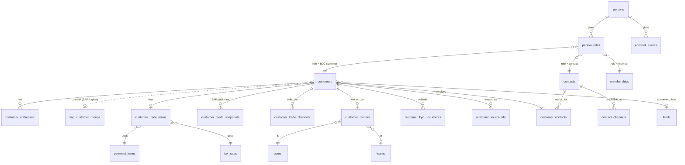
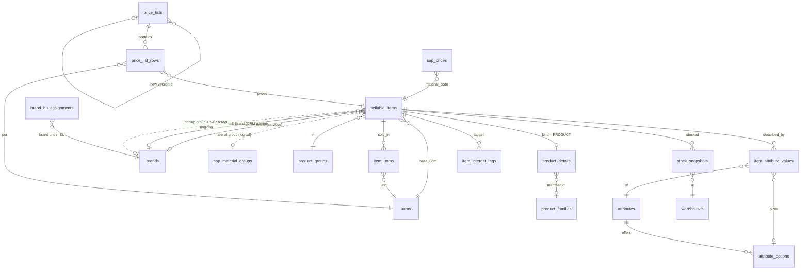
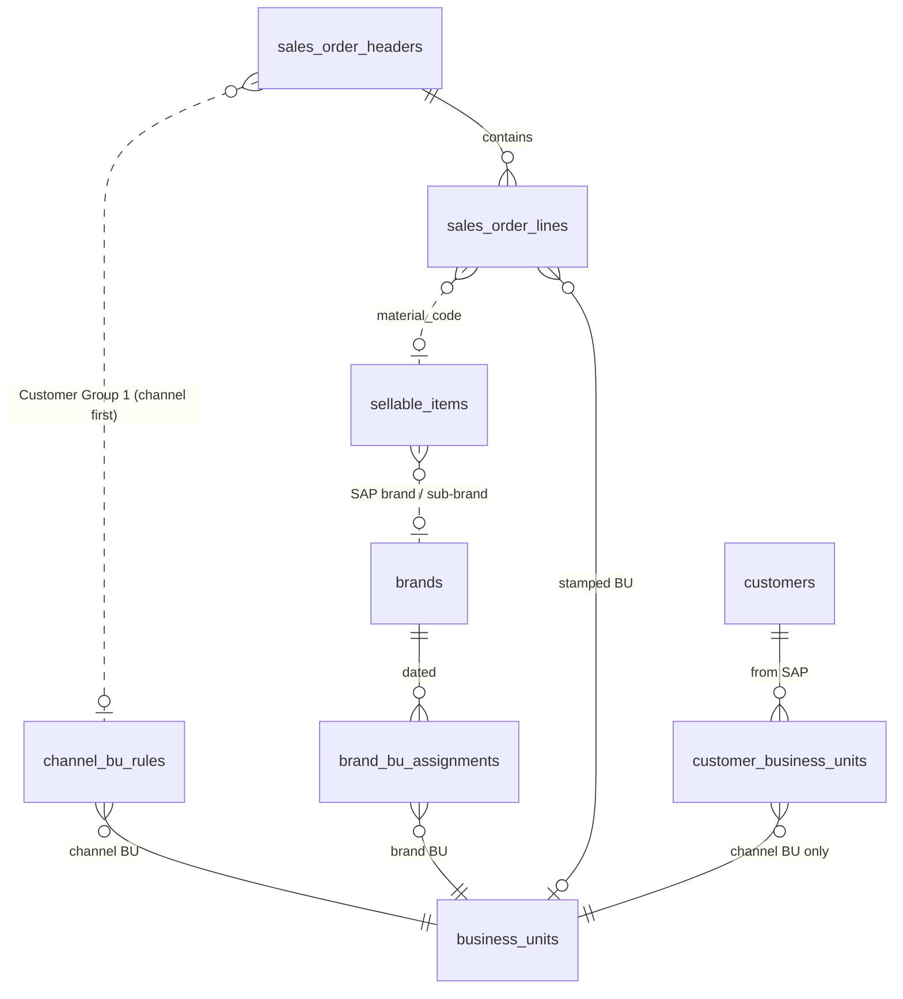
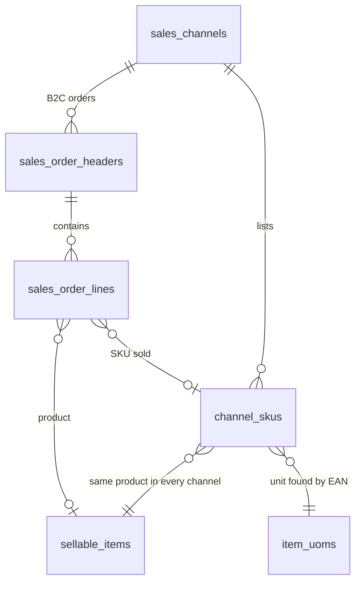

# AJT design app: customer and product data model (reverse-engineered), revision 6

Source: the clickable prototype at `https://ajt-design.vercel.app` (AJT CRM & Loyalty · Design).
The prototype has no public API or schema, so this model is derived from what its
screens show. Crawled 2026-11-14 with headless Chromium.

**Scope:** customer and product master data plus their direct children. Leads,
deals, quotes, orders, cases, inventory, and loyalty appear only as FK stubs.

**Status:** spec only. Nothing here is applied to `db/schema.ts`. Section 7 compares
this model with the current repo schema.

**Revision 2 (BU mapping clarification).** AJT clarified how Customer Group,
Product, Pricing, Brand, and Business Unit relate. Section 9 lists the resulting
conditions and limitations, section 10 is the Business Unit solution design, and
section 11 maps AJT's acceptance criteria to the model. Columns and tables added for
the clarification carry the `-- C` tag.

**Revision 3 (brand from SAP pricing group).** In AJT's SAP, the Material Pricing
Group holds one value per material and is used only to define the brand. The CRM
splits brands further into sub-brands using deeper Material Group levels. Section 12
is the brand design. Revision 2 is kept unchanged in `docs/ajt-design-data-model.md`.

**Revision 4 (sub-brands sit under Business Unit).** AJT's example: the SAP product
code of AminoMOF sits under Material Group Aminovital, the CRM maps Aminovital to
Business Unit H&N, so CRM sub-brand AminoMOF sits under H&N. The SAP brand (Material
Pricing Group) has no Business Unit above it. The Material Group → BU rule list is
kept by the CRM team and approved by AJT. Section 12 is rewritten; revision 3 is kept
in `docs/ajt-design-data-model-v3.md`.

**Revision 5 (Phase 1 decisions with the CRM vendor).** AJT chose the Phase 1 options
the vendor offered: (1) SAP sends each product's brand, CRM admins add sub-brands by
hand or Excel, and every brand sits under one Business Unit; (2) the BU of each sales
line is set per line: the customer's channel first (Modern Food Service → Modern
Food, Food Industrial → Food Industrial), otherwise the BU of the product's brand;
B2C lines always use the brand; (3) a customer's BU comes only from SAP, converted
from Customer Group 1, for the two channel BUs only. The Material Group → BU and
sub-brand rule lists of revision 4 are dropped (they would be a change request).
Sections 8–11 are rewritten and section 12 is removed. Revision 4 is kept in
`docs/ajt-design-data-model-v4.md`. Two points deviate from AJT's clarification and
need AJT sign-off (section 9.2).

**Revision 6 (B2C channel SKUs).** AJT's example file `Example_SKU_by_Channel.xlsx`
shows B2C marketplace SKUs for Lazada, Shopee and TikTok. Most products use the same
SKU (`TH_HYB_AJT-` + 13-digit EAN) in every channel; some use a legacy SAP code or a
suffix (`_KOL`, `_C2` promo, `_C` clearance, `_4` bundle). B2C SKUs and B2C orders now
use the same structure as B2B (product, sales order header and line, per-line BU),
except that B2C has no SKU unit price: a B2C line carries the amount actually paid.
Section 12 is the design. Revision 5 is kept in `docs/ajt-design-data-model-v5.md`.

## 0. Method and legend

Pages read:

| Area | Pages |
|------|-------|
| Customers | `/customers` (B2B tab and `?tab=b2c`), `/customers/C-2001` (B2B, natural person), `/customers/C-2002` (B2B, juristic), `/customers/C-2101` (B2C, no purchases), `/customers/CB-M-3004` (B2C, member), `/customers/new` |
| Contacts | `/contacts/CT-4003`, `/contacts/CT-4104` (same person as `CB-M-3004`) |
| Products | `/commerce/products`, `/commerce/products/P-4001`, `/commerce/products/P-4010`, `/commerce/products/reference` (all 6 tabs), `/commerce/products/import` |
| Services | `/commerce/services`, `/commerce/services/SV-1001` |
| Price lists | `/commerce/price-lists`, `PL-0001` (global, tiered), `PL-0002` (customer-group scope), `PL-0012` (promo, overlapping dates) |
| Master data | `/settings/master-data` (54 sets), plus the sets: channels, payment terms, account tiers, industries, customer groups, contact roles, tax rates, KYC |
| Loyalty | `/loyalty-cms/members` (only to confirm the member code format) |

Every column carries one tag in the DDL comments:

- `-- O` **observed**: the field or value is shown on a screen.
- `-- I` **inferred**: needed to make observed behaviour work (keys, audit columns, flags implied by UI text), but not shown.
- `-- C` **clarification**: required by AJT's BU mapping clarification. The prototype has no screen for it.

A comment of the form `joins table(column)` marks a **logical join**: the columns
match by value, but there is deliberately no foreign key, so data that arrives
before its master record is accepted and routed to an exception instead of rejected.

Conventions (decided for this spec, not taken from the repo):

- `INTEGER GENERATED ALWAYS AS IDENTITY` surrogate PK, plus a unique business code (`C-2001`, `P-4001`, `PL-0001`).
- `TIMESTAMPTZ` for events, `DATE` for calendar dates, `NUMERIC(14,2)` for money, `NUMERIC(14,3)` for quantities, `BOOLEAN` for flags.
- Enums owned by the system are `CHECK` constraints. Lists that admins edit are picklists (section 4).
- Thai text is the primary label. `_en` columns hold English where the UI shows it.

## 1. Key findings

1. **One customer register, two profiles.** B2B (`ลูกค้าธุรกิจ`) and B2C (`ลูกค้าทั่วไป`) share `/customers/{code}` and one list with two tabs. Legal form is a separate axis: a B2B customer can be a natural person (`C-2001 · ลูกค้าธุรกิจ · บุคคลธรรมดา`) or a juristic entity (`C-2002 · นิติบุคคล`).
2. **Codes show where a record came from.** `C-2xxx` is created in the CRM. `CB-M-3004` is a B2C customer that came in from loyalty membership `M-3004`. Loyalty CMS members use `AJM-1xxxx`. Contacts use `CT-4xxx`.
3. **A person can hold several roles.** `CT-4104` (contact at C-2001), `CB-M-3004` (B2C customer) and membership `M-3004` are the same person. The contact page has a panel "บทบาทของคนนี้ · คนเดียวกันในทุกส่วนของระบบ" (this person's roles, the same person everywhere in the system). The records stay separate and are joined by a link table.
4. **Contacts are M:N with customers.** Each relationship has a role, a department, a rapport level, owners, a time period (`8 มี.ค. 2569 → ตอนนี้`) and an end reason. A "primary company" (`บริษัทหลัก`) is flagged.
5. **Contact channels are their own rows.** Each phone, email, or LINE ID has a label (work or personal), a primary flag, and a status (verified, unusable, retired).
6. **Consent is per person, per purpose, per channel.** The UI shows "ยินยอม 4/7" (consented to 4 of 7). Purposes: marketing (split into LINE OA, email, SMS, phone), partner sharing, behaviour analytics, health data. The history is append-only and each entry records the request channel and the actor ("ลูกค้าถอนเองผ่าน LINE", the customer withdrew it themselves via LINE).
7. **SAP owns credit and the customer code. CDP owns B2C profiles and product interest tags.** The UI says "ข้อมูลจาก SAP ณ …" (data from SAP as of …), "แก้ไขที่ SAP" (edit in SAP) and "แก้ไขที่ CDP" (edit in CDP). Credit is a published snapshot, not a value the CRM computes.
8. **Prices do not live on products.** The products page footer says "ราคาอยู่ที่รายการราคา ไม่ได้อยู่บนสินค้า" (prices live on price lists, not on products). Price lists are versioned and immutable once active ("quotes and orders already reference this version"). Rows are item × sales UoM × minimum quantity.
9. **Products and services are one sellable-item concept.** Both use product groups, a base UoM, sales UoM conversions, and price-list rows. Only products have attributes, a GTIN, shelf life, a family, and stock.
10. **SKU variants are described by attributes.** A product family (`FAM-AJI-MSG`) groups SKUs, and typed attributes (net weight in g, volume in ml, flavour, packaging, storage) tell them apart.
11. **UoM conversion is per item.** Global UoMs only define quantity precision. "1 ลัง = 144 ซอง" (1 case = 144 sachets) is stored on the item, with its own barcode and gross weight.
12. **Field-level history and PII-view logging** appear on both customers and products ("ทุกการแก้ไข และทุกครั้งที่มีคนเปิดดูข้อมูลส่วนบุคคล": every edit, and every time someone opens personal data).
13. **Business Unit belongs to the product side, never the customer side** (AJT clarification; revision 5 adds two channel BUs from Customer Group 1, see 15). BU is resolved from an approved Material Group level of the product. SAP Customer Group is the customer's channel or classification. Customer and product meet only on a sales order line. The prototype shows no BU screen; the only trace is a "สมาชิกของ BU" (BU membership) column in the loyalty member list.
14. **Brand and sub-brand follow separate routes** (revision 4, superseded by 15 for BU). The SAP brand is the Material Pricing Group and has nothing above it. The CRM sub-brand comes from a CRM rule on a Material Group level below the BU level, and sits under the Business Unit its products map to: AminoMOF (Material Group Aminovital) sits under H&N. The prototype's brand list mixes both kinds (`BIRDY`, `BIRDY-ROBUSTA`, `ROSDEE-MENU`).
15. **Two kinds of Business Unit** (revision 5). Channel BUs (Modern Food, Food Industrial) follow the customer's SAP Customer Group 1. Brand BUs (Seasoning, Birdy, YumYum, H&N…) follow the product's brand. Every sales document can mix brands, so BU is set on each line, never on the document (section 10).
16. **B2C channel SKUs map to the same products** (revision 6). A marketplace SKU carries the product's EAN barcode, so it links to the product and to the sales unit at once; variants (KOL, promo, clearance, bundle) stay on the same product with a tag and a pack quantity. B2C money is the paid amount, never a price list (section 12).

## 2. Customer domain

### 2.1 ERD



### 2.2 DDL

```sql
-- ---------- stubs (outside scope, present so FKs resolve) ----------
CREATE TABLE teams (
  id    INTEGER GENERATED ALWAYS AS IDENTITY PRIMARY KEY,
  name  TEXT NOT NULL UNIQUE                         -- O "ทีมกรุงเทพ 2"
);
CREATE TABLE users (
  id       INTEGER GENERATED ALWAYS AS IDENTITY PRIMARY KEY,
  name     TEXT NOT NULL,                            -- O
  team_id  INTEGER REFERENCES teams(id)              -- O primary team shown next to name
);
CREATE TABLE leads (
  id         INTEGER GENERATED ALWAYS AS IDENTITY PRIMARY KEY,
  lead_code  TEXT NOT NULL UNIQUE                    -- O "L-1008"
);
CREATE TABLE memberships (                           -- loyalty, out of scope
  id               INTEGER GENERATED ALWAYS AS IDENTITY PRIMARY KEY,
  membership_code  TEXT NOT NULL UNIQUE,             -- O "M-3004", "AJM-10001"
  tier             TEXT,                             -- O Silver | Gold | Platinum
  tier_valid_until DATE                              -- O "ถือระดับนี้ถึง 24 มิ.ย. 2570"
);

-- ---------- customers ----------
CREATE TABLE customers (
  id                   INTEGER GENERATED ALWAYS AS IDENTITY PRIMARY KEY,
  customer_code        TEXT NOT NULL UNIQUE,         -- O C-2001 / CB-M-3004
  profile              TEXT NOT NULL CHECK (profile IN ('B2B','B2C')),                 -- O
  legal_form           TEXT NOT NULL CHECK (legal_form IN ('NATURAL','JURISTIC')),     -- O บุคคลธรรมดา / นิติบุคคล
  name_prefix_id       INTEGER REFERENCES picklist_values(id),  -- O "นาย", "บจก."
  name_th              TEXT NOT NULL,                -- O
  name_en              TEXT,                         -- O "Somchai Phetcharat"
  tax_id_encrypted     TEXT,                         -- O masked "x-xxxx-xxxxx-37-2"; encrypt like lib/pii.ts
  tax_id_last_digits   TEXT,                         -- I needed for the mask without decrypting
  sap_customer_code    TEXT UNIQUE,                  -- O "รหัสร้านค้า · ยังไม่มีรหัสจาก SAP"; customer identity key once SAP issues it
  customer_group_code  TEXT,                         -- C SAP Customer Group 1 = channel / classification, read-only; sets only the two channel BUs (rev 5, D1); joins sap_customer_groups(code)
  phone                TEXT,                         -- O company / shop phone
  email                TEXT,                         -- O
  website              TEXT,                         -- O
  birth_date           DATE,                         -- O natural persons only, masked
  gender               TEXT CHECK (gender IN ('MALE','FEMALE','UNSPECIFIED')),          -- O
  occupation_id        INTEGER REFERENCES picklist_values(id),  -- O "เจ้าของกิจการ"
  industry_id          INTEGER REFERENCES picklist_values(id),  -- O set 'industries'
  industry_other_text  TEXT,                         -- O free text when "other" is picked
  industry_subgroup_id INTEGER REFERENCES picklist_values(id),  -- O prototype set 'customer-groups' (factory sub-type); renamed so it is not confused with SAP Customer Group
  account_tier_id      INTEGER REFERENCES picklist_values(id),  -- O Key Account | General
  awareness_channel_id INTEGER REFERENCES picklist_values(id),  -- O "งานแสดงสินค้า / อีเวนต์"
  status               TEXT NOT NULL DEFAULT 'PENDING_DOCS'
                       CHECK (status IN ('PENDING_DOCS','ACTIVE','SUSPENDED','INACTIVE')),  -- O
  lifecycle_stage      TEXT,                         -- O "Active · เริ่มห่างหาย"; derived by job
  lifecycle_reason     TEXT,                         -- O second half of the label
  converted_from_lead_id INTEGER REFERENCES leads(id),          -- O "มาจากลีด L-1008"
  converted_at         TIMESTAMPTZ,                  -- O "แปลงเมื่อ 4 มี.ค. 2569"
  origin               TEXT NOT NULL DEFAULT 'CRM'
                       CHECK (origin IN ('CRM','LEAD','IMPORT','CDP','LOYALTY','RECEIPT')),  -- O "สร้างด้วยมือ ไม่ได้มาจากใบเสร็จ"
  created_by           INTEGER REFERENCES users(id), -- O history "สร้าง"
  created_at           TIMESTAMPTZ NOT NULL DEFAULT now(),
  updated_at           TIMESTAMPTZ NOT NULL DEFAULT now()
);
CREATE INDEX customers_profile_status ON customers(profile, status);

-- Bill-to / ship-to addresses and branches. "สำนักงานใหญ่ · รหัสสาขา 00000"
CREATE TABLE customer_addresses (
  id                INTEGER GENERATED ALWAYS AS IDENTITY PRIMARY KEY,
  customer_id       INTEGER NOT NULL REFERENCES customers(id) ON DELETE CASCADE,
  label             TEXT NOT NULL,                   -- O "สำนักงานใหญ่"
  branch_code       TEXT,                            -- O "00000" (Thai tax branch, 5 digits)
  address_line      TEXT NOT NULL,                   -- O
  subdistrict       TEXT,                            -- O แขวง
  district          TEXT,                            -- O เขต
  province          TEXT,                            -- O used as list column "จังหวัด"
  postal_code       TEXT,                            -- O
  country_id        INTEGER REFERENCES picklist_values(id),     -- O set 'countries'
  is_default_billing  BOOLEAN NOT NULL DEFAULT false,          -- O "ค่าตั้งต้น · ออกใบ"
  is_default_shipping BOOLEAN NOT NULL DEFAULT false,          -- O "ค่าตั้งต้น · จัดส่ง"
  receiver_name     TEXT,                            -- O masked
  receiver_phone    TEXT,                            -- O
  receiver_email    TEXT,                            -- O
  CHECK (branch_code IS NULL OR branch_code ~ '^[0-9]{5}$')    -- I
);
CREATE UNIQUE INDEX customer_addresses_one_default_bill
  ON customer_addresses(customer_id) WHERE is_default_billing;   -- I
CREATE UNIQUE INDEX customer_addresses_one_default_ship
  ON customer_addresses(customer_id) WHERE is_default_shipping;  -- I

-- Trade terms (tab "เงื่อนไขการค้า"). One row per customer.
CREATE TABLE customer_trade_terms (
  customer_id          INTEGER PRIMARY KEY REFERENCES customers(id) ON DELETE CASCADE,
  payment_term_id      INTEGER REFERENCES payment_terms(id),   -- O "1C09 · เครดิต 30 วัน"
  tax_rate_id          INTEGER REFERENCES tax_rates(id),       -- O NULL = org default ("ค่าตั้งต้นขององค์กร")
  receiving_conditions TEXT,                         -- O "รับของเฉพาะช่วงบ่าย 13:00-16:00"
  document_conditions  TEXT                          -- O "เงื่อนไขการส่งเอกสาร"
);
-- Price lists that apply to the customer are resolved by scope (section 3), not stored here.

-- Credit is published by SAP. Keep each snapshot, show the latest one.
CREATE TABLE customer_credit_snapshots (
  id            INTEGER GENERATED ALWAYS AS IDENTITY PRIMARY KEY,
  customer_id   INTEGER NOT NULL REFERENCES customers(id) ON DELETE CASCADE,
  credit_limit  NUMERIC(14,2) NOT NULL,              -- O ฿300,000
  credit_used   NUMERIC(14,2) NOT NULL,              -- O ฿34,129
  -- remaining = limit - used, computed at read time  -- O ฿265,871
  as_of         TIMESTAMPTZ NOT NULL,                -- O "ข้อมูลจาก SAP ณ 7 ส.ค. 2569 00:31 น."
  source_system TEXT NOT NULL DEFAULT 'SAP'          -- O
);
CREATE INDEX customer_credit_latest ON customer_credit_snapshots(customer_id, as_of DESC);

-- Trade channels (tab "ช่องทางการค้า"). One is primary and drives quotes and orders.
CREATE TABLE customer_trade_channels (
  id                     INTEGER GENERATED ALWAYS AS IDENTITY PRIMARY KEY,
  customer_id            INTEGER NOT NULL REFERENCES customers(id) ON DELETE CASCADE,
  business_type_id       INTEGER NOT NULL REFERENCES picklist_values(id), -- O leaf of set 'channels' (e.g. ยี่ปั๊ว under ร้านค้าดั้งเดิม)
  is_primary             BOOLEAN NOT NULL DEFAULT false,  -- O "ใบเสนอราคาและคำสั่งซื้อใช้ค่าของช่องทางหลัก"
  min_shelf_life_pct     NUMERIC(5,2) CHECK (min_shelf_life_pct BETWEEN 0 AND 100), -- O "อายุคงเหลือขั้นต่ำตอนส่ง 75%"
  UNIQUE (customer_id, business_type_id)
);
CREATE UNIQUE INDEX customer_trade_channels_one_primary
  ON customer_trade_channels(customer_id) WHERE is_primary;      -- I

-- Owners: "ผู้ดูแลหลัก" (primary) + "ผู้ดูแลร่วม · 3" (co-owners).
-- "หัวหน้าตามผัง" (managers per org chart) is derived from teams, not stored.
CREATE TABLE customer_owners (
  customer_id  INTEGER NOT NULL REFERENCES customers(id) ON DELETE CASCADE,
  user_id      INTEGER NOT NULL REFERENCES users(id),
  team_id      INTEGER REFERENCES teams(id),         -- O "หน่วยงานที่รับผิดชอบ · ทีมกรุงเทพ 2"
  owner_role   TEXT NOT NULL CHECK (owner_role IN ('PRIMARY','CO_OWNER')),  -- O
  assigned_at  TIMESTAMPTZ NOT NULL DEFAULT now(),
  PRIMARY KEY (customer_id, user_id)
);
CREATE UNIQUE INDEX customer_owners_one_primary
  ON customer_owners(customer_id) WHERE owner_role = 'PRIMARY';  -- I

-- KYC (tab "บันทึกและไฟล์"). Required types come from set 'kyc' and the
-- org policy "ต้องใช้เอกสาร" (documents required). Customer stays PENDING_DOCS until all are verified.
CREATE TABLE customer_kyc_documents (
  id            INTEGER GENERATED ALWAYS AS IDENTITY PRIMARY KEY,
  customer_id   INTEGER NOT NULL REFERENCES customers(id) ON DELETE CASCADE,
  doc_type_id   INTEGER NOT NULL REFERENCES picklist_values(id), -- O company-cert | vat-registration | director-id | bank-book
  status        TEXT NOT NULL DEFAULT 'SUBMITTED'
                CHECK (status IN ('SUBMITTED','VERIFIED','REJECTED')),  -- O "ยืนยันแล้ว"
  file_name     TEXT NOT NULL,                       -- O "ภพ20.pdf"
  file_url      TEXT NOT NULL,                       -- I
  uploaded_by   INTEGER REFERENCES users(id),        -- O "ผู้แนบ"
  uploaded_at   TIMESTAMPTZ NOT NULL DEFAULT now(),  -- O "แนบเมื่อ"
  verified_by   INTEGER REFERENCES users(id),        -- I
  verified_at   TIMESTAMPTZ                          -- I
);

-- "รหัสของลูกค้ารายนี้ในแต่ละระบบต้นทาง" (this customer's code in each source system).
-- For B2C: "หนึ่งแถวต่อการสมัครหนึ่งครั้ง" (one row per registration), e.g. ChocoCRM campaign sign-ups.
CREATE TABLE customer_source_ids (
  id              INTEGER GENERATED ALWAYS AS IDENTITY PRIMARY KEY,
  customer_id     INTEGER NOT NULL REFERENCES customers(id) ON DELETE CASCADE,
  source_system   TEXT NOT NULL,                     -- O "ChocoCRM"
  source_account  TEXT,                              -- O "Choco AjinomotoAmino"
  external_id     TEXT NOT NULL,                     -- O "ChocoCRM_crm_cp1_76921"
  campaign_name   TEXT,                              -- O "AminoVital Amino House Launch 2025"
  registered_at   TIMESTAMPTZ,                       -- O
  UNIQUE (source_system, external_id)
);

-- ---------- contacts ----------
CREATE TABLE contacts (
  id                INTEGER GENERATED ALWAYS AS IDENTITY PRIMARY KEY,
  contact_code      TEXT NOT NULL UNIQUE,            -- O CT-4003
  name_prefix_id    INTEGER REFERENCES picklist_values(id),  -- O "นางสาว"
  full_name         TEXT NOT NULL,                   -- O
  nickname          TEXT,                            -- O "นิด"
  preferred_language TEXT,                           -- O "ไทย"
  occupation_id     INTEGER REFERENCES picklist_values(id),  -- O
  birth_date        DATE,                            -- O masked
  gender            TEXT CHECK (gender IN ('MALE','FEMALE','UNSPECIFIED')),  -- O
  household_size    INTEGER,                         -- O "จำนวนคนในครัวเรือน"
  household_type_id INTEGER REFERENCES picklist_values(id),  -- O "อยู่คนเดียว"
  marital_status_id INTEGER REFERENCES picklist_values(id),  -- O
  income_band_id    INTEGER REFERENCES picklist_values(id),  -- O
  household_source  TEXT,                            -- O "พนักงานบันทึกให้" / "แบบสอบถาม · 9 มิ.ย. 2569"
  internal_note     TEXT,                            -- O "บันทึกภายใน"
  status            TEXT NOT NULL DEFAULT 'ACTIVE' CHECK (status IN ('ACTIVE','INACTIVE')),  -- O
  origin            TEXT,                            -- O "สร้างที่นี่" / "สมัครสมาชิกที่หน้าร้าน"
  last_imported_at  TIMESTAMPTZ,                     -- O "นำเข้าล่าสุด 30 ก.ค. 2569"
  created_at        TIMESTAMPTZ NOT NULL DEFAULT now()  -- O "วันที่สร้าง"
);

CREATE TABLE contact_channels (
  id          INTEGER GENERATED ALWAYS AS IDENTITY PRIMARY KEY,
  contact_id  INTEGER NOT NULL REFERENCES contacts(id) ON DELETE CASCADE,
  kind        TEXT NOT NULL CHECK (kind IN ('PHONE','EMAIL','LINE')),          -- O
  value       TEXT NOT NULL,                         -- O masked in UI
  label_id    INTEGER REFERENCES picklist_values(id),-- O "ที่ทำงาน" / "ส่วนตัว"
  is_primary  BOOLEAN NOT NULL DEFAULT false,        -- O "ช่องทางหลัก"
  status      TEXT NOT NULL DEFAULT 'ACTIVE'
              CHECK (status IN ('ACTIVE','VERIFIED','UNUSABLE','RETIRED')),     -- O ยืนยันแล้ว / ใช้ไม่ได้ / เลิกใช้
  created_at  TIMESTAMPTZ NOT NULL DEFAULT now()
);
CREATE UNIQUE INDEX contact_channels_one_primary_per_kind
  ON contact_channels(contact_id, kind) WHERE is_primary AND status <> 'RETIRED';  -- I

-- Customer <-> contact relationship (tab "ความสัมพันธ์").
CREATE TABLE customer_contacts (
  id                  INTEGER GENERATED ALWAYS AS IDENTITY PRIMARY KEY,
  customer_id         INTEGER NOT NULL REFERENCES customers(id) ON DELETE CASCADE,
  contact_id          INTEGER NOT NULL REFERENCES contacts(id) ON DELETE CASCADE,
  role_id             INTEGER REFERENCES picklist_values(id),   -- O set 'contact-roles' (จัดซื้อ, ผู้รับสินค้า...)
  role_other_text     TEXT,                                     -- O free text for "อื่น ๆ"
  job_title           TEXT,                                     -- O "หัวหน้าโกดัง"
  department_id       INTEGER REFERENCES picklist_values(id),   -- O set 'departments' ("ฝ่ายคลังสินค้า")
  rapport_id          INTEGER REFERENCES picklist_values(id),   -- O set 'relationship-rapport' ("ยังไม่คุ้นเคย")
  is_primary_contact  BOOLEAN NOT NULL DEFAULT false,           -- O "ผู้ติดต่อหลัก" for the customer
  is_primary_company  BOOLEAN NOT NULL DEFAULT false,           -- O "บริษัทหลักของบุคคลนี้" for the contact
  preferred_channel   TEXT,                                     -- O "ช่องทางและเวลาที่สะดวก"
  preferred_time      TEXT,                                     -- O
  started_on          DATE NOT NULL,                            -- O "8 มี.ค. 2569 →"
  ended_on            DATE,                                     -- O "แสดงผู้ติดต่อที่สิ้นสุดแล้ว (1)"
  end_reason_id       INTEGER REFERENCES picklist_values(id),   -- O set 'contact-end-reasons'
  CHECK (ended_on IS NULL OR ended_on >= started_on)
);
CREATE UNIQUE INDEX customer_contacts_open
  ON customer_contacts(customer_id, contact_id) WHERE ended_on IS NULL;           -- I
CREATE UNIQUE INDEX customer_contacts_one_primary_contact
  ON customer_contacts(customer_id) WHERE is_primary_contact AND ended_on IS NULL; -- I
CREATE UNIQUE INDEX customer_contacts_one_primary_company
  ON customer_contacts(contact_id) WHERE is_primary_company AND ended_on IS NULL;  -- I
-- Contact owners default to the primary company's primary owner
-- ("ตามผู้ดูแลหลักของ …"); an override table is left out until the UI needs one.

-- ---------- one person, many roles ----------
-- CT-4104 = CB-M-3004 = M-3004. The records stay separate (each module keeps its
-- own fields) and are joined through a person.
CREATE TABLE persons (
  id          INTEGER GENERATED ALWAYS AS IDENTITY PRIMARY KEY,   -- I
  created_at  TIMESTAMPTZ NOT NULL DEFAULT now()
);
CREATE TABLE person_roles (
  id             INTEGER GENERATED ALWAYS AS IDENTITY PRIMARY KEY,
  person_id      INTEGER NOT NULL REFERENCES persons(id) ON DELETE CASCADE,
  role           TEXT NOT NULL CHECK (role IN ('CONTACT','B2C_CUSTOMER','MEMBER')),  -- O the three rows of the panel
  contact_id     INTEGER UNIQUE REFERENCES contacts(id) ON DELETE CASCADE,
  customer_id    INTEGER UNIQUE REFERENCES customers(id) ON DELETE CASCADE,
  membership_id  INTEGER UNIQUE REFERENCES memberships(id) ON DELETE CASCADE,
  linked_by      INTEGER REFERENCES users(id),       -- O "ผูกบทบาทอื่น" is a manual action
  linked_at      TIMESTAMPTZ NOT NULL DEFAULT now(),
  CHECK (
    (role = 'CONTACT'      AND contact_id    IS NOT NULL AND customer_id IS NULL AND membership_id IS NULL) OR
    (role = 'B2C_CUSTOMER' AND customer_id   IS NOT NULL AND contact_id  IS NULL AND membership_id IS NULL) OR
    (role = 'MEMBER'       AND membership_id IS NOT NULL AND contact_id  IS NULL AND customer_id   IS NULL)
  )
);
-- A person can be a contact at several companies through customer_contacts,
-- but holds at most one contact record: UNIQUE(contact_id) here.

-- ---------- consent ----------
-- Per person, append-only. Current state = latest row per (person, purpose, channel).
-- "ยินยอม 4/7" counts the 7 purpose/channel cells that are GRANTED.
CREATE TABLE consent_events (
  id                 INTEGER GENERATED ALWAYS AS IDENTITY PRIMARY KEY,
  person_id          INTEGER NOT NULL REFERENCES persons(id) ON DELETE CASCADE,
  purpose            TEXT NOT NULL CHECK (purpose IN ('MARKETING','PARTNER_SHARING','BEHAVIOUR_ANALYTICS','HEALTH_DATA')), -- O
  channel            TEXT CHECK (channel IN ('LINE_OA','EMAIL','SMS','PHONE')),  -- O MARKETING only
  status             TEXT NOT NULL CHECK (status IN ('GRANTED','DENIED','WITHDRAWN')), -- O ยินยอม / ไม่ยินยอม / ถอน
  request_channel_id INTEGER REFERENCES picklist_values(id), -- O set 'consent-request-channels' ("ผ่าน LINE")
  actor              TEXT NOT NULL CHECK (actor IN ('SUBJECT','STAFF','IMPORT')),  -- O "ลูกค้าถอนเอง"
  recorded_by        INTEGER REFERENCES users(id),
  privacy_notice_version TEXT,                       -- O "หัวข้อความยินยอมตั้งที่ประกาศความเป็นส่วนตัว"
  captured_at        TIMESTAMPTZ NOT NULL DEFAULT now(),
  CHECK ((purpose = 'MARKETING') = (channel IS NOT NULL))
);
CREATE INDEX consent_events_current ON consent_events(person_id, purpose, channel, captured_at DESC);
```

Contacts and B2C customers that have no person yet show "ยังไม่เคยถาม" (never
asked). `consent_events` needs a person, so create a `persons` row the first time
consent is captured.

## 3. Product domain

### 3.1 ERD



### 3.2 DDL

```sql
-- ---------- reference (tab "กลุ่มสินค้า แบรนด์ และหน่วยขาย") ----------
-- Brands (revision 5). BRAND rows are SAP brands (Material Pricing Group); SUB_BRAND rows
-- are CRM-defined. Every brand sits under exactly one Business Unit on any date, through
-- brand_bu_assignments (section 10). Maintained by CRM master-data admins in Phase 1.
CREATE TABLE brands (
  id          INTEGER GENERATED ALWAYS AS IDENTITY PRIMARY KEY,
  code        TEXT NOT NULL UNIQUE,                  -- O "AJINOMOTO", "BIRDY-ROBUSTA"
  name_th     TEXT NOT NULL,                         -- O "อายิโนะโมะโต๊ะ"
  brand_level TEXT NOT NULL DEFAULT 'BRAND' CHECK (brand_level IN ('BRAND','SUB_BRAND')),  -- C
  sap_pricing_group_code TEXT UNIQUE,                -- C SAP Material Pricing Group that defines this top brand
  requires_sub_brand BOOLEAN NOT NULL DEFAULT false, -- C rev 5: products of this SAP brand must get a CRM sub-brand
  source_system TEXT NOT NULL DEFAULT 'CRM' CHECK (source_system IN ('CRM','EXCEL','CDP')),  -- C Phase 1 CRM/Excel, Phase 2 CDP
  is_active   BOOLEAN NOT NULL DEFAULT true,         -- O
  updated_at  TIMESTAMPTZ NOT NULL DEFAULT now(),    -- O "แก้ไขล่าสุด"
  CHECK (brand_level = 'BRAND' OR sap_pricing_group_code IS NULL)
);
-- User brand permissions ("สิทธิ์ของผู้ใช้กำหนดที่หน้าผู้ใช้งานระบบ") live with users; out of scope.

-- The product group also routes leads to salespeople and groups sales in reports.
CREATE TABLE product_groups (
  id           INTEGER GENERATED ALWAYS AS IDENTITY PRIMARY KEY,
  code         TEXT NOT NULL UNIQUE,                 -- O "PG-001"
  name_th      TEXT NOT NULL,                        -- O "ผงชูรส"
  description  TEXT,                                 -- O
  code_prefix  TEXT,                                 -- O "MSG" (used by item code generator)
  is_active    BOOLEAN NOT NULL DEFAULT true         -- O "ปิดกลุ่มแล้ว…ยังอ่านได้" -> soft disable only
);

CREATE TABLE uoms (
  id              INTEGER GENERATED ALWAYS AS IDENTITY PRIMARY KEY,
  code            TEXT NOT NULL UNIQUE,              -- O "UOM-CASE"
  name_th         TEXT NOT NULL,                     -- O "ลัง"
  description     TEXT,                              -- O
  decimal_places  SMALLINT NOT NULL DEFAULT 0 CHECK (decimal_places BETWEEN 0 AND 3), -- O "จำนวนเต็มเท่านั้น" = 0, "ไม่เกิน 2 ตำแหน่งทศนิยม" = 2
  is_active       BOOLEAN NOT NULL DEFAULT true
);

CREATE TABLE attributes (
  id          INTEGER GENERATED ALWAYS AS IDENTITY PRIMARY KEY,
  code        TEXT NOT NULL UNIQUE,                  -- O "ATTR-NET", "ATTR-FLAVOUR"
  name_th     TEXT NOT NULL,                         -- O "น้ำหนักสุทธิ"
  description TEXT,
  value_type  TEXT NOT NULL CHECK (value_type IN ('NUMBER_WITH_UNIT','OPTION')),  -- O "ตัวเลขพร้อมหน่วย · g" / "เลือกจากรายการ · 8 ตัวเลือก"
  unit        TEXT,                                  -- O "g", "ml"
  is_active   BOOLEAN NOT NULL DEFAULT true,
  CHECK ((value_type = 'NUMBER_WITH_UNIT') = (unit IS NOT NULL))
);
CREATE TABLE attribute_options (
  id            INTEGER GENERATED ALWAYS AS IDENTITY PRIMARY KEY,
  attribute_id  INTEGER NOT NULL REFERENCES attributes(id) ON DELETE CASCADE,
  label_th      TEXT NOT NULL,                       -- O "ต้นตำรับ", "ถุง", "อุณหภูมิห้อง"
  sort_order    INTEGER NOT NULL DEFAULT 0,
  is_active     BOOLEAN NOT NULL DEFAULT true,
  UNIQUE (attribute_id, label_th)
);

CREATE TABLE product_families (
  id       INTEGER GENERATED ALWAYS AS IDENTITY PRIMARY KEY,
  code     TEXT NOT NULL UNIQUE,                     -- O "FAM-AJI-MSG"
  name_th  TEXT                                      -- I
);

-- Item code rule (tab "รหัสสินค้า"): one org-wide row.
CREATE TABLE item_code_settings (
  id                    BOOLEAN PRIMARY KEY DEFAULT true CHECK (id),  -- singleton
  mode                  TEXT NOT NULL DEFAULT 'SUGGEST_EDITABLE'
                        CHECK (mode IN ('SUGGEST_EDITABLE','AUTO_LOCKED','MANUAL')),  -- O "ระบบเสนอให้ และแก้ได้"
  prefix                TEXT,                        -- O "P"
  separator             TEXT NOT NULL DEFAULT '-',   -- O "ขีดกลาง (P-4031)"
  sequence_digits       SMALLINT NOT NULL DEFAULT 4, -- O
  use_group_prefix      BOOLEAN NOT NULL DEFAULT false, -- O
  inventory_display_uom TEXT NOT NULL DEFAULT 'BASE'
                        CHECK (inventory_display_uom IN ('BASE','NET_WEIGHT_KG')),  -- O tab "หน่วยในคลัง"
  show_base_qty_below   BOOLEAN NOT NULL DEFAULT true  -- O
);

-- ---------- sellable items ----------
CREATE TABLE sellable_items (
  id                INTEGER GENERATED ALWAYS AS IDENTITY PRIMARY KEY,
  item_code         TEXT NOT NULL UNIQUE,            -- O P-4001 / SV-1001; never changes once issued
  kind              TEXT NOT NULL CHECK (kind IN ('PRODUCT','SERVICE')),  -- O "P-4001 · สินค้า"
  name_th           TEXT NOT NULL,                   -- O
  name_en           TEXT,                            -- O history "ชื่อภาษาอังกฤษ"
  description       TEXT,                            -- O services show one
  brand_id          INTEGER REFERENCES brands(id),   -- O manual brand, only for items with no SAP pricing group (services, CRM drafts); nullable: "ไม่ระบุแบรนด์"
  product_group_id  INTEGER NOT NULL REFERENCES product_groups(id),  -- O
  base_uom_id       INTEGER NOT NULL REFERENCES uoms(id),            -- O "หน่วยฐาน ซอง"
  is_active         BOOLEAN NOT NULL DEFAULT true,   -- O ใช้งาน / ไม่ใช้งาน
  source_system     TEXT NOT NULL DEFAULT 'LOCAL'
                    CHECK (source_system IN ('LOCAL','SAP','IMPORT')),  -- O "กรอกในระบบนี้" / "มาจาก SAP"
  material_code     TEXT UNIQUE,                     -- C SAP material number: product and pricing key; NULL for services and CRM-only drafts
  material_group_level TEXT,                         -- C hierarchy level as sent by SAP
  material_group_code  TEXT,                         -- C SAP classification, e.g. Aminovital; not used for BU in Phase 1; joins sap_material_groups(code)
  material_pricing_group_code TEXT,                  -- C option A: SAP sends the brand; joins brands(sap_pricing_group_code)
  sub_brand_id      INTEGER REFERENCES brands(id),   -- C option B: CRM admin assigns the sub-brand (by hand or Excel), e.g. AminoMOF
  updated_by        INTEGER REFERENCES users(id),    -- O "สมหญิง ผู้ดูแลสินค้า"
  created_at        TIMESTAMPTZ NOT NULL DEFAULT now(),
  updated_at        TIMESTAMPTZ NOT NULL DEFAULT now(),
  CHECK (source_system <> 'SAP' OR material_code IS NOT NULL),           -- C SAP items always carry the key
  CHECK (kind = 'PRODUCT' OR material_code IS NULL),                     -- C services have no SAP material (limitation L1)
  CHECK (material_group_code IS NULL OR material_group_level IS NOT NULL)
);
CREATE INDEX sellable_items_group ON sellable_items(product_group_id);
CREATE INDEX sellable_items_material_group ON sellable_items(material_group_level, material_group_code);
-- Brand is resolved by item_brand_current (section 10): sub-brand if set, else SAP brand,
-- else the manual brand. The brand's Business Unit is the product's brand BU.
-- product_group_id is the CRM's own grouping (lead routing, reports). It is not the SAP Material Group.
CREATE INDEX sellable_items_brand ON sellable_items(brand_id);
-- "ความครบของราคา" (price coverage: มีราคาที่ใช้ได้ has a usable price / ราคาไม่ครบ some units unpriced / ยังไม่มีราคา no price)
-- is derived from item_uoms × active price_list_rows. Not stored.

CREATE TABLE product_details (
  item_id          INTEGER PRIMARY KEY REFERENCES sellable_items(id) ON DELETE CASCADE,
  family_id        INTEGER REFERENCES product_families(id),  -- O "สายผลิตภัณฑ์"
  gtin             TEXT UNIQUE,                     -- O "8850001000019" (base unit barcode)
  shelf_life_days  INTEGER CHECK (shelf_life_days > 0)      -- O "อายุสินค้า 730 วัน"
);
-- Enforce kind = 'PRODUCT' in app code or with a trigger; a CHECK cannot look across tables.

-- Sales units. The base unit is also a row here (factor 1) so price rows and
-- barcodes treat every unit the same way.
CREATE TABLE item_uoms (
  id              INTEGER GENERATED ALWAYS AS IDENTITY PRIMARY KEY,
  item_id         INTEGER NOT NULL REFERENCES sellable_items(id) ON DELETE CASCADE,
  uom_id          INTEGER NOT NULL REFERENCES uoms(id),
  factor_to_base  NUMERIC(14,3) NOT NULL CHECK (factor_to_base > 0),  -- O "1 ลัง = 144 ซอง"
  barcode         TEXT,                              -- O "18850001000016" (case GTIN-14)
  gross_weight_kg NUMERIC(12,3),                     -- O "75.48 กก."
  is_active       BOOLEAN NOT NULL DEFAULT true,
  UNIQUE (item_id, uom_id),
  UNIQUE (id, item_id)                               -- C rev 6: lets a channel SKU's unit be checked against its product
);

CREATE TABLE item_attribute_values (
  item_id       INTEGER NOT NULL REFERENCES sellable_items(id) ON DELETE CASCADE,
  attribute_id  INTEGER NOT NULL REFERENCES attributes(id),
  number_value  NUMERIC(14,3),                       -- O 500 (g)
  option_id     INTEGER REFERENCES attribute_options(id),  -- O "ถุง"
  PRIMARY KEY (item_id, attribute_id),
  CHECK ((number_value IS NULL) <> (option_id IS NULL))
);
-- Net weight here also feeds the kg display on inventory screens.

-- "ป้ายความสนใจ · แก้ไขที่ CDP" (interest tags, edit in CDP): owned by the CDP, read-only here.
CREATE TABLE item_interest_tags (
  item_id   INTEGER NOT NULL REFERENCES sellable_items(id) ON DELETE CASCADE,
  tag       TEXT NOT NULL,                           -- O "ทำอาหารที่บ้าน"
  synced_at TIMESTAMPTZ NOT NULL DEFAULT now(),
  PRIMARY KEY (item_id, tag)
);

-- ---------- price lists ----------
-- One row = one version. A new version is a new row pointing at the version it replaces.
CREATE TABLE price_lists (
  id                 INTEGER GENERATED ALWAYS AS IDENTITY PRIMARY KEY,
  record_code        TEXT NOT NULL UNIQUE,           -- O URL key "PL-0001"
  list_code          TEXT NOT NULL,                  -- O "PL-SEASONING-THB" (stable across versions)
  version            INTEGER NOT NULL CHECK (version > 0),  -- O "v2"
  supersedes_id      INTEGER REFERENCES price_lists(id),    -- I "สร้างเป็นเวอร์ชันใหม่"
  name_th            TEXT NOT NULL,                  -- O
  description        TEXT,                           -- O
  currency           CHAR(3) NOT NULL,               -- O THB / USD
  scope_type         TEXT NOT NULL CHECK (scope_type IN ('ALL','INDUSTRY_SUBGROUP','CUSTOMER')),  -- O "ทุกคน" / "กลุ่มลูกค้า"; CUSTOMER is I
  scope_industry_subgroup_id INTEGER REFERENCES picklist_values(id),  -- O "ครัวกลางและรับจ้างผลิต"; CRM picklist, never SAP customer_group_code (limitation L3)
  scope_customer_id  INTEGER REFERENCES customers(id),             -- I
  valid_from         DATE NOT NULL,                  -- O
  valid_to           DATE,                           -- O NULL = open-ended "1 ม.ค. 2569 →"
  status             TEXT NOT NULL DEFAULT 'DRAFT' CHECK (status IN ('DRAFT','ACTIVE','INACTIVE')),  -- O ร่าง / เปิดใช้งาน / ปิดใช้งาน
  source_system      TEXT NOT NULL DEFAULT 'LOCAL',  -- O "กรอกในระบบนี้"
  activated_by       INTEGER REFERENCES users(id),   -- O "สมชาย ผู้ดูแลราคา"
  activated_at       TIMESTAMPTZ,                    -- O
  readiness_snapshot JSONB,                          -- O "สภาพของข้อมูล ณ ตอนที่กดเปิดใช้งาน": missing rows, zero prices, overlaps
  created_at         TIMESTAMPTZ NOT NULL DEFAULT now(),
  UNIQUE (list_code, version),
  CHECK (valid_to IS NULL OR valid_to >= valid_from),
  CHECK ((scope_type = 'INDUSTRY_SUBGROUP') = (scope_industry_subgroup_id IS NOT NULL)),
  CHECK ((scope_type = 'CUSTOMER') = (scope_customer_id IS NOT NULL))
);
-- price_lists are CRM-local lists (source "กรอกในระบบนี้"). Prices published by SAP live in
-- sap_prices (section 10), keyed by material_code. Which one a quote uses is open question 9.
-- Overlapping active lists are allowed but flagged ("ช่วงเวลาซ้อนกับรายการราคาที่ใช้อยู่" overlaps an active list, on PL-0012).

-- Tiered: several rows for the same (item, uom) with rising min_qty.
-- NULL price = row exists but is not priced yet ("1 แถวยังไม่มีราคา"); 0 = free.
CREATE TABLE price_list_rows (
  id             INTEGER GENERATED ALWAYS AS IDENTITY PRIMARY KEY,
  price_list_id  INTEGER NOT NULL REFERENCES price_lists(id) ON DELETE CASCADE,
  item_id        INTEGER NOT NULL REFERENCES sellable_items(id),
  uom_id         INTEGER NOT NULL REFERENCES uoms(id),
  min_qty        NUMERIC(14,3) NOT NULL DEFAULT 0 CHECK (min_qty >= 0),  -- O "ทุกจำนวน" = 0, "อย่างน้อย 20 ลัง"
  unit_price     NUMERIC(14,2) CHECK (unit_price >= 0),                  -- O
  source_system  TEXT NOT NULL DEFAULT 'LOCAL',      -- O
  updated_at     TIMESTAMPTZ NOT NULL DEFAULT now(), -- O "แก้ไขล่าสุด"
  UNIQUE (price_list_id, item_id, uom_id, min_qty)
);
CREATE INDEX price_list_rows_item ON price_list_rows(item_id, uom_id);
-- (item_id, uom_id) should exist in item_uoms; enforce in app code (a composite FK would need item_uoms keyed that way).

-- ---------- stock (stub) ----------
CREATE TABLE warehouses (
  id       INTEGER GENERATED ALWAYS AS IDENTITY PRIMARY KEY,
  name_th  TEXT NOT NULL UNIQUE                      -- O "คลังกลาง (กรุงเทพและปริมณฑล)"
);
-- "ยอดคือสิ่งที่ระบบต้นทางเผยแพร่ล่าสุด หักด้วยจำนวนที่คำสั่งซื้อจองไว้"
-- (the source system's latest published figure minus quantity reserved by orders):
-- on-hand comes from the source system; reserved is the sum of open order lines; available = on_hand - reserved.
CREATE TABLE stock_snapshots (
  item_id       INTEGER NOT NULL REFERENCES sellable_items(id) ON DELETE CASCADE,
  warehouse_id  INTEGER NOT NULL REFERENCES warehouses(id),
  on_hand_base  NUMERIC(14,3) NOT NULL,              -- O "ยอดจากระบบต้นทาง 477 ซอง"
  published_at  TIMESTAMPTZ NOT NULL,                -- O "อัปเดตล่าสุด"; drives stale-data badges
  PRIMARY KEY (item_id, warehouse_id)
);
```

## 4. Shared lookups and audit

Plain label lists go in one generic pair of tables. Lists that carry extra typed
columns get their own table.

```sql
CREATE TABLE picklist_sets (
  id          INTEGER GENERATED ALWAYS AS IDENTITY PRIMARY KEY,
  code        TEXT NOT NULL UNIQUE,     -- O URL key: 'industries', 'channels', 'kyc' ...
  name_th     TEXT NOT NULL,            -- O
  description TEXT,                     -- O
  module      TEXT NOT NULL,            -- O "ลูกค้าและผู้ติดต่อ" / "ค่าการค้า" / "นโยบายและเพดาน"
  is_hierarchical BOOLEAN NOT NULL DEFAULT false   -- O 'channels' shows └ children
);
CREATE TABLE picklist_values (
  id          INTEGER GENERATED ALWAYS AS IDENTITY PRIMARY KEY,
  set_id      INTEGER NOT NULL REFERENCES picklist_sets(id) ON DELETE CASCADE,
  code        TEXT NOT NULL,            -- O 'wholesaler', 'CR-002'
  label_th    TEXT NOT NULL,            -- O
  label_en    TEXT,
  description TEXT,                     -- O
  parent_id   INTEGER REFERENCES picklist_values(id),  -- O channel -> business type -> cuisine (3 levels)
  is_system_other BOOLEAN NOT NULL DEFAULT false,      -- O "อื่น ๆ · แถวของระบบ" (system row): pairs with *_other_text columns
  is_active   BOOLEAN NOT NULL DEFAULT true,
  sort_order  INTEGER NOT NULL DEFAULT 0,
  UNIQUE (set_id, code)
);

-- SAP reference hierarchies and the BU master (AJT clarification, section 10).
-- Created here because customers and sellable_items refer to them.
CREATE TABLE sap_customer_groups (
  id          INTEGER GENERATED ALWAYS AS IDENTITY PRIMARY KEY,
  level       TEXT NOT NULL,            -- C SAP Customer Group hierarchy level
  code        TEXT NOT NULL,            -- C channel / classification code
  name        TEXT NOT NULL,            -- C
  parent_id   INTEGER REFERENCES sap_customer_groups(id),  -- C
  synced_at   TIMESTAMPTZ NOT NULL DEFAULT now(),
  UNIQUE (level, code)
);
CREATE TABLE sap_material_groups (
  id          INTEGER GENERATED ALWAYS AS IDENTITY PRIMARY KEY,
  level       TEXT NOT NULL,            -- C SAP Material Group hierarchy level
  code        TEXT NOT NULL,            -- C
  name        TEXT NOT NULL,            -- C
  parent_id   INTEGER REFERENCES sap_material_groups(id),  -- C
  synced_at   TIMESTAMPTZ NOT NULL DEFAULT now(),
  UNIQUE (level, code)
);
CREATE TABLE business_units (
  id          INTEGER GENERATED ALWAYS AS IDENTITY PRIMARY KEY,
  bu_code     TEXT NOT NULL UNIQUE,     -- C AJT Business Unit identifier
  bu_type     TEXT NOT NULL DEFAULT 'BRAND' CHECK (bu_type IN ('CHANNEL','BRAND')),  -- C rev 5: Modern Food / Food Industrial = CHANNEL
  name_th     TEXT NOT NULL,            -- C
  name_en     TEXT,                     -- C
  is_active   BOOLEAN NOT NULL DEFAULT true
);

CREATE TABLE payment_terms (
  id          INTEGER GENERATED ALWAYS AS IDENTITY PRIMARY KEY,
  code        TEXT NOT NULL UNIQUE,     -- O 'credit-30'
  name_th     TEXT NOT NULL,            -- O "เครดิต 30 วัน"
  sap_code    TEXT UNIQUE,              -- O '1C09'; NULL = "ไม่มีรหัสต้นทาง"
  days        INTEGER NOT NULL DEFAULT 0 CHECK (days >= 0),  -- O 0 = pay on/before delivery
  is_active   BOOLEAN NOT NULL DEFAULT true
);

CREATE TABLE tax_rates (
  id          INTEGER GENERATED ALWAYS AS IDENTITY PRIMARY KEY,
  code        TEXT NOT NULL UNIQUE,     -- O 'vat-7'
  name_th     TEXT NOT NULL,            -- O
  rate_pct    NUMERIC(5,2) NOT NULL,    -- O 7.00
  is_org_default BOOLEAN NOT NULL DEFAULT false,  -- O "ค่าตั้งต้นขององค์กร"
  is_active   BOOLEAN NOT NULL DEFAULT true
);
CREATE UNIQUE INDEX tax_rates_one_default ON tax_rates((true)) WHERE is_org_default;
-- "การแก้อัตราไม่กระทบเอกสารที่ออกไปแล้ว" (changing a rate does not affect documents already issued): quotes and orders snapshot rate_pct.
```

Audit tables (these reference `users`, so they run after section 2):

```sql
-- Field-level history shared by customers, contacts, items and price lists.
CREATE TABLE change_log (
  id           BIGINT GENERATED ALWAYS AS IDENTITY PRIMARY KEY,
  entity_type  TEXT NOT NULL,           -- 'customer' | 'contact' | 'item' | 'price_list' ...
  entity_id    INTEGER NOT NULL,
  action       TEXT NOT NULL,           -- O สร้าง / แก้ไข / เปิดใช้งานรายการราคา / สร้างเป็นเวอร์ชันใหม่
  field        TEXT,                    -- O "ช่องที่แก้"
  old_value    TEXT,                    -- O "ค่าเดิม"
  new_value    TEXT,                    -- O "ค่าใหม่"
  reason       TEXT,                    -- O "เหตุผล"
  actor_id     INTEGER REFERENCES users(id),  -- O name + team shown
  source       TEXT,                    -- O "ที่มาของการแก้ไข"
  occurred_at  TIMESTAMPTZ NOT NULL DEFAULT now()
);
CREATE INDEX change_log_entity ON change_log(entity_type, entity_id, occurred_at DESC);

-- "ทุกครั้งที่มีคนเปิดดูข้อมูลส่วนบุคคล" (every time someone opens personal data): each unmask is logged.
CREATE TABLE pii_access_log (
  id           BIGINT GENERATED ALWAYS AS IDENTITY PRIMARY KEY,
  entity_type  TEXT NOT NULL,
  entity_id    INTEGER NOT NULL,
  field        TEXT NOT NULL,           -- O "เบอร์ผู้รับ"
  actor_id     INTEGER NOT NULL REFERENCES users(id),
  reason       TEXT,
  accessed_at  TIMESTAMPTZ NOT NULL DEFAULT now()
);
```

**DDL order:** section 4 lookups → section 2 → section 3 → section 4 audit.
Section 2 references the lookup tables; the audit tables reference `users`.

Picklist sets seen inside this scope (54 exist in total):

| Set code | Thai name | Used by |
|----------|-----------|---------|
| `industries` | กลุ่มอุตสาหกรรม | customers.industry_id |
| `customer-groups` | กลุ่มลูกค้า (factory sub-type under industry) | customers.industry_subgroup_id, price_lists scope. Not SAP Customer Group, which is `sap_customer_groups`. |
| `account-tiers` | ระดับลูกค้า (Key Account, General) | customers.account_tier_id |
| `channels` | ช่องทางการค้าและประเภทธุรกิจลูกค้า (hierarchical) | customer_trade_channels |
| `awareness-channels` | ช่องทางที่รู้จักเรา | customers.awareness_channel_id |
| `name-prefixes` | คำนำหน้าชื่อ | customers, contacts |
| `countries` | ประเทศ | customer_addresses |
| `contact-roles` | บทบาทผู้ติดต่อ | customer_contacts.role_id |
| `departments` | ฝ่ายของผู้ติดต่อ | customer_contacts.department_id |
| `relationship-rapport` | ระดับความสัมพันธ์ | customer_contacts.rapport_id |
| `contact-end-reasons` | เหตุผลที่สิ้นสุดความสัมพันธ์ | customer_contacts.end_reason_id |
| `contact-point-labels` | ป้ายช่องทางติดต่อ | contact_channels.label_id |
| `consent-request-channels` | ช่องทางที่รับคำขอความยินยอม | consent_events |
| `marriage-statuses`, `household-types`, `income-levels` | สถานภาพสมรส, ลักษณะครัวเรือน, ช่วงรายได้ | contacts |
| `kyc` | เอกสาร KYC | customer_kyc_documents.doc_type_id |

`contact-relationships` (spouse, parent: for B2C household links) and `event-names`
belong to the B2C/CDP side and are not modelled here.

## 5. Field dictionary (main screens)

| Screen | Thai label | Column |
|--------|-----------|--------|
| Customer header | `C-2001 · ลูกค้าธุรกิจ · บุคคลธรรมดา` | customers.customer_code, profile, legal_form |
| Customer header | สถานะ | customers.status |
| Customer header | วงจรชีวิต | customers.lifecycle_stage, lifecycle_reason |
| Customer header | หน่วยงานที่รับผิดชอบ / ผู้ดูแลหลัก / ผู้ดูแลร่วม | customer_owners |
| ข้อมูลลูกค้า | จดทะเบียนเป็น | customers.legal_form |
| ข้อมูลลูกค้า | ชื่อ / ชื่อภาษาอังกฤษ | customers.name_th, name_en |
| ข้อมูลลูกค้า | เลขบัตรประชาชน / เลขผู้เสียภาษี | customers.tax_id_encrypted, tax_id_last_digits |
| ข้อมูลลูกค้า | เบอร์โทรบริษัท / ร้านค้า, อีเมล, เว็บไซต์ | customers.phone, email, website |
| ข้อมูลลูกค้า | รหัสร้านค้า (SAP) | customers.sap_customer_code |
| ข้อมูลลูกค้า | วันเกิด, เพศ, อาชีพ | customers.birth_date, gender, occupation_id |
| ข้อมูลลูกค้า | กลุ่มอุตสาหกรรม, กลุ่มลูกค้า | customers.industry_id, industry_subgroup_id |
| ข้อมูลลูกค้า | รหัสร้านค้า (SAP) | customers.sap_customer_code (identity key) |
| (no screen) | SAP Customer Group | customers.customer_group_code → sap_customer_groups |
| ข้อมูลลูกค้า | ประเภทธุรกิจลูกค้า | customer_trade_channels (primary).business_type_id |
| ข้อมูลลูกค้า | ช่องทางที่รู้จักเรา | customers.awareness_channel_id |
| ที่อยู่และสาขา | สำนักงานใหญ่, รหัสสาขา, ที่อยู่, ผู้รับสินค้า | customer_addresses |
| เงื่อนไขการค้า | เงื่อนไขการรับของ / การส่งเอกสาร | customer_trade_terms.receiving_conditions, document_conditions |
| เงื่อนไขการค้า | ระดับลูกค้า | customers.account_tier_id |
| เงื่อนไขการค้า | รายการราคา | resolved: active price_lists where scope matches |
| เงื่อนไขการค้า | เงื่อนไขการชำระเงิน | customer_trade_terms.payment_term_id → payment_terms |
| เงื่อนไขการค้า | อัตรา VAT | customer_trade_terms.tax_rate_id (NULL = org default) |
| เงื่อนไขการค้า | วงเงินเครดิต / ใช้ไป / คงเหลือ | customer_credit_snapshots (latest) |
| เงื่อนไขการค้า | ช่องทางการค้า, อายุคงเหลือขั้นต่ำตอนส่ง | customer_trade_channels |
| ผู้ติดต่อ | ชื่อ, บทบาท, เบอร์, อีเมล, สถานะ, ความยินยอม | contacts + customer_contacts + contact_channels + consent_events |
| ที่มาของลูกค้า | ลีดต้นทาง, แปลงเมื่อ | customers.converted_from_lead_id, converted_at |
| ที่มาของลูกค้า | รหัสในแต่ละระบบต้นทาง | customer_source_ids |
| ประวัติ | ผู้แก้ไข, การกระทำ, ช่องที่แก้, ค่าเดิม, ค่าใหม่, เหตุผล | change_log + pii_access_log |
| บันทึกและไฟล์ | เอกสาร KYC | customer_kyc_documents |
| Contact | ชื่อเล่น, ภาษาที่ต้องการ, ครัวเรือน, ช่วงรายได้ | contacts.* |
| Contact | ช่องทางติดต่อ | contact_channels |
| Contact | บทบาทของคนนี้ | person_roles |
| Product | รหัสสินค้า, ชื่อ, แบรนด์, กลุ่มสินค้า, หน่วยฐาน | sellable_items.* |
| Product | สายผลิตภัณฑ์, บาร์โค้ดหรือ GTIN, อายุสินค้า | product_details.* |
| Product | คุณลักษณะ | item_attribute_values |
| Product | ป้ายความสนใจ | item_interest_tags |
| Product | หน่วยขาย, ตัวคูณ, บาร์โค้ด, น้ำหนักรวม | item_uoms |
| Product | ราคา (read-only) | price_list_rows via active price_lists |
| Product | คงคลัง | stock_snapshots |
| Product | ที่มา | sellable_items.source_system |
| (no screen) | SAP material, Material Group | sellable_items.material_code, material_group_level, material_group_code |
| (no screen) | Business Unit | product: `item_bu_current` (brand BU); sales line: stamped by `resolve_line_bu()` (section 10) |
| Product | แบรนด์ | `item_brand_current` (sub-brand, else SAP brand) |
| (no screen) | SAP Material Pricing Group | sellable_items.material_pricing_group_code → brands.sap_pricing_group_code |
| Price list | รหัสรายการราคา, เวอร์ชัน, สกุลเงิน, ขอบเขต, ช่วงเวลา, สถานะ | price_lists.* |
| Price list | ความพร้อมก่อนเปิดใช้ | price_lists.readiness_snapshot |
| Price list | สิ่งที่ตั้งราคา, หน่วยขาย, จำนวนขั้นต่ำ, ราคาต่อหน่วย | price_list_rows.* |
| (no screen) | SAP price | sap_prices (keyed by material_code) |
| (no screen) | Marketplace SKU (Lazada, Shopee, TikTok) | channel_skus (section 12) |
| (no screen) | B2C order, paid amount | sales_order_headers (order_source = MARKETPLACE), sales_order_lines.net_amount |

Values computed at read time, not stored: price coverage, total paid / order
count / average purchase cycle (from orders), open cases count, points balance
(from loyalty), remaining credit, available stock, consent "x/7".

## 6. Integrity rules the UI implies

- A new B2B customer starts as `PENDING_DOCS` when the org KYC policy says documents are required. It moves to `ACTIVE` when every required `kyc` type has a `VERIFIED` document. Quotes are allowed before that ("เริ่มได้ก่อนเอกสารครบ"); orders are not ("เอกสารครบและยืนยันแล้ว").
- A customer converted from a lead cannot be deleted once orders, notes or KYC are attached ("การแปลงครั้งนี้ย้อนกลับไม่ได้แล้ว", this conversion can no longer be undone). Set it to `INACTIVE` instead. So: no hard delete, and FKs from orders use `ON DELETE RESTRICT`.
- The customer create wizard searches first by name, code, tax ID or phone. Add an index on `tax_id_last_digits` and `phone`, and trigram indexes on names, to support duplicate checks ("ข้อมูลซ้ำ 3", 3 possible duplicates).
- Item codes never change once issued (orders and stock hold them).
- An active price-list version is read-only. Changes go into a new version (`supersedes_id`).
- Deactivating a product group, brand, UoM or picklist value is a soft disable. Existing rows keep their reference.

## 7. Gap vs current `db/schema.ts`

| Design-app concept | Current repo | Verdict |
|--------------------|-------------|---------|
| customers (profile + legal form) | `customers.cust_type` B2B/B2C; `tax_entity_type` JURISTIC/NATURAL | **Keep, reshape.** Same two axes already exist. Rename and add SAP code, status, lifecycle, industry and tier. |
| customers.brand, tier, points, clv | on `customers` | **Move out.** Loyalty tier and points belong to memberships. The design keeps brand per membership and per transaction, not per customer. |
| tax ID encrypted + last digits | `tax_id_encrypted`, `tax_id_last4` (`lib/pii.ts`, `lib/thaiId.ts`) | **Keep.** Same pattern. |
| B2B profile columns (`company_name`, `billing_address`, `payment_terms`, `contact_person`, `credit_limit`) | flat on `customers` with a `NOT VALID` CHECK | **Split** into customer_addresses, customer_trade_terms (FK to payment_terms), customer_contacts and customer_credit_snapshots. |
| payment terms | CHECK `CASH, NET7 … NET90` | **Replace** with the `payment_terms` table (SAP code, days). Design has COD and NET45 too. |
| contacts M:N, contact channels | none (`contact_person` text only) | **Missing.** |
| person ↔ roles | `customer_identity_links` (B2C↔B2B match by email or phone, PENDING/CONFIRMED) | **Different.** Repo links two customer rows after a match review. Design links contact, B2C customer and membership through a person. Both could coexist: identity links can feed person_roles once confirmed. |
| consents | `consents` per customer, 4 purposes, append-only | **Reshape** to per person, and add a channel dimension for MARKETING (gives the 7 cells). |
| owners / teams | `departments` + `department_pics`, `users.home_department_id` | **Missing** per-customer owner assignment. |
| KYC documents | none | **Missing.** |
| source-system IDs | `line_user_id`, `referral_code` only | **Missing** generic table. |
| distributors | separate table, optional `customer_id` | Design has no distributor entity. Dealers are B2B customers with a trade channel. Candidate to fold in. |
| products | `products` (sku, name, brand text, category text, unit_price, reorder_point, image_url, SAP fields `material_type`, `material_group`, `base_uom` text, weights) | **Reshape** into `sellable_items`. The `brand`, `category`, and `base_uom` columns become FKs. The `unit_price` column moves to price lists. The `reorder_point` column belongs to inventory. `sku` becomes `material_code` for SAP items, and `material_group` splits into level + code. |
| Brand | `products.brand` free text; `customers.brand` | **Reshape:** `brands` with SAP brands (from pricing group) and CRM sub-brands (admin-assigned); each brand under one BU via `brand_bu_assignments`. `customers.brand` moves to memberships (loyalty). |
| Business Unit | none. `customers.brand` and `transactions.brand` exist but brand is not BU | **Missing:** business_units (with CHANNEL/BRAND type), brand_bu_assignments, channel_bu_rules, customer_business_units, bu_exceptions. The free-text `brand` columns are not BU; they map to `brands`, which then point to a BU. |
| SAP Customer Group | none (`cust_type` is B2B/B2C, `customer_scores.behavior_class` is inferred) | **Missing:** customers.customer_group_code + sap_customer_groups. Do not derive it from `behavior_class`. |
| sales order bridge | `orders` / `order_items` (CRM self-ordering, keyed to distributors), `billing_documents` | **Different.** The BU bridge needs SAP sales order lines with `material_code` and BU lineage. Keep `orders` for CRM ordering; add the SAP order stubs or extend `order_items` with lineage. |
| material_descriptions (EN/TH) | separate table | Design shows only TH name + EN name. Fold into `name_en`, or keep the table if more languages are needed. |
| services | none | **Missing** (`kind = 'SERVICE'`). |
| UoM conversion | single `base_uom` | **Missing:** uoms + item_uoms. |
| attributes / families | none (`transaction_items.pack_size` only) | **Missing.** Net weight here could replace pack_size guessing in classification. |
| price lists | none | **Missing.** |
| stock | `inventory_transactions` ledger (plant, storage location, stock type) | **Different philosophy.** Repo computes on-hand from a ledger. Design shows source-published snapshots minus reservations. The repo ledger is richer, so keep it and treat stock_snapshots as a read model. |
| change log | `audit_log` (entity, action, detail) | **Extend** with field, old/new values and reason. PII access log is missing. |

## 8. Open questions

1. **Code numbering.** Do `C-` and `CB-M-` share a sequence, or is `CB-M-{n}` always membership `M-{n}`? The screens suggest the latter.
2. **B2C natural persons vs persons.** Should a B2C customer carry its own personal fields (birth date, gender) or read them through `person_roles` from the contact or member? The design shows them on both.
3. **Customer-specific price lists.** Only "all" and "customer group" scopes are visible. A `CUSTOMER` scope is inferred.
4. **Price resolution order** when several active lists match (promo vs general, overlap warning). The UI flags overlaps but does not show a precedence rule.
5. **Contact owner override.** The UI has "จัดการผู้ดูแล" (manage owners) on contacts, but the shown owner is inherited. Is there an override table?
6. **Multi-currency.** A USD list exists. Does a customer have a currency, or is it chosen per quote?
7. **Service ↔ brand.** `SV-1002` shows a brand and `SV-1001` shows "ไม่ระบุแบรนด์" (no brand), so brand is nullable for both kinds. Confirm.
8. **AJT sign-off on the two deviations.** Customer Group 1 decides the BU for Modern Food and Food Industrial, and brand decides the BU for brand BUs. Both differ from AJT's clarification (section 9.2). AJT must confirm in writing.
9. **Channel rule table.** The line rule needs a two-row list "Customer Group 1 → channel BU" inside the CRM (section 10, `channel_bu_rules`). The vendor priced a customer-level mapping table as a change request; confirm this small master-data list is Phase 1 scope.
10. **SAP price vs CRM price list.** When both an SAP price and a CRM-local price list cover the same material, which one does a quote use?
11. **Group-scoped pricing.** Does an SAP condition table really price by Customer Group? If yes, `sap_prices` gets a `customer_group_code` condition column. If no, the prototype's group-scoped list stays CRM-local.
12. **Brand moves to another BU.** When a brand changes BU, do past sales lines keep their BU (default here, stamped) or get restated?
13. **Pricing group sales area.** SAP stores Material Pricing Group per sales area. Which sales area is the source?
14. **SAP client scope.** Are `sap_customer_code` and `material_code` unique across SAP clients?
15. **Phase 2 from CDP.** When brands and BUs come from the CDP, do CDP codes replace the codes CRM admins typed in Phase 1? Agree the codes now so nothing has to be re-keyed.
16. **Customer BU for brand BUs.** Brand-BU staff cannot filter to "their" customers in Phase 1 (L1). Is option C (customer BU from actual purchases, a change request) wanted for Phase 2?
17. **Unit barcodes.** The EAN in a marketplace SKU must exist as a barcode on one sales unit (sachet, pack, case) in the CRM. Who loads unit barcodes for products SAP does not send them for?
18. **Promo pack quantity.** `_C2` is read as "1+1 = 2 units". Do all `_C<n>` suffixes mean n units, and who confirms new suffixes?
19. **Marketplace order feed.** Which system sends B2C orders (marketplace API, an aggregator, the CDP), and does it send discount and shipping separately from the paid amount?
20. **B2C customer link.** Marketplace orders often hide the buyer. Is a B2C order linked to a consumer only when the loyalty member is known, or never?

## 9. Conditions and limitations (revision 5)

Sources: "Clar." is AJT's BU mapping clarification; "Q1–Q3" are the Phase 1 decisions
on the vendor's three questions.

### 9.1 Conditions

| # | Condition | Source | Enforced by |
|---|-----------|--------|-------------|
| C1 | `sap_customer_code` is the customer identity key. | Clar. 2.1 | `customers.sap_customer_code UNIQUE` |
| C2 | `material_code` is the product and pricing key. | Clar. 2.2, 2.3 | `sellable_items.material_code UNIQUE`; `sap_prices.material_code` FK |
| C3 | BU is set on each sales line, never on the whole document. The header's Customer Group is never used as the document's BU. | Q2 | BU columns live on `sales_order_lines` only; headers have none |
| C4 | Line rule: if the order's Customer Group 1 has a channel rule, the line gets that channel BU; otherwise it gets the BU of the product's brand. B2C lines have no Customer Group and always use the brand. | Q2 | `resolve_line_bu()` is the only resolver |
| C5 | Every brand sits under exactly one BU on any date, and only under a brand-type BU. | Q1 | `brand_bu_assignments`: `EXCLUDE` per brand; trigger checks `bu_type = 'BRAND'` |
| C6 | A product's brand: the CRM sub-brand if an admin set one (option B), else the SAP brand from Material Pricing Group (option A), else a manual brand (services). | Q1 | `item_brand_current` |
| C7 | A customer's BU comes only from SAP, converted from Customer Group 1, and only for channel BUs. A customer may have several BU rows. | Q3 | `customer_business_units` (source `SAP`); trigger checks `bu_type = 'CHANNEL'` |
| C8 | A customer with no BU is visible to every B2B user. | Rule agreed 9 Nov | Application rule on customer visibility |
| C9 | Each sales line keeps a stamp: the BU; whether the channel or the brand decided it; the brand and Customer Group used; the rule row; and the date. | Clar. 5.5, 6 | Lineage columns, all-or-none `CHECK` |
| C10 | Nothing is guessed. A line with no channel rule and no brand BU stays without BU and goes to the to-fix list. | Clar. 5.3, 9 | `bu_exceptions` |
| C11 | Brand → BU and channel → BU rules are dated and never edited once approved. | Clar. 5.3 | `guard_bu_rule` trigger on both rule tables |
| C12 | Customer Group never decides a product's brand, and brand never decides a customer's BU. | Clar. 2.1 | No column or join between them |
| C13 | Customer Group is not part of any pricing key unless SAP sends it as a pricing condition. | Clar. 2.3 | `sap_prices` has no customer group column |
| C14 | A B2C marketplace SKU is unique within its channel; the same SKU text may repeat across channels. | Rev. 6 | `channel_skus UNIQUE (channel_id, channel_sku)` |
| C15 | A channel SKU links to exactly one product and one sales unit of that product. | Rev. 6, Q1 | `FOREIGN KEY (item_uom_id, sellable_item_id) → item_uoms(id, item_id)` |
| C16 | Variants (KOL, promo, clearance, bundle, legacy) stay on the same product, with a tag and a pack quantity. | Rev. 6, Q2 | `channel_skus.variant_type`, `pack_qty` |
| C17 | A B2C line carries the amount actually paid; there is no B2C unit price or price list. | Rev. 6, Q3 | `sales_order_lines.net_amount` required for MARKETPLACE orders; no price column |
| C18 | A B2C order has no Customer Group, so its lines always take the brand BU. | Q2 (rev 5) | `CHECK` on `sales_order_headers`: MARKETPLACE ⇒ `customer_group_code IS NULL` |

### 9.2 Deviations from AJT's clarification (need AJT sign-off)

| # | Clarification says | Phase 1 decision | Why |
|---|--------------------|------------------|-----|
| D1 | Customer Group must not be used as `bu_code` (clar. 2.1, 8). | Customer Group 1 sets the BU for Modern Food and Food Industrial, on sales lines and on customers. | These two BUs are defined by channel; no product field can tell them apart. |
| D2 | Brand must not be a mandatory level between product and BU unless AJT confirms (clar. 2.2). | Brand is the route to every brand BU. | Option A/B are free in Phase 1; the Material Group rule (option C) is a change request. |

### 9.3 Limitations

| # | Limitation | Effect | Way out |
|---|-----------|--------|---------|
| L1 | Customer BU covers channel BUs only (Q3 = A). | Brand-BU staff see all customers without a BU and cannot filter to "their" customers. | Option C change request (open question 16). |
| L2 | Channel wins over brand on a line. | Seasoning, Birdy and other brand-BU totals exclude their sales to Modern Food Service and Food Industrial customers. | Intended by the rule; show brand totals across all channels in a separate brand report. |
| L3 | Sub-brands are set by hand (option B). | A new SKU of a brand that splits gets no sub-brand until an admin sets it; it is flagged (`MISSING_SUB_BRAND`) instead of silently using the parent's BU. | Weekly to-fix review; option C later if volume is high. |
| L4 | A product's brand is not dated, only brand → BU is. | If an admin re-assigns a product's sub-brand, unstamped history would change. | Sales lines are stamped at import (C9), so reports read the stamp. |
| L5 | Phase 1 lists (brands, BUs, channel rules) are typed in the CRM. | Codes may differ from what the CDP sends in Phase 2. | Agree codes now (open question 15). |
| L6 | B2C purchases need a matched product per line. | Receipt lines with no matched product get no brand and no BU. | Existing receipt matching; unmatched lines go to the to-fix list. |
| L7 | Customer Group on the order is what counts. | If SAP changes a customer's group later, past lines keep the stamped BU. | Intended; restating is a deliberate action (open question 12). |
| L8 | SAP client scope is unknown. | Single-client uniqueness is assumed for both keys. | Open question 14. |
| L9 | Auto-matching needs the EAN as a unit barcode in the CRM. | A SKU whose EAN no unit carries goes to the to-fix list (`EAN_NOT_FOUND`). | Load unit barcodes (open question 17); admin maps the rest by Excel. |
| L10 | Suffix meaning is a convention, not data. | A new suffix lands as `OTHER` with pack quantity 1 until an admin sets it. | Confirm suffixes (open question 18). |
| L11 | B2C unit price is only paid ÷ quantity. | It mixes in promotions and vouchers; it is not a list price. | Intended (Q3); compare with SAP prices in a separate report if needed. |
| L12 | Marketplace buyers are often anonymous. | Many B2C orders have no customer; customer-level B2C reports cover only known members. | Open question 20. |

## 10. Business Unit solution design (revision 5)

| Kind of BU | Examples | Comes from | Applies to |
|------------|----------|-----------|-----------|
| Channel BU | Modern Food, Food Industrial | Customer Group 1 on the order (lines) or from SAP (customers) | B2B sales lines; customer visibility |
| Brand BU | Seasoning, Birdy, YumYum, H&N | The product's brand → its BU | Every other sales line, all B2C lines |



### 10.1 DDL

```sql
CREATE EXTENSION IF NOT EXISTS btree_gist;  -- for the no-overlap constraints

-- One guard for both rule tables: the target BU must be of the required type, and an
-- approved rule is history (only valid_to and status may change).
CREATE FUNCTION guard_bu_rule() RETURNS trigger LANGUAGE plpgsql AS $$
BEGIN
  IF TG_OP = 'DELETE' THEN
    IF OLD.rule_status <> 'DRAFT' THEN
      RAISE EXCEPTION 'rule % is %, only drafts can be deleted', OLD.id, OLD.rule_status;
    END IF;
    RETURN OLD;
  END IF;
  IF NOT EXISTS (SELECT 1 FROM business_units b WHERE b.id = NEW.business_unit_id AND b.bu_type = TG_ARGV[0]) THEN
    RAISE EXCEPTION 'business unit % is not a % BU', NEW.business_unit_id, TG_ARGV[0];
  END IF;
  IF TG_OP = 'UPDATE' AND OLD.rule_status <> 'DRAFT' AND
     (to_jsonb(NEW) - 'valid_to' - 'rule_status' - 'approved_by' - 'approved_at')
       <> (to_jsonb(OLD) - 'valid_to' - 'rule_status' - 'approved_by' - 'approved_at') THEN
    RAISE EXCEPTION 'rule % is %, close it with valid_to and add a new row', OLD.id, OLD.rule_status;
  END IF;
  RETURN NEW;
END $$;

-- Q1: every brand under exactly one brand BU on any date.
CREATE TABLE brand_bu_assignments (
  id               INTEGER GENERATED ALWAYS AS IDENTITY PRIMARY KEY,
  brand_id         INTEGER NOT NULL REFERENCES brands(id),            -- C
  business_unit_id INTEGER NOT NULL REFERENCES business_units(id),    -- C must be a BRAND BU
  valid_from       DATE NOT NULL,                                     -- C
  valid_to         DATE,                                              -- C
  rule_status      TEXT NOT NULL DEFAULT 'DRAFT' CHECK (rule_status IN ('DRAFT','APPROVED','RETIRED')),  -- C
  approved_by      INTEGER REFERENCES users(id),                      -- C
  approved_at      TIMESTAMPTZ,                                       -- C
  UNIQUE (brand_id, valid_from),
  CHECK (valid_to IS NULL OR valid_to >= valid_from),
  CHECK (rule_status <> 'APPROVED' OR (approved_by IS NOT NULL AND approved_at IS NOT NULL)),
  EXCLUDE USING gist (brand_id WITH =, daterange(valid_from, valid_to, '[]') WITH &&) WHERE (rule_status = 'APPROVED')
);
CREATE TRIGGER brand_bu_assignments_guard BEFORE INSERT OR UPDATE OR DELETE ON brand_bu_assignments
  FOR EACH ROW EXECUTE FUNCTION guard_bu_rule('BRAND');

-- Q2: which Customer Group 1 values make a channel BU (two rows in Phase 1).
CREATE TABLE channel_bu_rules (
  id                  INTEGER GENERATED ALWAYS AS IDENTITY PRIMARY KEY,
  customer_group_code TEXT NOT NULL,                                  -- C e.g. Modern Food Service; joins sap_customer_groups(code)
  business_unit_id    INTEGER NOT NULL REFERENCES business_units(id), -- C must be a CHANNEL BU
  valid_from          DATE NOT NULL,                                  -- C
  valid_to            DATE,                                           -- C
  rule_status         TEXT NOT NULL DEFAULT 'DRAFT' CHECK (rule_status IN ('DRAFT','APPROVED','RETIRED')),  -- C
  approved_by         INTEGER REFERENCES users(id),                   -- C
  approved_at         TIMESTAMPTZ,                                    -- C
  UNIQUE (customer_group_code, valid_from),
  CHECK (valid_to IS NULL OR valid_to >= valid_from),
  CHECK (rule_status <> 'APPROVED' OR (approved_by IS NOT NULL AND approved_at IS NOT NULL)),
  EXCLUDE USING gist (customer_group_code WITH =, daterange(valid_from, valid_to, '[]') WITH &&) WHERE (rule_status = 'APPROVED')
);
CREATE TRIGGER channel_bu_rules_guard BEFORE INSERT OR UPDATE OR DELETE ON channel_bu_rules
  FOR EACH ROW EXECUTE FUNCTION guard_bu_rule('CHANNEL');

-- Q3: customer BU rows sent by SAP (converted from Customer Group 1), channel BUs only.
CREATE TABLE customer_business_units (
  customer_id      INTEGER NOT NULL REFERENCES customers(id) ON DELETE CASCADE,  -- C
  business_unit_id INTEGER NOT NULL REFERENCES business_units(id),             -- C must be a CHANNEL BU
  source_system    TEXT NOT NULL DEFAULT 'SAP' CHECK (source_system = 'SAP'),   -- C
  synced_at        TIMESTAMPTZ NOT NULL DEFAULT now(),
  PRIMARY KEY (customer_id, business_unit_id)
);
CREATE FUNCTION guard_customer_bu() RETURNS trigger LANGUAGE plpgsql AS $$
BEGIN
  IF NOT EXISTS (SELECT 1 FROM business_units b WHERE b.id = NEW.business_unit_id AND b.bu_type = 'CHANNEL') THEN
    RAISE EXCEPTION 'customer BU % is not a channel BU; brand BUs are never set on customers', NEW.business_unit_id;
  END IF;
  RETURN NEW;
END $$;
CREATE TRIGGER customer_business_units_guard BEFORE INSERT OR UPDATE ON customer_business_units
  FOR EACH ROW EXECUTE FUNCTION guard_customer_bu();

-- SAP prices. Linked by material_code only (clar. 2.3).
CREATE TABLE sap_prices (
  id                   INTEGER GENERATED ALWAYS AS IDENTITY PRIMARY KEY,
  material_code        TEXT NOT NULL REFERENCES sellable_items(material_code),  -- C pricing key
  condition_type       TEXT,                       -- C only if SAP sends it
  sales_org            TEXT,                       -- C only if SAP sends it
  distribution_channel TEXT,                       -- C only if SAP sends it
  uom_id               INTEGER REFERENCES uoms(id),-- I
  amount               NUMERIC(14,2) NOT NULL CHECK (amount >= 0),  -- C
  currency             CHAR(3) NOT NULL,           -- C
  valid_from           DATE NOT NULL,              -- C
  valid_to             DATE,                       -- C
  synced_at            TIMESTAMPTZ NOT NULL DEFAULT now(),
  CHECK (valid_to IS NULL OR valid_to >= valid_from),
  UNIQUE NULLS NOT DISTINCT (material_code, condition_type, sales_org, distribution_channel, uom_id, currency, valid_from)
);

-- Revision 6: B2C sales channels and their SKUs (section 12).
CREATE TABLE sales_channels (
  id                INTEGER GENERATED ALWAYS AS IDENTITY PRIMARY KEY,
  code              TEXT NOT NULL UNIQUE,          -- C LAZADA, SHOPEE, TIKTOK
  name              TEXT NOT NULL,                 -- C
  kind              TEXT NOT NULL DEFAULT 'MARKETPLACE' CHECK (kind IN ('MARKETPLACE','LINE_SHOP','WEB_SHOP','OTHER')),  -- C
  customer_profile  TEXT NOT NULL DEFAULT 'B2C' CHECK (customer_profile = 'B2C'),  -- C B2C only; B2B channels are SAP Customer Groups
  is_active         BOOLEAN NOT NULL DEFAULT true
);
INSERT INTO sales_channels (code, name) VALUES ('LAZADA','Lazada'), ('SHOPEE','Shopee'), ('TIKTOK','TikTok');

CREATE TABLE channel_skus (
  id                INTEGER GENERATED ALWAYS AS IDENTITY PRIMARY KEY,
  channel_id        INTEGER NOT NULL REFERENCES sales_channels(id),  -- C
  channel_sku       TEXT NOT NULL,                 -- C as listed on the marketplace, e.g. TH_HYB_AJT-8850250014089
  listed_name       TEXT,                          -- C product name as listed in that channel
  sellable_item_id  INTEGER REFERENCES sellable_items(id),  -- C the product (same for every channel)
  item_uom_id       INTEGER,                       -- C the sales unit found by EAN (sachet, pack, case)
  ean               TEXT CHECK (ean ~ '^[0-9]{13}$'),  -- C read from the SKU
  variant_type      TEXT NOT NULL DEFAULT 'STANDARD'
                    CHECK (variant_type IN ('STANDARD','KOL','PROMO','CLEARANCE','BUNDLE','LEGACY','OTHER')),  -- C from the suffix
  pack_qty          NUMERIC(10,3) NOT NULL DEFAULT 1 CHECK (pack_qty > 0),  -- C units of item_uom per SKU sold: _4 = 4, promo 1+1 = 2
  match_source      TEXT NOT NULL DEFAULT 'NONE' CHECK (match_source IN ('EAN_AUTO','MATERIAL_CODE','ADMIN','NONE')),  -- C
  status            TEXT NOT NULL DEFAULT 'ACTIVE' CHECK (status IN ('ACTIVE','INACTIVE')),  -- C
  first_seen_at     TIMESTAMPTZ NOT NULL DEFAULT now(),
  last_seen_at      TIMESTAMPTZ NOT NULL DEFAULT now(),
  FOREIGN KEY (item_uom_id, sellable_item_id) REFERENCES item_uoms(id, item_id),
  UNIQUE (channel_id, channel_sku),
  CHECK ((sellable_item_id IS NULL) = (match_source = 'NONE'))
);
CREATE INDEX channel_skus_item ON channel_skus(sellable_item_id);
CREATE INDEX channel_skus_ean ON channel_skus(ean);

-- Sales documents: SAP B2B orders and B2C marketplace orders share one structure. No BU on the header (C3).
CREATE TABLE sales_order_headers (
  id                   INTEGER GENERATED ALWAYS AS IDENTITY PRIMARY KEY,
  order_source         TEXT NOT NULL DEFAULT 'SAP_B2B' CHECK (order_source IN ('SAP_B2B','MARKETPLACE')),  -- C rev 6
  sap_order_no         TEXT UNIQUE,                -- C B2B: SAP order number
  sap_customer_code    TEXT,                       -- C B2B: joins customers(sap_customer_code)
  channel_id           INTEGER REFERENCES sales_channels(id),  -- C B2C: marketplace
  external_order_no    TEXT,                       -- C B2C: marketplace order number
  customer_id          INTEGER REFERENCES customers(id),  -- I resolved at import; often empty for B2C
  customer_group_code  TEXT,                       -- C B2B: Customer Group 1, used only for the channel check
  order_date           DATE NOT NULL,              -- C
  synced_at            TIMESTAMPTZ NOT NULL DEFAULT now(),
  UNIQUE (channel_id, external_order_no),
  CHECK (order_source <> 'SAP_B2B' OR (sap_order_no IS NOT NULL AND sap_customer_code IS NOT NULL AND channel_id IS NULL)),
  CHECK (order_source <> 'MARKETPLACE' OR (channel_id IS NOT NULL AND external_order_no IS NOT NULL AND customer_group_code IS NULL))
);

CREATE TABLE sales_order_lines (
  id                   INTEGER GENERATED ALWAYS AS IDENTITY PRIMARY KEY,
  header_id            INTEGER NOT NULL REFERENCES sales_order_headers(id) ON DELETE CASCADE,
  line_no              TEXT NOT NULL,              -- C
  material_code        TEXT,                       -- C B2B: as sent by SAP; joins sellable_items(material_code)
  channel_sku          TEXT,                       -- C B2C: SKU as sent by the marketplace
  channel_sku_id       INTEGER REFERENCES channel_skus(id),  -- I B2C: resolved at import
  sellable_item_id     INTEGER REFERENCES sellable_items(id),  -- I resolved at import
  quantity             NUMERIC(14,3),              -- C B2B: in the SAP sales unit; B2C: number of channel SKUs sold
  net_amount           NUMERIC(14,2),              -- C B2B: net amount; B2C: amount actually paid (no unit price, C17)
  discount_amount      NUMERIC(14,2),              -- C B2C: discount if the marketplace sends it
  -- Stamp (C9): all set together or not at all.
  bu_id                INTEGER REFERENCES business_units(id),  -- C
  bu_source            TEXT CHECK (bu_source IN ('CHANNEL','BRAND')),  -- C
  bu_rule_id           INTEGER,                    -- C channel_bu_rules.id or brand_bu_assignments.id
  bu_brand_id          INTEGER REFERENCES brands(id),  -- C brand used (NULL when the channel decided)
  bu_customer_group_code TEXT,                     -- C Customer Group 1 seen at stamping
  bu_as_of_date        DATE,                       -- C = order date
  bu_resolved_at       TIMESTAMPTZ,                -- C
  UNIQUE (header_id, line_no),
  CHECK (material_code IS NOT NULL OR channel_sku IS NOT NULL),
  CHECK (num_nulls(bu_id, bu_source, bu_rule_id, bu_as_of_date, bu_resolved_at) IN (0, 5)),
  CHECK (bu_source IS DISTINCT FROM 'BRAND' OR bu_brand_id IS NOT NULL)
);
CREATE INDEX sales_order_lines_bu ON sales_order_lines(bu_id);

-- One to-fix list for BU and brand problems.
CREATE TABLE bu_exceptions (
  id                   INTEGER GENERATED ALWAYS AS IDENTITY PRIMARY KEY,
  sellable_item_id     INTEGER REFERENCES sellable_items(id) ON DELETE CASCADE,       -- C
  sales_order_line_id  INTEGER REFERENCES sales_order_lines(id) ON DELETE CASCADE,    -- C
  channel_sku_id       INTEGER REFERENCES channel_skus(id) ON DELETE CASCADE,         -- C rev 6
  reason               TEXT NOT NULL CHECK (reason IN (
                         'UNKNOWN_MATERIAL','NO_BRAND','MISSING_SUB_BRAND','UNKNOWN_PRICING_GROUP',
                         'BRAND_WITHOUT_BU','NO_BU',
                         'UNKNOWN_CHANNEL_SKU','EAN_NOT_FOUND','EAN_AMBIGUOUS')),  -- C
  detail               TEXT,                       -- C
  as_of_date           DATE NOT NULL,              -- C
  status               TEXT NOT NULL DEFAULT 'OPEN' CHECK (status IN ('OPEN','RESOLVED','IGNORED')),  -- C
  detected_at          TIMESTAMPTZ NOT NULL DEFAULT now(),
  resolved_at          TIMESTAMPTZ,
  resolved_by          INTEGER REFERENCES users(id),
  CHECK (num_nonnulls(sellable_item_id, sales_order_line_id, channel_sku_id) = 1)
);
CREATE UNIQUE INDEX bu_exceptions_open_item ON bu_exceptions(sellable_item_id, reason)
  WHERE status = 'OPEN' AND sellable_item_id IS NOT NULL;
CREATE UNIQUE INDEX bu_exceptions_open_line ON bu_exceptions(sales_order_line_id, reason)
  WHERE status = 'OPEN' AND sales_order_line_id IS NOT NULL;
CREATE UNIQUE INDEX bu_exceptions_open_sku ON bu_exceptions(channel_sku_id, reason)
  WHERE status = 'OPEN' AND channel_sku_id IS NOT NULL;
```

### 10.2 Resolution logic

```sql
-- Brand -> BU on a date.
CREATE FUNCTION resolve_brand_bu(p_brand_id INTEGER, p_as_of DATE)
RETURNS TABLE (rule_id INTEGER, business_unit_id INTEGER)
LANGUAGE sql STABLE AS $$
  SELECT a.id, a.business_unit_id FROM brand_bu_assignments a
  WHERE a.rule_status = 'APPROVED' AND a.brand_id = p_brand_id
    AND daterange(a.valid_from, a.valid_to, '[]') @> p_as_of
$$;

-- Customer Group 1 -> channel BU on a date.
CREATE FUNCTION resolve_channel_bu(p_customer_group TEXT, p_as_of DATE)
RETURNS TABLE (rule_id INTEGER, business_unit_id INTEGER)
LANGUAGE sql STABLE AS $$
  SELECT r.id, r.business_unit_id FROM channel_bu_rules r
  WHERE r.rule_status = 'APPROVED' AND r.customer_group_code = p_customer_group
    AND daterange(r.valid_from, r.valid_to, '[]') @> p_as_of
$$;

-- A product's brand (C6): sub-brand, else SAP brand, else manual brand.
CREATE VIEW item_brand_current AS
SELECT i.id AS item_id, i.item_code, i.kind,
       COALESCE(sb.id, sap.id, man.id) AS brand_id,
       COALESCE(sb.code, sap.code, man.code) AS brand_code,
       sap.code AS sap_brand_code, sb.code AS sub_brand_code,
       CASE
         WHEN i.material_pricing_group_code IS NOT NULL AND sap.id IS NULL THEN 'UNKNOWN_PRICING_GROUP'
         WHEN sb.id IS NULL AND sap.requires_sub_brand THEN 'MISSING_SUB_BRAND'
         WHEN COALESCE(sb.id, sap.id, man.id) IS NULL THEN 'NO_BRAND'
         ELSE 'RESOLVED'
       END AS brand_status
FROM sellable_items i
LEFT JOIN brands sb  ON sb.id = i.sub_brand_id AND sb.brand_level = 'SUB_BRAND'
LEFT JOIN brands sap ON sap.sap_pricing_group_code = i.material_pricing_group_code AND sap.brand_level = 'BRAND'
LEFT JOIN brands man ON man.id = i.brand_id;

-- A product's brand BU today (what the product screen shows).
CREATE VIEW item_bu_current AS
SELECT b.item_id, b.item_code, b.brand_code, r.rule_id,
       CASE WHEN b.brand_status = 'RESOLVED' THEN bu.bu_code END AS bu_code,  -- no BU shown while the brand is incomplete
       CASE WHEN b.brand_status <> 'RESOLVED' THEN b.brand_status
            WHEN r.rule_id IS NULL THEN 'BRAND_WITHOUT_BU'
            ELSE 'RESOLVED' END AS bu_status
FROM item_brand_current b
LEFT JOIN LATERAL resolve_brand_bu(b.brand_id, current_date) r ON true
LEFT JOIN business_units bu ON bu.id = r.business_unit_id;

-- The line rule (C4): channel first, then brand. B2C passes NULL as Customer Group.
-- Returns no row when neither applies (C10).
CREATE FUNCTION resolve_line_bu(p_customer_group TEXT, p_item_id INTEGER, p_as_of DATE)
RETURNS TABLE (bu_source TEXT, rule_id INTEGER, business_unit_id INTEGER, brand_id INTEGER)
LANGUAGE sql STABLE AS $$
  SELECT 'CHANNEL', c.rule_id, c.business_unit_id, NULL::INTEGER
  FROM resolve_channel_bu(p_customer_group, p_as_of) c
  UNION ALL
  SELECT 'BRAND', r.rule_id, r.business_unit_id, b.brand_id
  FROM item_brand_current b, LATERAL resolve_brand_bu(b.brand_id, p_as_of) r
  WHERE b.item_id = p_item_id AND b.brand_status = 'RESOLVED'
    AND NOT EXISTS (SELECT 1 FROM resolve_channel_bu(p_customer_group, p_as_of))
$$;

-- Order-line import, step 1: link the product by material_code.
UPDATE sales_order_lines l SET sellable_item_id = i.id
FROM sellable_items i
WHERE i.material_code = l.material_code AND l.sellable_item_id IS NULL;

-- Step 2: stamp the BU (channel first, then brand) for the order date.
WITH r AS (
  SELECT l.id AS line_id, h.customer_group_code, h.order_date, x.*
  FROM sales_order_lines l
  JOIN sales_order_headers h ON h.id = l.header_id
  CROSS JOIN LATERAL resolve_line_bu(h.customer_group_code, l.sellable_item_id, h.order_date) x
  WHERE l.bu_id IS NULL
)
UPDATE sales_order_lines l
SET bu_id = r.business_unit_id, bu_source = r.bu_source, bu_rule_id = r.rule_id,
    bu_brand_id = r.brand_id, bu_customer_group_code = r.customer_group_code,
    bu_as_of_date = r.order_date, bu_resolved_at = now()
FROM r
WHERE l.id = r.line_id;

-- Step 3: to-fix list for lines without BU.
INSERT INTO bu_exceptions (sales_order_line_id, reason, detail, as_of_date)
SELECT l.id,
       CASE WHEN l.sellable_item_id IS NOT NULL THEN 'NO_BU'
            WHEN l.channel_sku IS NOT NULL THEN 'UNKNOWN_CHANNEL_SKU'
            ELSE 'UNKNOWN_MATERIAL' END,
       COALESCE(l.material_code, l.channel_sku) || ' / ' || COALESCE(h.customer_group_code, '-'), h.order_date
FROM sales_order_lines l JOIN sales_order_headers h ON h.id = l.header_id
WHERE l.bu_id IS NULL
ON CONFLICT (sales_order_line_id, reason) WHERE status = 'OPEN' AND sales_order_line_id IS NOT NULL DO NOTHING;

-- Product import: brand problems per product (raised even when the channel would decide).
INSERT INTO bu_exceptions (sellable_item_id, reason, detail, as_of_date)
SELECT item_id, bu_status, brand_code, current_date
FROM item_bu_current
WHERE bu_status IN ('UNKNOWN_PRICING_GROUP','MISSING_SUB_BRAND','NO_BRAND','BRAND_WITHOUT_BU')
ON CONFLICT (sellable_item_id, reason) WHERE status = 'OPEN' AND sellable_item_id IS NOT NULL DO NOTHING;

-- Report: revenue by BU, split by how the BU was decided.
SELECT bu.bu_code, l.bu_source, sum(l.net_amount) AS net_amount, count(*) AS lines
FROM sales_order_lines l JOIN business_units bu ON bu.id = l.bu_id
GROUP BY 1, 2;

-- Report: which BUs a customer bought from (from sales lines; not the visibility BU).
SELECT c.sap_customer_code, bu.bu_code, sum(l.net_amount) AS net_amount
FROM customers c
JOIN sales_order_headers h ON h.customer_id = c.id
JOIN sales_order_lines l ON l.header_id = h.id
JOIN business_units bu ON bu.id = l.bu_id
GROUP BY 1, 2;
```

B2C purchase lines (loyalty receipts and transactions) use the same function with
`p_customer_group = NULL`, so they always take the brand BU.

### 10.3 Operating rules

1. **Brands and BUs (Phase 1):** CRM master-data admins add, edit and deactivate brands and BUs in the CRM or by Excel import. Each new brand needs an approved `brand_bu_assignments` row before its sales count in a BU. Phase 2 loads them from the CDP.
2. **Product import:** SAP sends `material_code`, Material Group and Material Pricing Group (option A). Admins set sub-brands by hand or Excel (option B). The product import then raises brand exceptions.
3. **Customer import:** SAP sends zero or more BU rows per customer, converted from Customer Group 1 (option A). Rows for a brand BU are rejected and logged. Customers with no row stay visible to all B2B users.
4. **Order import:** steps 1–3 above, in one transaction. The header's Customer Group 1 is copied to the line stamp; it is never stored as a document BU.
5. **Changes:** a brand moving BU, or a channel rule change, closes the old row with `valid_to` and approves a new one. Past lines keep their stamp unless AJT decides to restate (open question 12).

### 10.4 Worked example

| Document | Customer Group 1 | Line | Brand | Line BU | Decided by |
|----------|------------------|------|-------|---------|-----------|
| B2B order 1 | Traditional Trade | AminoMOF stick | AminoMOF (sub-brand) | H&N | Brand |
| B2B order 1 | Traditional Trade | Rosdee 165g | Rosdee | Seasoning | Brand |
| B2B order 1 | Traditional Trade | Birdy can | Birdy | Birdy | Brand |
| B2B order 2 | Modern Food Service | Rosdee 165g | Rosdee | Modern Food | Channel |
| B2B order 2 | Modern Food Service | Birdy can | Birdy | Modern Food | Channel |
| B2C receipt | none | Birdy can | Birdy | Birdy | Brand |

Customer visibility: the order-2 customer has BU row Modern Food (from SAP); the
order-1 customer has no BU row, so every B2B user sees it.

## 11. Acceptance criteria → model (revision 5)

| Criterion (clar. 9 unless noted) | Met by | Note |
|----------------------------------|--------|------|
| Customer identity by `sap_customer_code` | C1 | |
| Product and pricing by `material_code` | C2 | |
| Customer Group stored as channel / classification | `customers.customer_group_code` | Also drives the two channel BUs (D1) |
| No customer-side product BU field | `customer_business_units` holds channel BUs only (trigger) | D1 |
| Brand optional and independent of BU | Not met for brand BUs | D2: brand is the route to brand BUs |
| Unknown classification goes to an exception, no invented BU | `bu_exceptions`, C10 | |
| Customer can have lines in several BUs | BU on the line (C3) | |
| Sales by BU from transaction lines | `resolve_line_bu()` stamp | |
| History uses the rule valid at the transaction date | Dated rules + stamp (C9, C11) | |
| Multi-brand documents split correctly (Q2) | Per-line BU | |
| Customer with no BU visible to all B2B users (9 Nov) | C8 | |

## 12. B2C channel SKUs (revision 6)

Source: AJT's `Example_SKU_by_Channel.xlsx` (three sheets: the same SKU in three
channels, the same data one row per product, and SKUs that differ by channel).

| What the file shows | How the model holds it |
|---------------------|------------------------|
| Same SKU `TH_HYB_AJT-8850250014089` in Lazada, Shopee and TikTok | Three `channel_skus` rows (one per channel), all pointing to the same product and unit |
| The 13 digits after `TH_HYB_AJT-` are the EAN barcode | Matched to the barcode of a sales unit (sachet, pack, case), so the SKU knows its product **and** its unit |
| Lazada legacy code `110010050` | `variant_type = LEGACY`, matched to the SAP `material_code` |
| `_KOL` (TikTok KOL SKU) | `KOL`, same product |
| `_C2` (promo 1+1) | `PROMO`, `pack_qty = 2` |
| `_C` (clearance) | `CLEARANCE` |
| `_4`, `_PACK` (bundle) | `BUNDLE`, `pack_qty = 4` (`_PACK`: set by an admin) |
| SKU missing in a channel (`–`) | No row for that channel |
| No unit price for B2C | B2C order lines carry the amount actually paid (C17) |

B2C orders use the same `sales_order_headers` and `sales_order_lines` as B2B, with
`order_source = 'MARKETPLACE'`. Their lines take the brand BU (C18), through the same
`resolve_line_bu()` as every other line.



### 12.1 Matching logic

```sql
-- Read the EAN, legacy code, variant and pack quantity from a marketplace SKU.
CREATE FUNCTION parse_channel_sku(p_sku TEXT)
RETURNS TABLE (ean TEXT, legacy_code TEXT, variant_type TEXT, pack_qty NUMERIC)
LANGUAGE sql IMMUTABLE AS $$
  SELECT substring(p_sku from '^TH_HYB_AJT-([0-9]{13})'),
         substring(p_sku from '^([0-9]{9})'),
         CASE
           WHEN p_sku ~ '^[0-9]{9}'                 THEN 'LEGACY'
           WHEN p_sku ~ '_KOL$'                     THEN 'KOL'
           WHEN p_sku ~ '_C[0-9]+$'                 THEN 'PROMO'
           WHEN p_sku ~ '_C$'                       THEN 'CLEARANCE'
           WHEN p_sku ~ '_([0-9]+|PACK)$'           THEN 'BUNDLE'
           WHEN p_sku ~ '^TH_HYB_AJT-[0-9]{13}$'    THEN 'STANDARD'
           ELSE 'OTHER'
         END,
         CASE
           WHEN p_sku ~ '^TH_HYB_AJT-[0-9]{13}_C[0-9]+$' THEN substring(p_sku from '_C([0-9]+)$')::NUMERIC
           WHEN p_sku ~ '^TH_HYB_AJT-[0-9]{13}_[0-9]+$'  THEN substring(p_sku from '_([0-9]+)$')::NUMERIC
           ELSE 1
         END
$$;

-- Step A: parse every SKU that no one has matched yet (admin-mapped rows are left alone).
UPDATE channel_skus cs
SET (ean, variant_type, pack_qty) = (SELECT x.ean, x.variant_type, x.pack_qty FROM parse_channel_sku(cs.channel_sku) x)
WHERE cs.match_source = 'NONE';

-- Step B: match by EAN (unit barcode, or the product GTIN for the base unit) or by legacy SAP code.
WITH p AS (
  SELECT cs.id, cs.ean, x.legacy_code
  FROM channel_skus cs CROSS JOIN LATERAL parse_channel_sku(cs.channel_sku) x
  WHERE cs.match_source = 'NONE'
), cand AS (
  SELECT p.id, iu.item_id, iu.id AS item_uom_id, 'EAN_AUTO' AS src
  FROM p JOIN item_uoms iu ON iu.barcode = p.ean
  UNION
  SELECT p.id, i.id, iu.id, 'EAN_AUTO'
  FROM p JOIN product_details pd ON pd.gtin = p.ean
  JOIN sellable_items i ON i.id = pd.item_id
  JOIN item_uoms iu ON iu.item_id = i.id AND iu.uom_id = i.base_uom_id
  UNION
  SELECT p.id, i.id, iu.id, 'MATERIAL_CODE'
  FROM p JOIN sellable_items i ON i.material_code = p.legacy_code
  JOIN item_uoms iu ON iu.item_id = i.id AND iu.uom_id = i.base_uom_id
), one AS (
  SELECT id, min(item_id) AS item_id, min(item_uom_id) AS item_uom_id, min(src) AS src,
         count(DISTINCT item_id) AS n_items
  FROM cand GROUP BY id
)
UPDATE channel_skus cs
SET sellable_item_id = one.item_id, item_uom_id = one.item_uom_id, match_source = one.src
FROM one
WHERE cs.id = one.id AND one.n_items = 1;

-- Step C: to-fix list for SKUs still unmatched (an admin maps them by hand or Excel).
INSERT INTO bu_exceptions (channel_sku_id, reason, detail, as_of_date)
SELECT cs.id,
       CASE WHEN EXISTS (SELECT 1 FROM item_uoms iu WHERE iu.barcode = cs.ean
                         GROUP BY iu.barcode HAVING count(DISTINCT iu.item_id) > 1)
            THEN 'EAN_AMBIGUOUS' ELSE 'EAN_NOT_FOUND' END,
       ch.code || ' / ' || cs.channel_sku, current_date
FROM channel_skus cs JOIN sales_channels ch ON ch.id = cs.channel_id
WHERE cs.match_source = 'NONE'
ON CONFLICT (channel_sku_id, reason) WHERE status = 'OPEN' AND channel_sku_id IS NOT NULL DO NOTHING;

-- One row per product and channel, like sheet 2 of the file. "Same" = one SKU text, listed in every active channel.
CREATE VIEW channel_sku_matrix AS
SELECT i.item_code, i.name_th,
       string_agg(cs.channel_sku, ', ' ORDER BY cs.channel_sku) FILTER (WHERE ch.code = 'LAZADA') AS lazada_sku,
       string_agg(cs.channel_sku, ', ' ORDER BY cs.channel_sku) FILTER (WHERE ch.code = 'SHOPEE') AS shopee_sku,
       string_agg(cs.channel_sku, ', ' ORDER BY cs.channel_sku) FILTER (WHERE ch.code = 'TIKTOK') AS tiktok_sku,
       CASE WHEN count(DISTINCT cs.channel_sku) = 1
             AND count(DISTINCT cs.channel_id) = (SELECT count(*) FROM sales_channels WHERE is_active)
            THEN 'Same' ELSE 'Different' END AS sku_check
FROM sellable_items i
JOIN channel_skus cs ON cs.sellable_item_id = i.id AND cs.status = 'ACTIVE'
JOIN sales_channels ch ON ch.id = cs.channel_id
GROUP BY i.id, i.item_code, i.name_th;

-- B2C quantities in base units, and the paid amount per base unit (not a price list, C17).
CREATE VIEW b2c_line_quantities AS
SELECT l.id AS line_id, h.external_order_no, ch.code AS channel, cs.channel_sku, cs.variant_type,
       l.quantity AS skus_sold, cs.pack_qty, iu.factor_to_base,
       l.quantity * cs.pack_qty * iu.factor_to_base AS base_units,
       l.net_amount AS paid,
       round(l.net_amount / NULLIF(l.quantity * cs.pack_qty * iu.factor_to_base, 0), 2) AS paid_per_base_unit
FROM sales_order_lines l
JOIN sales_order_headers h ON h.id = l.header_id AND h.order_source = 'MARKETPLACE'
JOIN sales_channels ch ON ch.id = h.channel_id
JOIN channel_skus cs ON cs.id = l.channel_sku_id
JOIN item_uoms iu ON iu.id = cs.item_uom_id;
```

### 12.2 B2C order import

```sql
-- Step 1: a SKU seen on an order for the first time is added to the channel's SKU list.
INSERT INTO channel_skus (channel_id, channel_sku)
SELECT DISTINCT h.channel_id, l.channel_sku
FROM sales_order_lines l JOIN sales_order_headers h ON h.id = l.header_id
WHERE h.order_source = 'MARKETPLACE' AND l.channel_sku IS NOT NULL
ON CONFLICT (channel_id, channel_sku) DO NOTHING;

-- Step 2: run 12.1 steps A–C, then link each line to its channel SKU and product.
UPDATE sales_order_lines l
SET channel_sku_id = cs.id, sellable_item_id = cs.sellable_item_id
FROM sales_order_headers h, channel_skus cs
WHERE h.id = l.header_id AND h.order_source = 'MARKETPLACE'
  AND cs.channel_id = h.channel_id AND cs.channel_sku = l.channel_sku
  AND (l.channel_sku_id IS NULL OR l.sellable_item_id IS NULL);

-- Step 3: section 10.2 steps 2 and 3 stamp the BU (no Customer Group, so always the brand BU)
-- and list lines whose SKU is still unknown (UNKNOWN_CHANNEL_SKU).
```

### 12.3 Operating rules

1. **Channels:** Lazada, Shopee and TikTok are seeded. A new marketplace is a new `sales_channels` row; B2B channels stay SAP Customer Groups.
2. **SKU list:** loaded from each marketplace's SKU export (like sheet 1) and grown automatically from orders. Matching runs after every load.
3. **Admin mapping:** SKUs on the to-fix list are mapped by an admin by hand or Excel (`match_source = ADMIN`), including product, unit, variant, and pack quantity. Admin rows are never overwritten by the automatic match.
4. **Variants:** KOL, promo, clearance, and bundle SKUs count toward the same product. Reports can split by `variant_type`.
5. **Money:** B2C revenue is the paid amount. Unit figures are paid ÷ base units, for analysis only.
6. **BU:** every B2C line takes the BU of the product's brand (C18).

### 12.4 Worked example (from the file)

| Channel SKU | Channels | Variant | Pack | Product, unit | Match |
|-------------|----------|---------|------|---------------|-------|
| TH_HYB_AJT-8850250014089 | Lazada, Shopee, TikTok | STANDARD | 1 | aminoVITAL Jelly Shot Red, box | EAN_AUTO |
| TH_HYB_AJT-8850250014089_KOL | TikTok | KOL | 1 | same product | EAN_AUTO |
| TH_HYB_AJT-8850250014805_C2 | Lazada, TikTok | PROMO | 2 | AminoMOF, box | EAN_AUTO |
| TH_HYB_AJT-8850250016038_4 | Lazada, Shopee, TikTok | BUNDLE | 4 | Quick Meal pork congee, sachet | EAN_AUTO |
| 110010050 | Lazada | LEGACY | 1 | Ajinomoto MSG 50 g | MATERIAL_CODE |
| TH_HYB_AJT-8850250000150_C | TikTok | CLEARANCE | 1 | YumYum Jumbo minced pork | EAN_AUTO |

A TikTok order for two `_C2` AminoMOF SKUs paid 398 THB counts as 4 boxes of AminoMOF
(2 × pack 2), 99.50 THB paid per box, in BU H&N.
