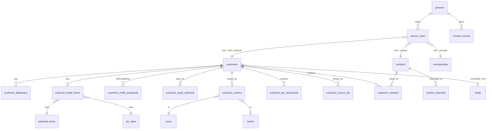
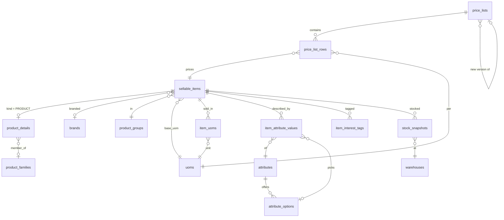

# AJT design app: customer and product data model (reverse-engineered)

Source: the clickable prototype at `https://ajt-design.vercel.app` (AJT CRM & Loyalty · Design).
The prototype has no public API or schema, so this model is derived from what its
screens show. Crawled 2026-11-14 with headless Chromium.

**Scope:** customer and product master data plus their direct children. Leads,
deals, quotes, orders, cases, inventory, and loyalty appear only as FK stubs.

**Status:** spec only. Nothing here is applied to `db/schema.ts`. Section 7 compares
this model with the current repo schema.

## 0. Method and legend

Pages read:

| Area | Pages |
|------|-------|
| Customers | `/customers` (B2B tab and `?tab=b2c`), `/customers/C-2001` (B2B, natural person), `/customers/C-2002` (B2B, juristic), `/customers/C-2101` (B2C, no purchases), `/customers/CB-M-3004` (B2C, member), `/customers/new` |
| Contacts | `/contacts/CT-4003`, `/contacts/CT-4104` (same person as `CB-M-3004`) |
| Products | `/commerce/products`, `/commerce/products/P-4001`, `/commerce/products/P-4010`, `/commerce/products/reference` (all 6 tabs), `/commerce/products/import` |
| Services | `/commerce/services`, `/commerce/services/SV-1001` |
| Price lists | `/commerce/price-lists`, `PL-0001` (global, tiered), `PL-0002` (customer-group scope), `PL-0012` (promo, overlapping dates) |
| Master data | `/settings/master-data` (54 sets), plus the sets: channels, payment terms, account tiers, industries, customer groups, contact roles, tax rates, KYC |
| Loyalty | `/loyalty-cms/members` (only to confirm the member code format) |

Every column carries one tag in the DDL comments:

- `-- O` **observed**: the field or value is shown on a screen.
- `-- I` **inferred**: needed to make observed behaviour work (keys, audit columns, flags implied by UI text), but not shown.

Conventions (decided for this spec, not taken from the repo):

- `INTEGER GENERATED ALWAYS AS IDENTITY` surrogate PK, plus a unique business code (`C-2001`, `P-4001`, `PL-0001`).
- `TIMESTAMPTZ` for events, `DATE` for calendar dates, `NUMERIC(14,2)` for money, `NUMERIC(14,3)` for quantities, `BOOLEAN` for flags.
- Enums owned by the system are `CHECK` constraints. Lists that admins edit are picklists (section 4).
- Thai text is the primary label. `_en` columns hold English where the UI shows it.

## 1. Key findings

1. **One customer register, two profiles.** B2B (`ลูกค้าธุรกิจ`) and B2C (`ลูกค้าทั่วไป`) share `/customers/{code}` and one list with two tabs. Legal form is a separate axis: a B2B customer can be a natural person (`C-2001 · ลูกค้าธุรกิจ · บุคคลธรรมดา`) or a juristic entity (`C-2002 · นิติบุคคล`).
2. **Codes show where a record came from.** `C-2xxx` is created in the CRM. `CB-M-3004` is a B2C customer that came in from loyalty membership `M-3004`. Loyalty CMS members use `AJM-1xxxx`. Contacts use `CT-4xxx`.
3. **A person can hold several roles.** `CT-4104` (contact at C-2001), `CB-M-3004` (B2C customer) and membership `M-3004` are the same person. The contact page has a panel "บทบาทของคนนี้ · คนเดียวกันในทุกส่วนของระบบ" (this person's roles, the same person everywhere in the system). The records stay separate and are joined by a link table.
4. **Contacts are M:N with customers.** Each relationship has a role, a department, a rapport level, owners, a time period (`8 มี.ค. 2569 → ตอนนี้`) and an end reason. A "primary company" (`บริษัทหลัก`) is flagged.
5. **Contact channels are their own rows.** Each phone, email, or LINE ID has a label (work or personal), a primary flag, and a status (verified, unusable, retired).
6. **Consent is per person, per purpose, per channel.** The UI shows "ยินยอม 4/7" (consented to 4 of 7). Purposes: marketing (split into LINE OA, email, SMS, phone), partner sharing, behaviour analytics, health data. The history is append-only and each entry records the request channel and the actor ("ลูกค้าถอนเองผ่าน LINE", the customer withdrew it themselves via LINE).
7. **SAP owns credit and the customer code. CDP owns B2C profiles and product interest tags.** The UI says "ข้อมูลจาก SAP ณ …" (data from SAP as of …), "แก้ไขที่ SAP" (edit in SAP) and "แก้ไขที่ CDP" (edit in CDP). Credit is a published snapshot, not a value the CRM computes.
8. **Prices do not live on products.** The products page footer says "ราคาอยู่ที่รายการราคา ไม่ได้อยู่บนสินค้า" (prices live on price lists, not on products). Price lists are versioned and immutable once active ("quotes and orders already reference this version"). Rows are item × sales UoM × minimum quantity.
9. **Products and services are one sellable-item concept.** Both use product groups, a base UoM, sales UoM conversions, and price-list rows. Only products have attributes, a GTIN, shelf life, a family, and stock.
10. **SKU variants are described by attributes.** A product family (`FAM-AJI-MSG`) groups SKUs, and typed attributes (net weight in g, volume in ml, flavour, packaging, storage) tell them apart.
11. **UoM conversion is per item.** Global UoMs only define quantity precision. "1 ลัง = 144 ซอง" (1 case = 144 sachets) is stored on the item, with its own barcode and gross weight.
12. **Field-level history and PII-view logging** appear on both customers and products ("ทุกการแก้ไข และทุกครั้งที่มีคนเปิดดูข้อมูลส่วนบุคคล": every edit, and every time someone opens personal data).

## 2. Customer domain

### 2.1 ERD



### 2.2 DDL

```sql
-- ---------- stubs (outside scope, present so FKs resolve) ----------
CREATE TABLE teams (
  id    INTEGER GENERATED ALWAYS AS IDENTITY PRIMARY KEY,
  name  TEXT NOT NULL UNIQUE                         -- O "ทีมกรุงเทพ 2"
);
CREATE TABLE users (
  id       INTEGER GENERATED ALWAYS AS IDENTITY PRIMARY KEY,
  name     TEXT NOT NULL,                            -- O
  team_id  INTEGER REFERENCES teams(id)              -- O primary team shown next to name
);
CREATE TABLE leads (
  id         INTEGER GENERATED ALWAYS AS IDENTITY PRIMARY KEY,
  lead_code  TEXT NOT NULL UNIQUE                    -- O "L-1008"
);
CREATE TABLE memberships (                           -- loyalty, out of scope
  id               INTEGER GENERATED ALWAYS AS IDENTITY PRIMARY KEY,
  membership_code  TEXT NOT NULL UNIQUE,             -- O "M-3004", "AJM-10001"
  tier             TEXT,                             -- O Silver | Gold | Platinum
  tier_valid_until DATE                              -- O "ถือระดับนี้ถึง 24 มิ.ย. 2570"
);

-- ---------- customers ----------
CREATE TABLE customers (
  id                   INTEGER GENERATED ALWAYS AS IDENTITY PRIMARY KEY,
  customer_code        TEXT NOT NULL UNIQUE,         -- O C-2001 / CB-M-3004
  profile              TEXT NOT NULL CHECK (profile IN ('B2B','B2C')),                 -- O
  legal_form           TEXT NOT NULL CHECK (legal_form IN ('NATURAL','JURISTIC')),     -- O บุคคลธรรมดา / นิติบุคคล
  name_prefix_id       INTEGER REFERENCES picklist_values(id),  -- O "นาย", "บจก."
  name_th              TEXT NOT NULL,                -- O
  name_en              TEXT,                         -- O "Somchai Phetcharat"
  tax_id_encrypted     TEXT,                         -- O masked "x-xxxx-xxxxx-37-2"; encrypt like lib/pii.ts
  tax_id_last_digits   TEXT,                         -- I needed for the mask without decrypting
  sap_customer_code    TEXT UNIQUE,                  -- O "รหัสร้านค้า · ยังไม่มีรหัสจาก SAP"
  phone                TEXT,                         -- O company / shop phone
  email                TEXT,                         -- O
  website              TEXT,                         -- O
  birth_date           DATE,                         -- O natural persons only, masked
  gender               TEXT CHECK (gender IN ('MALE','FEMALE','UNSPECIFIED')),          -- O
  occupation_id        INTEGER REFERENCES picklist_values(id),  -- O "เจ้าของกิจการ"
  industry_id          INTEGER REFERENCES picklist_values(id),  -- O set 'industries'
  industry_other_text  TEXT,                         -- O free text when "other" is picked
  customer_group_id    INTEGER REFERENCES picklist_values(id),  -- O set 'customer-groups'
  account_tier_id      INTEGER REFERENCES picklist_values(id),  -- O Key Account | General
  awareness_channel_id INTEGER REFERENCES picklist_values(id),  -- O "งานแสดงสินค้า / อีเวนต์"
  status               TEXT NOT NULL DEFAULT 'PENDING_DOCS'
                       CHECK (status IN ('PENDING_DOCS','ACTIVE','SUSPENDED','INACTIVE')),  -- O
  lifecycle_stage      TEXT,                         -- O "Active · เริ่มห่างหาย"; derived by job
  lifecycle_reason     TEXT,                         -- O second half of the label
  converted_from_lead_id INTEGER REFERENCES leads(id),          -- O "มาจากลีด L-1008"
  converted_at         TIMESTAMPTZ,                  -- O "แปลงเมื่อ 4 มี.ค. 2569"
  origin               TEXT NOT NULL DEFAULT 'CRM'
                       CHECK (origin IN ('CRM','LEAD','IMPORT','CDP','LOYALTY','RECEIPT')),  -- O "สร้างด้วยมือ ไม่ได้มาจากใบเสร็จ"
  created_by           INTEGER REFERENCES users(id), -- O history "สร้าง"
  created_at           TIMESTAMPTZ NOT NULL DEFAULT now(),
  updated_at           TIMESTAMPTZ NOT NULL DEFAULT now()
);
CREATE INDEX customers_profile_status ON customers(profile, status);

-- Bill-to / ship-to addresses and branches. "สำนักงานใหญ่ · รหัสสาขา 00000"
CREATE TABLE customer_addresses (
  id                INTEGER GENERATED ALWAYS AS IDENTITY PRIMARY KEY,
  customer_id       INTEGER NOT NULL REFERENCES customers(id) ON DELETE CASCADE,
  label             TEXT NOT NULL,                   -- O "สำนักงานใหญ่"
  branch_code       TEXT,                            -- O "00000" (Thai tax branch, 5 digits)
  address_line      TEXT NOT NULL,                   -- O
  subdistrict       TEXT,                            -- O แขวง
  district          TEXT,                            -- O เขต
  province          TEXT,                            -- O used as list column "จังหวัด"
  postal_code       TEXT,                            -- O
  country_id        INTEGER REFERENCES picklist_values(id),     -- O set 'countries'
  is_default_billing  BOOLEAN NOT NULL DEFAULT false,          -- O "ค่าตั้งต้น · ออกใบ"
  is_default_shipping BOOLEAN NOT NULL DEFAULT false,          -- O "ค่าตั้งต้น · จัดส่ง"
  receiver_name     TEXT,                            -- O masked
  receiver_phone    TEXT,                            -- O
  receiver_email    TEXT,                            -- O
  CHECK (branch_code IS NULL OR branch_code ~ '^[0-9]{5}$')    -- I
);
CREATE UNIQUE INDEX customer_addresses_one_default_bill
  ON customer_addresses(customer_id) WHERE is_default_billing;   -- I
CREATE UNIQUE INDEX customer_addresses_one_default_ship
  ON customer_addresses(customer_id) WHERE is_default_shipping;  -- I

-- Trade terms (tab "เงื่อนไขการค้า"). One row per customer.
CREATE TABLE customer_trade_terms (
  customer_id          INTEGER PRIMARY KEY REFERENCES customers(id) ON DELETE CASCADE,
  payment_term_id      INTEGER REFERENCES payment_terms(id),   -- O "1C09 · เครดิต 30 วัน"
  tax_rate_id          INTEGER REFERENCES tax_rates(id),       -- O NULL = org default ("ค่าตั้งต้นขององค์กร")
  receiving_conditions TEXT,                         -- O "รับของเฉพาะช่วงบ่าย 13:00-16:00"
  document_conditions  TEXT                          -- O "เงื่อนไขการส่งเอกสาร"
);
-- Price lists that apply to the customer are resolved by scope (section 3), not stored here.

-- Credit is published by SAP. Keep each snapshot, show the latest one.
CREATE TABLE customer_credit_snapshots (
  id            INTEGER GENERATED ALWAYS AS IDENTITY PRIMARY KEY,
  customer_id   INTEGER NOT NULL REFERENCES customers(id) ON DELETE CASCADE,
  credit_limit  NUMERIC(14,2) NOT NULL,              -- O ฿300,000
  credit_used   NUMERIC(14,2) NOT NULL,              -- O ฿34,129
  -- remaining = limit - used, computed at read time  -- O ฿265,871
  as_of         TIMESTAMPTZ NOT NULL,                -- O "ข้อมูลจาก SAP ณ 7 ส.ค. 2569 00:31 น."
  source_system TEXT NOT NULL DEFAULT 'SAP'          -- O
);
CREATE INDEX customer_credit_latest ON customer_credit_snapshots(customer_id, as_of DESC);

-- Trade channels (tab "ช่องทางการค้า"). One is primary and drives quotes and orders.
CREATE TABLE customer_trade_channels (
  id                     INTEGER GENERATED ALWAYS AS IDENTITY PRIMARY KEY,
  customer_id            INTEGER NOT NULL REFERENCES customers(id) ON DELETE CASCADE,
  business_type_id       INTEGER NOT NULL REFERENCES picklist_values(id), -- O leaf of set 'channels' (e.g. ยี่ปั๊ว under ร้านค้าดั้งเดิม)
  is_primary             BOOLEAN NOT NULL DEFAULT false,  -- O "ใบเสนอราคาและคำสั่งซื้อใช้ค่าของช่องทางหลัก"
  min_shelf_life_pct     NUMERIC(5,2) CHECK (min_shelf_life_pct BETWEEN 0 AND 100), -- O "อายุคงเหลือขั้นต่ำตอนส่ง 75%"
  UNIQUE (customer_id, business_type_id)
);
CREATE UNIQUE INDEX customer_trade_channels_one_primary
  ON customer_trade_channels(customer_id) WHERE is_primary;      -- I

-- Owners: "ผู้ดูแลหลัก" (primary) + "ผู้ดูแลร่วม · 3" (co-owners).
-- "หัวหน้าตามผัง" (managers per org chart) is derived from teams, not stored.
CREATE TABLE customer_owners (
  customer_id  INTEGER NOT NULL REFERENCES customers(id) ON DELETE CASCADE,
  user_id      INTEGER NOT NULL REFERENCES users(id),
  team_id      INTEGER REFERENCES teams(id),         -- O "หน่วยงานที่รับผิดชอบ · ทีมกรุงเทพ 2"
  owner_role   TEXT NOT NULL CHECK (owner_role IN ('PRIMARY','CO_OWNER')),  -- O
  assigned_at  TIMESTAMPTZ NOT NULL DEFAULT now(),
  PRIMARY KEY (customer_id, user_id)
);
CREATE UNIQUE INDEX customer_owners_one_primary
  ON customer_owners(customer_id) WHERE owner_role = 'PRIMARY';  -- I

-- KYC (tab "บันทึกและไฟล์"). Required types come from set 'kyc' and the
-- org policy "ต้องใช้เอกสาร" (documents required). Customer stays PENDING_DOCS until all are verified.
CREATE TABLE customer_kyc_documents (
  id            INTEGER GENERATED ALWAYS AS IDENTITY PRIMARY KEY,
  customer_id   INTEGER NOT NULL REFERENCES customers(id) ON DELETE CASCADE,
  doc_type_id   INTEGER NOT NULL REFERENCES picklist_values(id), -- O company-cert | vat-registration | director-id | bank-book
  status        TEXT NOT NULL DEFAULT 'SUBMITTED'
                CHECK (status IN ('SUBMITTED','VERIFIED','REJECTED')),  -- O "ยืนยันแล้ว"
  file_name     TEXT NOT NULL,                       -- O "ภพ20.pdf"
  file_url      TEXT NOT NULL,                       -- I
  uploaded_by   INTEGER REFERENCES users(id),        -- O "ผู้แนบ"
  uploaded_at   TIMESTAMPTZ NOT NULL DEFAULT now(),  -- O "แนบเมื่อ"
  verified_by   INTEGER REFERENCES users(id),        -- I
  verified_at   TIMESTAMPTZ                          -- I
);

-- "รหัสของลูกค้ารายนี้ในแต่ละระบบต้นทาง" (this customer's code in each source system).
-- For B2C: "หนึ่งแถวต่อการสมัครหนึ่งครั้ง" (one row per registration), e.g. ChocoCRM campaign sign-ups.
CREATE TABLE customer_source_ids (
  id              INTEGER GENERATED ALWAYS AS IDENTITY PRIMARY KEY,
  customer_id     INTEGER NOT NULL REFERENCES customers(id) ON DELETE CASCADE,
  source_system   TEXT NOT NULL,                     -- O "ChocoCRM"
  source_account  TEXT,                              -- O "Choco AjinomotoAmino"
  external_id     TEXT NOT NULL,                     -- O "ChocoCRM_crm_cp1_76921"
  campaign_name   TEXT,                              -- O "AminoVital Amino House Launch 2025"
  registered_at   TIMESTAMPTZ,                       -- O
  UNIQUE (source_system, external_id)
);

-- ---------- contacts ----------
CREATE TABLE contacts (
  id                INTEGER GENERATED ALWAYS AS IDENTITY PRIMARY KEY,
  contact_code      TEXT NOT NULL UNIQUE,            -- O CT-4003
  name_prefix_id    INTEGER REFERENCES picklist_values(id),  -- O "นางสาว"
  full_name         TEXT NOT NULL,                   -- O
  nickname          TEXT,                            -- O "นิด"
  preferred_language TEXT,                           -- O "ไทย"
  occupation_id     INTEGER REFERENCES picklist_values(id),  -- O
  birth_date        DATE,                            -- O masked
  gender            TEXT CHECK (gender IN ('MALE','FEMALE','UNSPECIFIED')),  -- O
  household_size    INTEGER,                         -- O "จำนวนคนในครัวเรือน"
  household_type_id INTEGER REFERENCES picklist_values(id),  -- O "อยู่คนเดียว"
  marital_status_id INTEGER REFERENCES picklist_values(id),  -- O
  income_band_id    INTEGER REFERENCES picklist_values(id),  -- O
  household_source  TEXT,                            -- O "พนักงานบันทึกให้" / "แบบสอบถาม · 9 มิ.ย. 2569"
  internal_note     TEXT,                            -- O "บันทึกภายใน"
  status            TEXT NOT NULL DEFAULT 'ACTIVE' CHECK (status IN ('ACTIVE','INACTIVE')),  -- O
  origin            TEXT,                            -- O "สร้างที่นี่" / "สมัครสมาชิกที่หน้าร้าน"
  last_imported_at  TIMESTAMPTZ,                     -- O "นำเข้าล่าสุด 30 ก.ค. 2569"
  created_at        TIMESTAMPTZ NOT NULL DEFAULT now()  -- O "วันที่สร้าง"
);

CREATE TABLE contact_channels (
  id          INTEGER GENERATED ALWAYS AS IDENTITY PRIMARY KEY,
  contact_id  INTEGER NOT NULL REFERENCES contacts(id) ON DELETE CASCADE,
  kind        TEXT NOT NULL CHECK (kind IN ('PHONE','EMAIL','LINE')),          -- O
  value       TEXT NOT NULL,                         -- O masked in UI
  label_id    INTEGER REFERENCES picklist_values(id),-- O "ที่ทำงาน" / "ส่วนตัว"
  is_primary  BOOLEAN NOT NULL DEFAULT false,        -- O "ช่องทางหลัก"
  status      TEXT NOT NULL DEFAULT 'ACTIVE'
              CHECK (status IN ('ACTIVE','VERIFIED','UNUSABLE','RETIRED')),     -- O ยืนยันแล้ว / ใช้ไม่ได้ / เลิกใช้
  created_at  TIMESTAMPTZ NOT NULL DEFAULT now()
);
CREATE UNIQUE INDEX contact_channels_one_primary_per_kind
  ON contact_channels(contact_id, kind) WHERE is_primary AND status <> 'RETIRED';  -- I

-- Customer <-> contact relationship (tab "ความสัมพันธ์").
CREATE TABLE customer_contacts (
  id                  INTEGER GENERATED ALWAYS AS IDENTITY PRIMARY KEY,
  customer_id         INTEGER NOT NULL REFERENCES customers(id) ON DELETE CASCADE,
  contact_id          INTEGER NOT NULL REFERENCES contacts(id) ON DELETE CASCADE,
  role_id             INTEGER REFERENCES picklist_values(id),   -- O set 'contact-roles' (จัดซื้อ, ผู้รับสินค้า...)
  role_other_text     TEXT,                                     -- O free text for "อื่น ๆ"
  job_title           TEXT,                                     -- O "หัวหน้าโกดัง"
  department_id       INTEGER REFERENCES picklist_values(id),   -- O set 'departments' ("ฝ่ายคลังสินค้า")
  rapport_id          INTEGER REFERENCES picklist_values(id),   -- O set 'relationship-rapport' ("ยังไม่คุ้นเคย")
  is_primary_contact  BOOLEAN NOT NULL DEFAULT false,           -- O "ผู้ติดต่อหลัก" for the customer
  is_primary_company  BOOLEAN NOT NULL DEFAULT false,           -- O "บริษัทหลักของบุคคลนี้" for the contact
  preferred_channel   TEXT,                                     -- O "ช่องทางและเวลาที่สะดวก"
  preferred_time      TEXT,                                     -- O
  started_on          DATE NOT NULL,                            -- O "8 มี.ค. 2569 →"
  ended_on            DATE,                                     -- O "แสดงผู้ติดต่อที่สิ้นสุดแล้ว (1)"
  end_reason_id       INTEGER REFERENCES picklist_values(id),   -- O set 'contact-end-reasons'
  CHECK (ended_on IS NULL OR ended_on >= started_on)
);
CREATE UNIQUE INDEX customer_contacts_open
  ON customer_contacts(customer_id, contact_id) WHERE ended_on IS NULL;           -- I
CREATE UNIQUE INDEX customer_contacts_one_primary_contact
  ON customer_contacts(customer_id) WHERE is_primary_contact AND ended_on IS NULL; -- I
CREATE UNIQUE INDEX customer_contacts_one_primary_company
  ON customer_contacts(contact_id) WHERE is_primary_company AND ended_on IS NULL;  -- I
-- Contact owners default to the primary company's primary owner
-- ("ตามผู้ดูแลหลักของ …"); an override table is left out until the UI needs one.

-- ---------- one person, many roles ----------
-- CT-4104 = CB-M-3004 = M-3004. The records stay separate (each module keeps its
-- own fields) and are joined through a person.
CREATE TABLE persons (
  id          INTEGER GENERATED ALWAYS AS IDENTITY PRIMARY KEY,   -- I
  created_at  TIMESTAMPTZ NOT NULL DEFAULT now()
);
CREATE TABLE person_roles (
  id             INTEGER GENERATED ALWAYS AS IDENTITY PRIMARY KEY,
  person_id      INTEGER NOT NULL REFERENCES persons(id) ON DELETE CASCADE,
  role           TEXT NOT NULL CHECK (role IN ('CONTACT','B2C_CUSTOMER','MEMBER')),  -- O the three rows of the panel
  contact_id     INTEGER UNIQUE REFERENCES contacts(id) ON DELETE CASCADE,
  customer_id    INTEGER UNIQUE REFERENCES customers(id) ON DELETE CASCADE,
  membership_id  INTEGER UNIQUE REFERENCES memberships(id) ON DELETE CASCADE,
  linked_by      INTEGER REFERENCES users(id),       -- O "ผูกบทบาทอื่น" is a manual action
  linked_at      TIMESTAMPTZ NOT NULL DEFAULT now(),
  CHECK (
    (role = 'CONTACT'      AND contact_id    IS NOT NULL AND customer_id IS NULL AND membership_id IS NULL) OR
    (role = 'B2C_CUSTOMER' AND customer_id   IS NOT NULL AND contact_id  IS NULL AND membership_id IS NULL) OR
    (role = 'MEMBER'       AND membership_id IS NOT NULL AND contact_id  IS NULL AND customer_id   IS NULL)
  )
);
-- A person can be a contact at several companies through customer_contacts,
-- but holds at most one contact record: UNIQUE(contact_id) here.

-- ---------- consent ----------
-- Per person, append-only. Current state = latest row per (person, purpose, channel).
-- "ยินยอม 4/7" counts the 7 purpose/channel cells that are GRANTED.
CREATE TABLE consent_events (
  id                 INTEGER GENERATED ALWAYS AS IDENTITY PRIMARY KEY,
  person_id          INTEGER NOT NULL REFERENCES persons(id) ON DELETE CASCADE,
  purpose            TEXT NOT NULL CHECK (purpose IN ('MARKETING','PARTNER_SHARING','BEHAVIOUR_ANALYTICS','HEALTH_DATA')), -- O
  channel            TEXT CHECK (channel IN ('LINE_OA','EMAIL','SMS','PHONE')),  -- O MARKETING only
  status             TEXT NOT NULL CHECK (status IN ('GRANTED','DENIED','WITHDRAWN')), -- O ยินยอม / ไม่ยินยอม / ถอน
  request_channel_id INTEGER REFERENCES picklist_values(id), -- O set 'consent-request-channels' ("ผ่าน LINE")
  actor              TEXT NOT NULL CHECK (actor IN ('SUBJECT','STAFF','IMPORT')),  -- O "ลูกค้าถอนเอง"
  recorded_by        INTEGER REFERENCES users(id),
  privacy_notice_version TEXT,                       -- O "หัวข้อความยินยอมตั้งที่ประกาศความเป็นส่วนตัว"
  captured_at        TIMESTAMPTZ NOT NULL DEFAULT now(),
  CHECK ((purpose = 'MARKETING') = (channel IS NOT NULL))
);
CREATE INDEX consent_events_current ON consent_events(person_id, purpose, channel, captured_at DESC);
```

Contacts and B2C customers that have no person yet show "ยังไม่เคยถาม" (never
asked). `consent_events` needs a person, so create a `persons` row the first time
consent is captured.

## 3. Product domain

### 3.1 ERD



### 3.2 DDL

```sql
-- ---------- reference (tab "กลุ่มสินค้า แบรนด์ และหน่วยขาย") ----------
CREATE TABLE brands (
  id          INTEGER GENERATED ALWAYS AS IDENTITY PRIMARY KEY,
  code        TEXT NOT NULL UNIQUE,                  -- O "AJINOMOTO", "BIRDY-ROBUSTA"
  name_th     TEXT NOT NULL,                         -- O "อายิโนะโมะโต๊ะ"
  is_active   BOOLEAN NOT NULL DEFAULT true,         -- O
  updated_at  TIMESTAMPTZ NOT NULL DEFAULT now()     -- O "แก้ไขล่าสุด"
);
-- User brand permissions ("สิทธิ์ของผู้ใช้กำหนดที่หน้าผู้ใช้งานระบบ") live with users; out of scope.

-- The product group also routes leads to salespeople and groups sales in reports.
CREATE TABLE product_groups (
  id           INTEGER GENERATED ALWAYS AS IDENTITY PRIMARY KEY,
  code         TEXT NOT NULL UNIQUE,                 -- O "PG-001"
  name_th      TEXT NOT NULL,                        -- O "ผงชูรส"
  description  TEXT,                                 -- O
  code_prefix  TEXT,                                 -- O "MSG" (used by item code generator)
  is_active    BOOLEAN NOT NULL DEFAULT true         -- O "ปิดกลุ่มแล้ว…ยังอ่านได้" -> soft disable only
);

CREATE TABLE uoms (
  id              INTEGER GENERATED ALWAYS AS IDENTITY PRIMARY KEY,
  code            TEXT NOT NULL UNIQUE,              -- O "UOM-CASE"
  name_th         TEXT NOT NULL,                     -- O "ลัง"
  description     TEXT,                              -- O
  decimal_places  SMALLINT NOT NULL DEFAULT 0 CHECK (decimal_places BETWEEN 0 AND 3), -- O "จำนวนเต็มเท่านั้น" = 0, "ไม่เกิน 2 ตำแหน่งทศนิยม" = 2
  is_active       BOOLEAN NOT NULL DEFAULT true
);

CREATE TABLE attributes (
  id          INTEGER GENERATED ALWAYS AS IDENTITY PRIMARY KEY,
  code        TEXT NOT NULL UNIQUE,                  -- O "ATTR-NET", "ATTR-FLAVOUR"
  name_th     TEXT NOT NULL,                         -- O "น้ำหนักสุทธิ"
  description TEXT,
  value_type  TEXT NOT NULL CHECK (value_type IN ('NUMBER_WITH_UNIT','OPTION')),  -- O "ตัวเลขพร้อมหน่วย · g" / "เลือกจากรายการ · 8 ตัวเลือก"
  unit        TEXT,                                  -- O "g", "ml"
  is_active   BOOLEAN NOT NULL DEFAULT true,
  CHECK ((value_type = 'NUMBER_WITH_UNIT') = (unit IS NOT NULL))
);
CREATE TABLE attribute_options (
  id            INTEGER GENERATED ALWAYS AS IDENTITY PRIMARY KEY,
  attribute_id  INTEGER NOT NULL REFERENCES attributes(id) ON DELETE CASCADE,
  label_th      TEXT NOT NULL,                       -- O "ต้นตำรับ", "ถุง", "อุณหภูมิห้อง"
  sort_order    INTEGER NOT NULL DEFAULT 0,
  is_active     BOOLEAN NOT NULL DEFAULT true,
  UNIQUE (attribute_id, label_th)
);

CREATE TABLE product_families (
  id       INTEGER GENERATED ALWAYS AS IDENTITY PRIMARY KEY,
  code     TEXT NOT NULL UNIQUE,                     -- O "FAM-AJI-MSG"
  name_th  TEXT                                      -- I
);

-- Item code rule (tab "รหัสสินค้า"): one org-wide row.
CREATE TABLE item_code_settings (
  id                    BOOLEAN PRIMARY KEY DEFAULT true CHECK (id),  -- singleton
  mode                  TEXT NOT NULL DEFAULT 'SUGGEST_EDITABLE'
                        CHECK (mode IN ('SUGGEST_EDITABLE','AUTO_LOCKED','MANUAL')),  -- O "ระบบเสนอให้ และแก้ได้"
  prefix                TEXT,                        -- O "P"
  separator             TEXT NOT NULL DEFAULT '-',   -- O "ขีดกลาง (P-4031)"
  sequence_digits       SMALLINT NOT NULL DEFAULT 4, -- O
  use_group_prefix      BOOLEAN NOT NULL DEFAULT false, -- O
  inventory_display_uom TEXT NOT NULL DEFAULT 'BASE'
                        CHECK (inventory_display_uom IN ('BASE','NET_WEIGHT_KG')),  -- O tab "หน่วยในคลัง"
  show_base_qty_below   BOOLEAN NOT NULL DEFAULT true  -- O
);

-- ---------- sellable items ----------
CREATE TABLE sellable_items (
  id                INTEGER GENERATED ALWAYS AS IDENTITY PRIMARY KEY,
  item_code         TEXT NOT NULL UNIQUE,            -- O P-4001 / SV-1001; never changes once issued
  kind              TEXT NOT NULL CHECK (kind IN ('PRODUCT','SERVICE')),  -- O "P-4001 · สินค้า"
  name_th           TEXT NOT NULL,                   -- O
  name_en           TEXT,                            -- O history "ชื่อภาษาอังกฤษ"
  description       TEXT,                            -- O services show one
  brand_id          INTEGER REFERENCES brands(id),   -- O nullable: "ไม่ระบุแบรนด์"
  product_group_id  INTEGER NOT NULL REFERENCES product_groups(id),  -- O
  base_uom_id       INTEGER NOT NULL REFERENCES uoms(id),            -- O "หน่วยฐาน ซอง"
  is_active         BOOLEAN NOT NULL DEFAULT true,   -- O ใช้งาน / ไม่ใช้งาน
  source_system     TEXT NOT NULL DEFAULT 'LOCAL'
                    CHECK (source_system IN ('LOCAL','SAP','IMPORT')),  -- O "กรอกในระบบนี้" / "มาจาก SAP"
  source_ref        TEXT,                            -- I SAP material number when synced
  updated_by        INTEGER REFERENCES users(id),    -- O "สมหญิง ผู้ดูแลสินค้า"
  created_at        TIMESTAMPTZ NOT NULL DEFAULT now(),
  updated_at        TIMESTAMPTZ NOT NULL DEFAULT now()
);
CREATE INDEX sellable_items_group ON sellable_items(product_group_id);
CREATE INDEX sellable_items_brand ON sellable_items(brand_id);
-- "ความครบของราคา" (price coverage: มีราคาที่ใช้ได้ has a usable price / ราคาไม่ครบ some units unpriced / ยังไม่มีราคา no price)
-- is derived from item_uoms × active price_list_rows. Not stored.

CREATE TABLE product_details (
  item_id          INTEGER PRIMARY KEY REFERENCES sellable_items(id) ON DELETE CASCADE,
  family_id        INTEGER REFERENCES product_families(id),  -- O "สายผลิตภัณฑ์"
  gtin             TEXT UNIQUE,                     -- O "8850001000019" (base unit barcode)
  shelf_life_days  INTEGER CHECK (shelf_life_days > 0)      -- O "อายุสินค้า 730 วัน"
);
-- Enforce kind = 'PRODUCT' in app code or with a trigger; a CHECK cannot look across tables.

-- Sales units. The base unit is also a row here (factor 1) so price rows and
-- barcodes treat every unit the same way.
CREATE TABLE item_uoms (
  id              INTEGER GENERATED ALWAYS AS IDENTITY PRIMARY KEY,
  item_id         INTEGER NOT NULL REFERENCES sellable_items(id) ON DELETE CASCADE,
  uom_id          INTEGER NOT NULL REFERENCES uoms(id),
  factor_to_base  NUMERIC(14,3) NOT NULL CHECK (factor_to_base > 0),  -- O "1 ลัง = 144 ซอง"
  barcode         TEXT,                              -- O "18850001000016" (case GTIN-14)
  gross_weight_kg NUMERIC(12,3),                     -- O "75.48 กก."
  is_active       BOOLEAN NOT NULL DEFAULT true,
  UNIQUE (item_id, uom_id)
);

CREATE TABLE item_attribute_values (
  item_id       INTEGER NOT NULL REFERENCES sellable_items(id) ON DELETE CASCADE,
  attribute_id  INTEGER NOT NULL REFERENCES attributes(id),
  number_value  NUMERIC(14,3),                       -- O 500 (g)
  option_id     INTEGER REFERENCES attribute_options(id),  -- O "ถุง"
  PRIMARY KEY (item_id, attribute_id),
  CHECK ((number_value IS NULL) <> (option_id IS NULL))
);
-- Net weight here also feeds the kg display on inventory screens.

-- "ป้ายความสนใจ · แก้ไขที่ CDP" (interest tags, edit in CDP): owned by the CDP, read-only here.
CREATE TABLE item_interest_tags (
  item_id   INTEGER NOT NULL REFERENCES sellable_items(id) ON DELETE CASCADE,
  tag       TEXT NOT NULL,                           -- O "ทำอาหารที่บ้าน"
  synced_at TIMESTAMPTZ NOT NULL DEFAULT now(),
  PRIMARY KEY (item_id, tag)
);

-- ---------- price lists ----------
-- One row = one version. A new version is a new row pointing at the version it replaces.
CREATE TABLE price_lists (
  id                 INTEGER GENERATED ALWAYS AS IDENTITY PRIMARY KEY,
  record_code        TEXT NOT NULL UNIQUE,           -- O URL key "PL-0001"
  list_code          TEXT NOT NULL,                  -- O "PL-SEASONING-THB" (stable across versions)
  version            INTEGER NOT NULL CHECK (version > 0),  -- O "v2"
  supersedes_id      INTEGER REFERENCES price_lists(id),    -- I "สร้างเป็นเวอร์ชันใหม่"
  name_th            TEXT NOT NULL,                  -- O
  description        TEXT,                           -- O
  currency           CHAR(3) NOT NULL,               -- O THB / USD
  scope_type         TEXT NOT NULL CHECK (scope_type IN ('ALL','CUSTOMER_GROUP','CUSTOMER')),  -- O "ทุกคน" / "กลุ่มลูกค้า"; CUSTOMER is I
  scope_customer_group_id INTEGER REFERENCES picklist_values(id),  -- O "ครัวกลางและรับจ้างผลิต"
  scope_customer_id  INTEGER REFERENCES customers(id),             -- I
  valid_from         DATE NOT NULL,                  -- O
  valid_to           DATE,                           -- O NULL = open-ended "1 ม.ค. 2569 →"
  status             TEXT NOT NULL DEFAULT 'DRAFT' CHECK (status IN ('DRAFT','ACTIVE','INACTIVE')),  -- O ร่าง / เปิดใช้งาน / ปิดใช้งาน
  source_system      TEXT NOT NULL DEFAULT 'LOCAL',  -- O "กรอกในระบบนี้"
  activated_by       INTEGER REFERENCES users(id),   -- O "สมชาย ผู้ดูแลราคา"
  activated_at       TIMESTAMPTZ,                    -- O
  readiness_snapshot JSONB,                          -- O "สภาพของข้อมูล ณ ตอนที่กดเปิดใช้งาน": missing rows, zero prices, overlaps
  created_at         TIMESTAMPTZ NOT NULL DEFAULT now(),
  UNIQUE (list_code, version),
  CHECK (valid_to IS NULL OR valid_to >= valid_from),
  CHECK ((scope_type = 'CUSTOMER_GROUP') = (scope_customer_group_id IS NOT NULL)),
  CHECK ((scope_type = 'CUSTOMER') = (scope_customer_id IS NOT NULL))
);
-- Overlapping active lists are allowed but flagged ("ช่วงเวลาซ้อนกับรายการราคาที่ใช้อยู่" overlaps an active list, on PL-0012).

-- Tiered: several rows for the same (item, uom) with rising min_qty.
-- NULL price = row exists but is not priced yet ("1 แถวยังไม่มีราคา"); 0 = free.
CREATE TABLE price_list_rows (
  id             INTEGER GENERATED ALWAYS AS IDENTITY PRIMARY KEY,
  price_list_id  INTEGER NOT NULL REFERENCES price_lists(id) ON DELETE CASCADE,
  item_id        INTEGER NOT NULL REFERENCES sellable_items(id),
  uom_id         INTEGER NOT NULL REFERENCES uoms(id),
  min_qty        NUMERIC(14,3) NOT NULL DEFAULT 0 CHECK (min_qty >= 0),  -- O "ทุกจำนวน" = 0, "อย่างน้อย 20 ลัง"
  unit_price     NUMERIC(14,2) CHECK (unit_price >= 0),                  -- O
  source_system  TEXT NOT NULL DEFAULT 'LOCAL',      -- O
  updated_at     TIMESTAMPTZ NOT NULL DEFAULT now(), -- O "แก้ไขล่าสุด"
  UNIQUE (price_list_id, item_id, uom_id, min_qty)
);
CREATE INDEX price_list_rows_item ON price_list_rows(item_id, uom_id);
-- (item_id, uom_id) should exist in item_uoms; enforce in app code (a composite FK would need item_uoms keyed that way).

-- ---------- stock (stub) ----------
CREATE TABLE warehouses (
  id       INTEGER GENERATED ALWAYS AS IDENTITY PRIMARY KEY,
  name_th  TEXT NOT NULL UNIQUE                      -- O "คลังกลาง (กรุงเทพและปริมณฑล)"
);
-- "ยอดคือสิ่งที่ระบบต้นทางเผยแพร่ล่าสุด หักด้วยจำนวนที่คำสั่งซื้อจองไว้"
-- (the source system's latest published figure minus quantity reserved by orders):
-- on-hand comes from the source system; reserved is the sum of open order lines; available = on_hand - reserved.
CREATE TABLE stock_snapshots (
  item_id       INTEGER NOT NULL REFERENCES sellable_items(id) ON DELETE CASCADE,
  warehouse_id  INTEGER NOT NULL REFERENCES warehouses(id),
  on_hand_base  NUMERIC(14,3) NOT NULL,              -- O "ยอดจากระบบต้นทาง 477 ซอง"
  published_at  TIMESTAMPTZ NOT NULL,                -- O "อัปเดตล่าสุด"; drives stale-data badges
  PRIMARY KEY (item_id, warehouse_id)
);
```

## 4. Shared lookups and audit

Plain label lists go in one generic pair of tables. Lists that carry extra typed
columns get their own table.

```sql
CREATE TABLE picklist_sets (
  id          INTEGER GENERATED ALWAYS AS IDENTITY PRIMARY KEY,
  code        TEXT NOT NULL UNIQUE,     -- O URL key: 'industries', 'channels', 'kyc' ...
  name_th     TEXT NOT NULL,            -- O
  description TEXT,                     -- O
  module      TEXT NOT NULL,            -- O "ลูกค้าและผู้ติดต่อ" / "ค่าการค้า" / "นโยบายและเพดาน"
  is_hierarchical BOOLEAN NOT NULL DEFAULT false   -- O 'channels' shows └ children
);
CREATE TABLE picklist_values (
  id          INTEGER GENERATED ALWAYS AS IDENTITY PRIMARY KEY,
  set_id      INTEGER NOT NULL REFERENCES picklist_sets(id) ON DELETE CASCADE,
  code        TEXT NOT NULL,            -- O 'wholesaler', 'CR-002'
  label_th    TEXT NOT NULL,            -- O
  label_en    TEXT,
  description TEXT,                     -- O
  parent_id   INTEGER REFERENCES picklist_values(id),  -- O channel -> business type -> cuisine (3 levels)
  is_system_other BOOLEAN NOT NULL DEFAULT false,      -- O "อื่น ๆ · แถวของระบบ" (system row): pairs with *_other_text columns
  is_active   BOOLEAN NOT NULL DEFAULT true,
  sort_order  INTEGER NOT NULL DEFAULT 0,
  UNIQUE (set_id, code)
);

CREATE TABLE payment_terms (
  id          INTEGER GENERATED ALWAYS AS IDENTITY PRIMARY KEY,
  code        TEXT NOT NULL UNIQUE,     -- O 'credit-30'
  name_th     TEXT NOT NULL,            -- O "เครดิต 30 วัน"
  sap_code    TEXT UNIQUE,              -- O '1C09'; NULL = "ไม่มีรหัสต้นทาง"
  days        INTEGER NOT NULL DEFAULT 0 CHECK (days >= 0),  -- O 0 = pay on/before delivery
  is_active   BOOLEAN NOT NULL DEFAULT true
);

CREATE TABLE tax_rates (
  id          INTEGER GENERATED ALWAYS AS IDENTITY PRIMARY KEY,
  code        TEXT NOT NULL UNIQUE,     -- O 'vat-7'
  name_th     TEXT NOT NULL,            -- O
  rate_pct    NUMERIC(5,2) NOT NULL,    -- O 7.00
  is_org_default BOOLEAN NOT NULL DEFAULT false,  -- O "ค่าตั้งต้นขององค์กร"
  is_active   BOOLEAN NOT NULL DEFAULT true
);
CREATE UNIQUE INDEX tax_rates_one_default ON tax_rates((true)) WHERE is_org_default;
-- "การแก้อัตราไม่กระทบเอกสารที่ออกไปแล้ว" (changing a rate does not affect documents already issued): quotes and orders snapshot rate_pct.
```

Audit tables (these reference `users`, so they run after section 2):

```sql
-- Field-level history shared by customers, contacts, items and price lists.
CREATE TABLE change_log (
  id           BIGINT GENERATED ALWAYS AS IDENTITY PRIMARY KEY,
  entity_type  TEXT NOT NULL,           -- 'customer' | 'contact' | 'item' | 'price_list' ...
  entity_id    INTEGER NOT NULL,
  action       TEXT NOT NULL,           -- O สร้าง / แก้ไข / เปิดใช้งานรายการราคา / สร้างเป็นเวอร์ชันใหม่
  field        TEXT,                    -- O "ช่องที่แก้"
  old_value    TEXT,                    -- O "ค่าเดิม"
  new_value    TEXT,                    -- O "ค่าใหม่"
  reason       TEXT,                    -- O "เหตุผล"
  actor_id     INTEGER REFERENCES users(id),  -- O name + team shown
  source       TEXT,                    -- O "ที่มาของการแก้ไข"
  occurred_at  TIMESTAMPTZ NOT NULL DEFAULT now()
);
CREATE INDEX change_log_entity ON change_log(entity_type, entity_id, occurred_at DESC);

-- "ทุกครั้งที่มีคนเปิดดูข้อมูลส่วนบุคคล" (every time someone opens personal data): each unmask is logged.
CREATE TABLE pii_access_log (
  id           BIGINT GENERATED ALWAYS AS IDENTITY PRIMARY KEY,
  entity_type  TEXT NOT NULL,
  entity_id    INTEGER NOT NULL,
  field        TEXT NOT NULL,           -- O "เบอร์ผู้รับ"
  actor_id     INTEGER NOT NULL REFERENCES users(id),
  reason       TEXT,
  accessed_at  TIMESTAMPTZ NOT NULL DEFAULT now()
);
```

**DDL order:** section 4 lookups → section 2 → section 3 → section 4 audit.
Section 2 references the lookup tables; the audit tables reference `users`.

Picklist sets seen inside this scope (54 exist in total):

| Set code | Thai name | Used by |
|----------|-----------|---------|
| `industries` | กลุ่มอุตสาหกรรม | customers.industry_id |
| `customer-groups` | กลุ่มลูกค้า | customers.customer_group_id, price_lists scope |
| `account-tiers` | ระดับลูกค้า (Key Account, General) | customers.account_tier_id |
| `channels` | ช่องทางการค้าและประเภทธุรกิจลูกค้า (hierarchical) | customer_trade_channels |
| `awareness-channels` | ช่องทางที่รู้จักเรา | customers.awareness_channel_id |
| `name-prefixes` | คำนำหน้าชื่อ | customers, contacts |
| `countries` | ประเทศ | customer_addresses |
| `contact-roles` | บทบาทผู้ติดต่อ | customer_contacts.role_id |
| `departments` | ฝ่ายของผู้ติดต่อ | customer_contacts.department_id |
| `relationship-rapport` | ระดับความสัมพันธ์ | customer_contacts.rapport_id |
| `contact-end-reasons` | เหตุผลที่สิ้นสุดความสัมพันธ์ | customer_contacts.end_reason_id |
| `contact-point-labels` | ป้ายช่องทางติดต่อ | contact_channels.label_id |
| `consent-request-channels` | ช่องทางที่รับคำขอความยินยอม | consent_events |
| `marriage-statuses`, `household-types`, `income-levels` | สถานภาพสมรส, ลักษณะครัวเรือน, ช่วงรายได้ | contacts |
| `kyc` | เอกสาร KYC | customer_kyc_documents.doc_type_id |

`contact-relationships` (spouse, parent: for B2C household links) and `event-names`
belong to the B2C/CDP side and are not modelled here.

## 5. Field dictionary (main screens)

| Screen | Thai label | Column |
|--------|-----------|--------|
| Customer header | `C-2001 · ลูกค้าธุรกิจ · บุคคลธรรมดา` | customers.customer_code, profile, legal_form |
| Customer header | สถานะ | customers.status |
| Customer header | วงจรชีวิต | customers.lifecycle_stage, lifecycle_reason |
| Customer header | หน่วยงานที่รับผิดชอบ / ผู้ดูแลหลัก / ผู้ดูแลร่วม | customer_owners |
| ข้อมูลลูกค้า | จดทะเบียนเป็น | customers.legal_form |
| ข้อมูลลูกค้า | ชื่อ / ชื่อภาษาอังกฤษ | customers.name_th, name_en |
| ข้อมูลลูกค้า | เลขบัตรประชาชน / เลขผู้เสียภาษี | customers.tax_id_encrypted, tax_id_last_digits |
| ข้อมูลลูกค้า | เบอร์โทรบริษัท / ร้านค้า, อีเมล, เว็บไซต์ | customers.phone, email, website |
| ข้อมูลลูกค้า | รหัสร้านค้า (SAP) | customers.sap_customer_code |
| ข้อมูลลูกค้า | วันเกิด, เพศ, อาชีพ | customers.birth_date, gender, occupation_id |
| ข้อมูลลูกค้า | กลุ่มอุตสาหกรรม, กลุ่มลูกค้า | customers.industry_id, customer_group_id |
| ข้อมูลลูกค้า | ประเภทธุรกิจลูกค้า | customer_trade_channels (primary).business_type_id |
| ข้อมูลลูกค้า | ช่องทางที่รู้จักเรา | customers.awareness_channel_id |
| ที่อยู่และสาขา | สำนักงานใหญ่, รหัสสาขา, ที่อยู่, ผู้รับสินค้า | customer_addresses |
| เงื่อนไขการค้า | เงื่อนไขการรับของ / การส่งเอกสาร | customer_trade_terms.receiving_conditions, document_conditions |
| เงื่อนไขการค้า | ระดับลูกค้า | customers.account_tier_id |
| เงื่อนไขการค้า | รายการราคา | resolved: active price_lists where scope matches |
| เงื่อนไขการค้า | เงื่อนไขการชำระเงิน | customer_trade_terms.payment_term_id → payment_terms |
| เงื่อนไขการค้า | อัตรา VAT | customer_trade_terms.tax_rate_id (NULL = org default) |
| เงื่อนไขการค้า | วงเงินเครดิต / ใช้ไป / คงเหลือ | customer_credit_snapshots (latest) |
| เงื่อนไขการค้า | ช่องทางการค้า, อายุคงเหลือขั้นต่ำตอนส่ง | customer_trade_channels |
| ผู้ติดต่อ | ชื่อ, บทบาท, เบอร์, อีเมล, สถานะ, ความยินยอม | contacts + customer_contacts + contact_channels + consent_events |
| ที่มาของลูกค้า | ลีดต้นทาง, แปลงเมื่อ | customers.converted_from_lead_id, converted_at |
| ที่มาของลูกค้า | รหัสในแต่ละระบบต้นทาง | customer_source_ids |
| ประวัติ | ผู้แก้ไข, การกระทำ, ช่องที่แก้, ค่าเดิม, ค่าใหม่, เหตุผล | change_log + pii_access_log |
| บันทึกและไฟล์ | เอกสาร KYC | customer_kyc_documents |
| Contact | ชื่อเล่น, ภาษาที่ต้องการ, ครัวเรือน, ช่วงรายได้ | contacts.* |
| Contact | ช่องทางติดต่อ | contact_channels |
| Contact | บทบาทของคนนี้ | person_roles |
| Product | รหัสสินค้า, ชื่อ, แบรนด์, กลุ่มสินค้า, หน่วยฐาน | sellable_items.* |
| Product | สายผลิตภัณฑ์, บาร์โค้ดหรือ GTIN, อายุสินค้า | product_details.* |
| Product | คุณลักษณะ | item_attribute_values |
| Product | ป้ายความสนใจ | item_interest_tags |
| Product | หน่วยขาย, ตัวคูณ, บาร์โค้ด, น้ำหนักรวม | item_uoms |
| Product | ราคา (read-only) | price_list_rows via active price_lists |
| Product | คงคลัง | stock_snapshots |
| Product | ที่มา | sellable_items.source_system |
| Price list | รหัสรายการราคา, เวอร์ชัน, สกุลเงิน, ขอบเขต, ช่วงเวลา, สถานะ | price_lists.* |
| Price list | ความพร้อมก่อนเปิดใช้ | price_lists.readiness_snapshot |
| Price list | สิ่งที่ตั้งราคา, หน่วยขาย, จำนวนขั้นต่ำ, ราคาต่อหน่วย | price_list_rows.* |

Values computed at read time, not stored: price coverage, total paid / order
count / average purchase cycle (from orders), open cases count, points balance
(from loyalty), remaining credit, available stock, consent "x/7".

## 6. Integrity rules the UI implies

- A new B2B customer starts as `PENDING_DOCS` when the org KYC policy says documents are required. It moves to `ACTIVE` when every required `kyc` type has a `VERIFIED` document. Quotes are allowed before that ("เริ่มได้ก่อนเอกสารครบ"); orders are not ("เอกสารครบและยืนยันแล้ว").
- A customer converted from a lead cannot be deleted once orders, notes or KYC are attached ("การแปลงครั้งนี้ย้อนกลับไม่ได้แล้ว", this conversion can no longer be undone). Set it to `INACTIVE` instead. So: no hard delete, and FKs from orders use `ON DELETE RESTRICT`.
- The customer create wizard searches first by name, code, tax ID or phone. Add an index on `tax_id_last_digits` and `phone`, and trigram indexes on names, to support duplicate checks ("ข้อมูลซ้ำ 3", 3 possible duplicates).
- Item codes never change once issued (orders and stock hold them).
- An active price-list version is read-only. Changes go into a new version (`supersedes_id`).
- Deactivating a product group, brand, UoM or picklist value is a soft disable. Existing rows keep their reference.

## 7. Gap vs current `db/schema.ts`

| Design-app concept | Current repo | Verdict |
|--------------------|-------------|---------|
| customers (profile + legal form) | `customers.cust_type` B2B/B2C; `tax_entity_type` JURISTIC/NATURAL | **Keep, reshape.** Same two axes already exist. Rename and add SAP code, status, lifecycle, industry and tier. |
| customers.brand, tier, points, clv | on `customers` | **Move out.** Loyalty tier and points belong to memberships. The design keeps brand per membership and per transaction, not per customer. |
| tax ID encrypted + last digits | `tax_id_encrypted`, `tax_id_last4` (`lib/pii.ts`, `lib/thaiId.ts`) | **Keep.** Same pattern. |
| B2B profile columns (`company_name`, `billing_address`, `payment_terms`, `contact_person`, `credit_limit`) | flat on `customers` with a `NOT VALID` CHECK | **Split** into customer_addresses, customer_trade_terms (FK to payment_terms), customer_contacts and customer_credit_snapshots. |
| payment terms | CHECK `CASH, NET7 … NET90` | **Replace** with the `payment_terms` table (SAP code, days). Design has COD and NET45 too. |
| contacts M:N, contact channels | none (`contact_person` text only) | **Missing.** |
| person ↔ roles | `customer_identity_links` (B2C↔B2B match by email or phone, PENDING/CONFIRMED) | **Different.** Repo links two customer rows after a match review. Design links contact, B2C customer and membership through a person. Both could coexist: identity links can feed person_roles once confirmed. |
| consents | `consents` per customer, 4 purposes, append-only | **Reshape** to per person, and add a channel dimension for MARKETING (gives the 7 cells). |
| owners / teams | `departments` + `department_pics`, `users.home_department_id` | **Missing** per-customer owner assignment. |
| KYC documents | none | **Missing.** |
| source-system IDs | `line_user_id`, `referral_code` only | **Missing** generic table. |
| distributors | separate table, optional `customer_id` | Design has no distributor entity. Dealers are B2B customers with a trade channel. Candidate to fold in. |
| products | `products` (sku, name, brand text, category text, unit_price, reorder_point, image_url, SAP fields `material_type`, `material_group`, `base_uom` text, weights) | **Reshape** into `sellable_items`. The `brand`, `category`, and `base_uom` columns become FKs. The `unit_price` column moves to price lists. The `reorder_point` column belongs to inventory. |
| material_descriptions (EN/TH) | separate table | Design shows only TH name + EN name. Fold into `name_en`, or keep the table if more languages are needed. |
| services | none | **Missing** (`kind = 'SERVICE'`). |
| UoM conversion | single `base_uom` | **Missing:** uoms + item_uoms. |
| attributes / families | none (`transaction_items.pack_size` only) | **Missing.** Net weight here could replace pack_size guessing in classification. |
| price lists | none | **Missing.** |
| stock | `inventory_transactions` ledger (plant, storage location, stock type) | **Different philosophy.** Repo computes on-hand from a ledger. Design shows source-published snapshots minus reservations. The repo ledger is richer, so keep it and treat stock_snapshots as a read model. |
| change log | `audit_log` (entity, action, detail) | **Extend** with field, old/new values and reason. PII access log is missing. |

## 8. Open questions

1. **Code numbering.** Do `C-` and `CB-M-` share a sequence, or is `CB-M-{n}` always membership `M-{n}`? The screens suggest the latter.
2. **B2C natural persons vs persons.** Should a B2C customer carry its own personal fields (birth date, gender) or read them through `person_roles` from the contact or member? The design shows them on both.
3. **Customer-specific price lists.** Only "all" and "customer group" scopes are visible. A `CUSTOMER` scope is inferred.
4. **Price resolution order** when several active lists match (promo vs general, overlap warning). The UI flags overlaps but does not show a precedence rule.
5. **Contact owner override.** The UI has "จัดการผู้ดูแล" (manage owners) on contacts, but the shown owner is inherited. Is there an override table?
6. **Multi-currency.** A USD list exists. Does a customer have a currency, or is it chosen per quote?
7. **Service ↔ brand.** `SV-1002` shows a brand and `SV-1001` shows "ไม่ระบุแบรนด์" (no brand), so brand is nullable for both kinds. Confirm.
